# 1. 이론 {#sec-ch9}

## 텍스트를 모델에 넣으려면 {#sec-text-to-input}

4장에서는 시계열 값을 트랜스포머에 넣었습니다. 시계열은 이미 숫자이므로 선형 변환 한 번으로 모델 차원 $d_{\text{model}}$의 벡터로 바꾸면 되었습니다. 텍스트는 사정이 다릅니다. 신경망은 숫자 텐서만 계산할 수 있는데, 텍스트는 문자열입니다. 문자열을 어떻게 잘라서, 어떻게 숫자로 바꾸고, 어떻게 순서를 남길지를 먼저 정해야 모델에 넣을 수 있습니다. 이 장은 이 입구를 만드는 일에서 시작해 인코더–디코더 트랜스포머를 직접 구현하고, 인코더만 쌓은 모델인 BERT까지 이어집니다.

입구는 네 단계로 이루어집니다. 먼저 **토크나이저**가 문장을 **토큰**이라는 조각으로 자릅니다. 각 토큰은 어휘 사전에서 **토큰 ID**라는 정수 번호를 받습니다. 이 번호는 이름표일 뿐이라서, **임베딩 층**이 번호를 $d$차원 실수 벡터로 바꿉니다. 마지막으로 **위치 인코딩**을 더해 토큰의 순서 정보를 벡터에 담습니다. 그림 9-1이 문장 `Transformers are changing the world!`로 이 과정을 보여 줍니다.

::: {.figbody}
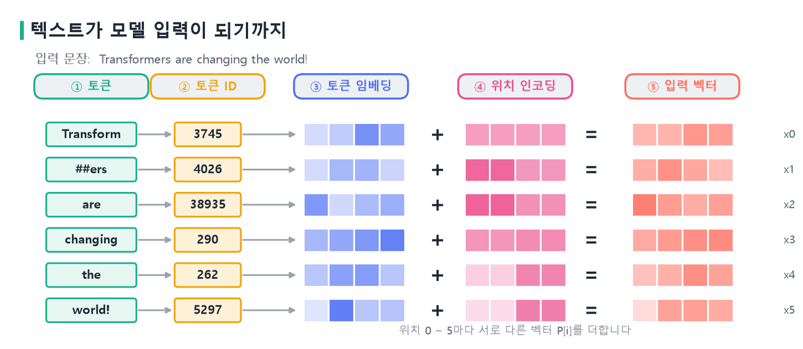{width=100% fig-alt="텍스트가 모델 입력이 되기까지"}
:::
::: {.figcap}
**그림 9-1** 텍스트가 모델 입력이 되기까지. 문장이 토큰으로 잘리고(①), 토큰마다 정수 ID를 받고(②), 임베딩 행렬에서 벡터를 읽고(③), 위치마다 다른 벡터가 더해져(④) 모델의 입력 벡터가 됩니다(⑤). 이 그림의 ID와 벡터 값은 과정을 보이기 위한 예시입니다.
:::

그림에서 문장은 토큰 6개가 되고, 입력은 모양이 $(6, d)$인 행렬이 됩니다. 이후 트랜스포머는 이 행렬에서 출발합니다. 이 장의 앞부분은 행렬이 만들어지는 과정을, 뒷부분은 행렬이 트랜스포머를 통과하는 과정을 다룹니다.

## 토큰화와 서브워드 {#sec-tokenization}

### 어떤 단위로 자를 것인가

가장 먼저 정할 것은 자르는 단위입니다. 단어, 문자, 그 중간인 서브워드를 후보로 둘 수 있고, 각각 장단점이 뚜렷합니다.

| 단위 | 어휘 크기 | 처음 보는 단어 | 문제 |
|---|---|---|---|
| 단어 | 매우 큼 (수십만) | 어휘에 없으면 처리 불가(OOV) | 어휘 사전이 폭발한다 |
| 문자 | 매우 작음 | 항상 표현 가능 | 시퀀스가 길고, 문자 하나는 의미 단위가 아니다 |
| **서브워드** | **중간 (수만)** | **조각의 조합으로 표현** | 두 문제의 중간 |

단어 단위는 직관적이지만 어휘가 끝없이 커집니다. 영어는 `run`, `runs`, `running`, `runner`를 모두 다른 단어로 세고, 한국어는 `먹었다`, `먹으니`, `먹고`처럼 어미가 붙은 형태만으로도 어휘가 크게 불어납니다. 어휘에 없는 단어를 만나면 모델은 그 단어를 아무것도 모르는 미등록 단어(OOV, out-of-vocabulary)로 처리할 수밖에 없습니다. 반대로 문자 단위는 어휘가 작고 OOV가 없지만, 문장이 매우 길어져 트랜스포머의 $O(L^2)$ 비용이 부담스러워집니다. 게다가 문자 하나에는 의미가 거의 없어서 모델이 의미 단위를 처음부터 다시 배워야 합니다.

**서브워드(subword)**는 두 방식의 중간입니다. 자주 나오는 조각은 하나의 단위로 두고, 드문 단어는 여러 조각으로 쪼갭니다. 처음 보는 단어 `lowest`도 이미 아는 조각 `low`와 `est`의 조합으로 나타낼 수 있어서 OOV가 생기지 않습니다. 오늘날 대부분의 언어 모델이 서브워드를 씁니다.

### BPE: 자주 나오는 쌍을 합칩니다

서브워드 조각을 만드는 대표적인 방법이 **BPE(Byte Pair Encoding)**입니다. 원래는 데이터 압축 기법이었고, Sennrich 등이 2016년에 기계 번역의 희귀 단어 문제를 풀려고 서브워드 분할에 적용했습니다. 알고리즘은 단순합니다.

1. 모든 단어를 문자 단위로 쪼개고, 단어의 끝에 `</w>`를 붙여 끝을 표시합니다.
2. 이웃한 기호 쌍 가운데 가장 자주 나오는 쌍을 셉니다.
3. 그 쌍을 하나의 새 기호로 **병합**합니다.
4. 목표 어휘 크기가 될 때까지 2~3을 반복합니다.

작은 말뭉치 `low`, `lower`, `newest`, `widest`로 직접 따라가 보겠습니다. 처음에는 모든 단어가 문자로 쪼개져 있습니다. 이웃 쌍의 빈도를 세면 `(e, s)`, `(l, o)`, `(o, w)`, `(s, t)` 등이 각각 2회로 가장 많습니다. 동률일 때는 알파벳 순으로 고르기로 하면 `(e, s)`가 먼저 병합되어 `es`가 생깁니다. 다음에는 `(es, t)`가 2회로 가장 많아 `est`가 되고, 이어서 `(est, </w>)`가 병합되어 `est</w>`가 됩니다. 이렇게 다섯 번을 병합한 결과가 그림 9-2입니다.

::: {.figbody}
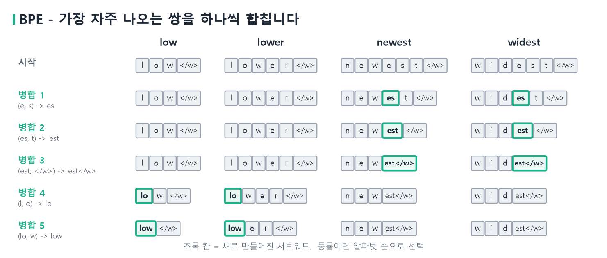{width=100% fig-alt="BPE 병합 과정"}
:::
::: {.figcap}
**그림 9-2** BPE 병합 과정. 초록색 칸이 그 단계에서 새로 만들어진 기호입니다. 다섯 번 병합하자 `newest`와 `widest`는 `est</w>`라는 공통 조각을 갖게 되고, `low`와 `lower`는 `low`라는 조각을 공유합니다. 빈도가 높은 쌍이 먼저 합쳐지므로 의미 있는 조각이 자연스럽게 만들어집니다.
:::

다섯 번의 병합으로 `est</w>`와 `low`가 어휘에 들어왔습니다. 이 조각은 사람이 정한 것이 아니라 빈도에서 저절로 나왔습니다. 이제 `lowest`를 만나면 `low`와 `est</w>`로 자를 수 있습니다. 같은 알고리즘을 큰 말뭉치에 수만 번 반복하면, 자주 쓰이는 단어는 하나의 토큰이 되고 드문 단어는 몇 개의 조각으로 쪼개지는 어휘 사전이 만들어집니다. 아래 코드는 같은 과정을 파이썬으로 옮긴 것입니다.

**코드 9-1** BPE 병합을 직접 구현합니다.

```python
import collections

def get_pairs(vocab):                       # 이웃한 기호 쌍의 빈도
    pairs = collections.Counter()
    for word, freq in vocab.items():
        s = word.split()
        for a, b in zip(s, s[1:]):
            pairs[(a, b)] += freq
    return pairs

def merge(vocab, pair):                     # 선택한 쌍을 하나의 기호로 합침
    a, b = pair
    new = {}
    for word, freq in vocab.items():
        s, out, i = word.split(), [], 0
        while i < len(s):
            if i < len(s) - 1 and s[i] == a and s[i + 1] == b:
                out.append(a + b); i += 2
            else:
                out.append(s[i]); i += 1
        new[" ".join(out)] = freq
    return new

vocab = {"l o w </w>": 1, "l o w e r </w>": 1,
         "n e w e s t </w>": 1, "w i d e s t </w>": 1}
for step in range(5):
    pairs = get_pairs(vocab)
    best = min(pairs, key=lambda p: (-pairs[p], p))   # 최다 빈도, 동률이면 사전순
    vocab = merge(vocab, best)
    print(step + 1, best, list(vocab))
```

`best`를 고르는 줄이 알고리즘의 핵심입니다. 빈도가 가장 높은 쌍을 고르고, 동률이면 사전순으로 앞선 쌍을 고릅니다. 실제 구현은 단어 빈도를 가중하고 어휘 크기에 도달할 때까지 반복하지만 원리는 같습니다.

### WordPiece와 바이트 수준 BPE

BERT는 BPE와 비슷한 **WordPiece**를 씁니다. 합칠 쌍을 고르는 기준이 단순한 빈도가 아니라, 병합했을 때 학습 말뭉치의 우도가 얼마나 커지는지입니다. 결과물은 비슷해서 큰 차이를 느끼기 어렵습니다. 다만 표기가 다릅니다. WordPiece는 단어 중간에서 이어 붙는 조각 앞에 `##`를 붙입니다. `playing`은 `play`와 `##ing`로 쪼개지고, `##`는 "앞 조각에 이어진다"는 표시입니다. 그림 9-1의 `Transform`과 `##ers`가 이런 예입니다.

GPT-2 계열은 **바이트 수준 BPE**를 씁니다. 문자가 아니라 바이트에서 병합을 시작하므로 어떤 문자열이든 표현할 수 있어 OOV가 원천적으로 사라집니다. 어휘 크기는 모델마다 다릅니다. BERT는 약 3만 개, GPT-2는 50,257개입니다. 어휘가 크면 같은 문장을 더 짧은 토큰열로 표현할 수 있지만 임베딩 행렬이 커지고, 어휘가 작으면 반대가 됩니다.

### 특수 토큰

어휘에는 문장의 내용이 아니라 구조를 나타내는 **특수 토큰**도 들어 있습니다. BERT에서는 `[CLS]`(문장 전체를 요약하는 자리), `[SEP]`(문장 경계), `[PAD]`(길이를 맞추는 채움), `[MASK]`(가려진 토큰)가 쓰입니다. 번역 모델의 디코더는 `<start>`와 `<end>`로 생성의 시작과 끝을 표시합니다. 이 토큰들도 일반 토큰처럼 ID와 임베딩 벡터를 갖고 학습됩니다.

## 토큰 임베딩 {#sec-embedding}

### 정수 ID와 원-핫 벡터

토크나이저가 내놓는 것은 `[3745, 4026, 38935, 290, 262, 5297]` 같은 정수열입니다. 이 숫자는 어휘 사전에서 토큰이 차지하는 번호일 뿐이어서, 크기에 의미가 없습니다. 290이 262보다 "크다"고 해서 두 토큰의 관계가 정해지지 않습니다. 정수를 그대로 모델에 넣으면 모델이 번호의 크기를 의미로 오해합니다.

이를 피하는 가장 단순한 방법이 **원-핫 벡터**입니다. 어휘 크기가 $V$이면 토큰마다 $V$차원 벡터를 만들어, 자기 번호 자리만 1로 두고 나머지를 0으로 둡니다. 원-핫 벡터는 번호의 크기 문제를 없애지만 두 가지 한계가 있습니다. 첫째, 차원이 어휘 크기만큼 커서(예: 3만) 대부분이 0인 희소한 벡터가 됩니다. 둘째, 서로 다른 두 토큰의 원-핫 벡터는 항상 직교하므로 내적이 0입니다. `고양이`와 `강아지`가 비슷하다는 정보를 담을 방법이 없습니다.

### 임베딩 층은 행렬에서 행을 읽는 표입니다

**임베딩(embedding)**은 이 문제를 $d$차원의 조밀한 실수 벡터로 풉니다. $d$는 보통 수백에서 수천이고(BERT-base는 768) 어휘 크기보다 훨씬 작습니다. 구현은 간단합니다. $V\times d$ 크기의 행렬 $W$를 하나 두고, 토큰 ID가 $k$이면 $W$의 $k$번째 행을 그 토큰의 벡터로 씁니다.

$$
\mathbf e_k = \text{onehot}(k)\,W = W[k].
$$

원-핫 벡터에 행렬을 곱하면 $k$번째 행만 골라지므로 두 표현은 같은 결과를 냅니다. 실제로는 곱셈을 하지 않고 행을 곧바로 읽습니다. 그림 9-3이 어휘 6개, 차원 4인 작은 예를 보여 줍니다.

::: {.figbody}
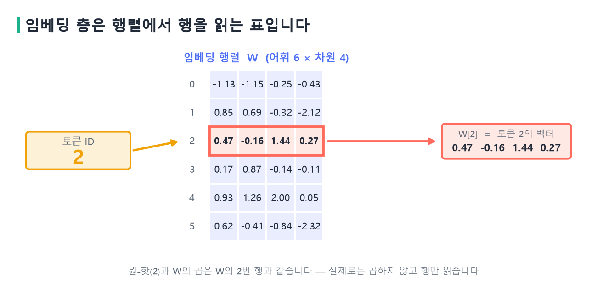{width=88% fig-alt="임베딩 층이 행을 읽는 과정"}
:::
::: {.figcap}
**그림 9-3** 임베딩 층. 토큰 ID 2가 들어오면 $6\times4$ 행렬 $W$의 2번 행(0부터 센 번호이므로 위에서 세 번째)을 읽어 그 토큰의 벡터로 씁니다. 원-핫 벡터와 $W$를 곱한 결과와 같습니다.
:::

$W$의 모든 원소는 학습되는 파라미터입니다. 모델은 손실을 줄이는 방향으로 역전파하면서 이 행렬도 함께 갱신하므로, 비슷한 문맥에 등장하는 토큰들이 비슷한 벡터를 갖도록 자연스럽게 조정됩니다. 파라미터 수는 $V\times d$입니다. 어휘 3만, 차원 768이면 약 2,300만 개로, 작지 않은 비중입니다. 파이토치에서는 `nn.Embedding`이 이 행렬을 제공합니다.

**코드 9-2** `nn.Embedding`이 원-핫 곱과 같은 결과를 내는지 확인합니다.

```python
import torch, torch.nn as nn, torch.nn.functional as F

torch.manual_seed(0)
emb = nn.Embedding(num_embeddings=6, embedding_dim=4)  # W : 6×4
ids = torch.tensor([2, 5, 1])                          # 토큰 ID

print(emb(ids).shape)                    # torch.Size([3, 4])
one_hot = F.one_hot(ids, 6).float()
print(torch.allclose(one_hot @ emb.weight, emb(ids)))  # True
```

입력은 정수 ID이고 출력은 실수 벡터입니다. 문장 하나는 $(T)$에서 $(T, d)$로 모양이 바뀝니다. 트랜스포머는 임베딩 벡터에 $\sqrt{d}$를 곱한 뒤 위치 정보를 더합니다. 원 논문이 이렇게 했고, 이 장의 구현도 같습니다. 임베딩 값의 크기를 위치 인코딩 값(최대 1)과 견줄 만하게 맞추려는 장치입니다.

## 텍스트 임베딩의 종류 {#sec-embedding-types}

임베딩이라는 말은 문맥에 따라 조금씩 다른 것을 가리킵니다. 단어 하나에 벡터 하나를 주는 임베딩이 있고, 문장 속 위치에 따라 달라지는 임베딩이 있고, 문장 전체를 벡터 하나로 만드는 임베딩이 있습니다. 세 가지를 구분하면 뒤에서 BERT를 이해하기 쉽습니다.

| | 원-핫 | 임베딩 |
|:--|:--|:--|
| 차원 | $V$ (BERT는 약 3만) | $d$ (예: 768) |
| 값 | 0과 1 (희소) | 실수 (조밀) |
| 의미 | 모든 쌍이 직교 → 유사도 0 | 비슷한 뜻 → 가까움 |
| 학습 | 없음 | 데이터로 학습 |

### 정적 임베딩

**정적 임베딩(static embedding)**은 어휘의 각 단어에 벡터를 하나씩 줍니다. Mikolov 등의 **Word2Vec**(2013)과 Pennington 등의 **GloVe**(2014)가 대표적입니다. 단어가 주변에서 어떤 단어와 함께 나오는지를 예측하도록 학습하면, 비슷한 문맥에 쓰이는 단어가 가까운 벡터를 갖게 됩니다. 이런 벡터에서는 `왕 - 남자 + 여자`가 `여왕`에 가까운 벡터가 된다는 예가 유명합니다.

정적 임베딩의 약점은 단어의 벡터가 문장과 무관하게 하나라는 점입니다. `배가 고프다`의 `배`와 `배가 출항한다`의 `배`는 뜻이 전혀 다른데, 정적 임베딩은 두 경우에 같은 벡터를 씁니다. 다의어의 여러 뜻이 하나의 벡터에 섞입니다.

### 문맥 임베딩

**문맥 임베딩(contextual embedding)**은 같은 단어라도 문장에 따라 다른 벡터를 줍니다. BERT와 GPT가 이 방식입니다. 이 모델들에서 임베딩 층은 출발점일 뿐이고, 트랜스포머 레이어를 통과하며 주변 단어의 정보가 섞인 **출력 벡터**가 그 위치의 문맥 임베딩입니다. 그림 9-4가 두 방식을 비교합니다.

::: {.figbody}
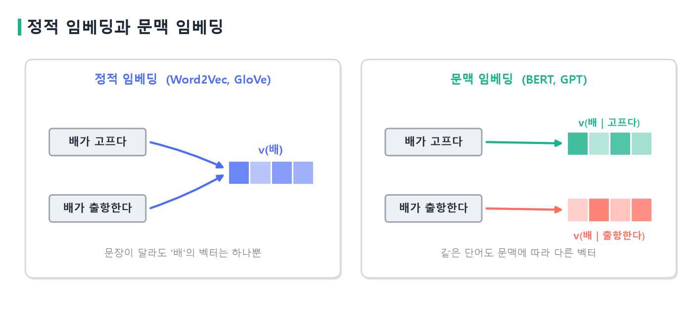{width=100% fig-alt="정적 임베딩과 문맥 임베딩"}
:::
::: {.figcap}
**그림 9-4** 정적 임베딩과 문맥 임베딩. 정적 임베딩은 두 문장의 `배`에 같은 벡터를 주지만, 문맥 임베딩은 주변 단어 `고프다`와 `출항한다`를 반영해 서로 다른 벡터를 줍니다.
:::

### 문장 임베딩과 코사인 유사도

문장이나 문서 전체를 벡터 하나로 나타내야 할 때가 있습니다. 검색에서 질문과 문서가 얼마나 비슷한지 재거나, 문장을 군집화하는 경우입니다. 이때는 토큰 벡터들의 **평균**을 쓰거나 BERT의 `[CLS]` 위치 벡터를 씁니다. 다만 사전학습한 BERT의 출력을 그대로 평균 내면 문장 유사도 성능이 기대만큼 나오지 않는 것으로 알려져, 문장 유사도를 위해 따로 학습한 모델(Sentence-BERT 등)을 쓰는 것이 보통입니다.

두 벡터가 얼마나 가까운지는 **코사인 유사도**로 잽니다. 길이가 아니라 **방향**을 비교하는 값입니다.

$$
\cos(\mathbf a,\mathbf b)=\frac{\mathbf a\cdot\mathbf b}{\|\mathbf a\|\,\|\mathbf b\|}\in[-1,1].
$$

방향이 같으면 1, 직각이면 0, 반대이면 $-1$입니다. 그림 9-5에서 $\mathbf a=(1,2)$와 $\mathbf b=(2,4)$는 길이가 달라도 방향이 같아 코사인이 1이고, $\mathbf c=(2,-1)$은 $\mathbf a$와 직각이라 0, $\mathbf d=(-1,-2)$는 반대 방향이라 $-1$입니다.

::: {.figbody}
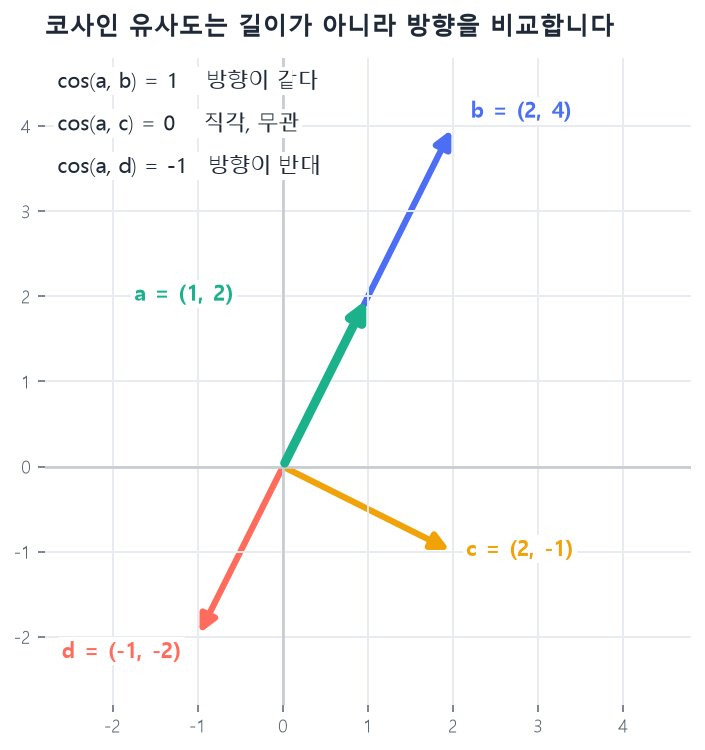{width=62% fig-alt="코사인 유사도 예시"}
:::
::: {.figcap}
**그림 9-5** 코사인 유사도. 벡터 $\mathbf a$를 기준으로, 같은 방향의 $\mathbf b$는 1, 직각인 $\mathbf c$는 0, 반대 방향인 $\mathbf d$는 $-1$입니다. 벡터 값은 계산을 보이기 위한 예시입니다.
:::

**코드 9-3** 코사인 유사도를 계산합니다.

```python
import torch
import torch.nn.functional as F

a = torch.tensor([1.0, 2.0])
for name, v in [("b", [2.0, 4.0]), ("c", [2.0, -1.0]), ("d", [-1.0, -2.0])]:
    cos = F.cosine_similarity(a, torch.tensor(v), dim=0)
    print(name, round(cos.item(), 2))      # b 1.0 / c 0.0 / d -1.0
```

갓 초기화한 임베딩은 무작위라서 코사인 유사도에 의미가 없습니다. 의미 있는 가까움은 학습이 끝난 뒤에 생깁니다.

## 어텐션 다시 보기 {#sec-attention-review}

임베딩이 준비되면 트랜스포머 레이어가 이어받습니다. 어텐션의 원리는 4장에서 자세히 다뤘으므로, 이 장에서는 텍스트 예시로 흐름을 짧게 복습하고 코드를 한 번 더 확인합니다.

입력 행렬 $X$에 서로 다른 세 가중치 행렬을 곱해 쿼리·키·값을 만듭니다.

$$
Q=XW^Q,\qquad K=XW^K,\qquad V=XW^V.
$$

쿼리는 이 위치가 찾는 정보, 키는 다른 위치가 내건 속성, 값은 실제로 건네줄 내용입니다. 문장 `I really love my cute dog.`에서 `love` 위치의 표현을 갱신한다고 하겠습니다. `love`의 쿼리 $\mathbf q_{\text{love}}$를 문장의 모든 단어의 키와 비교하는 것이 첫 단계입니다(그림 9-6).

::: {.figbody}
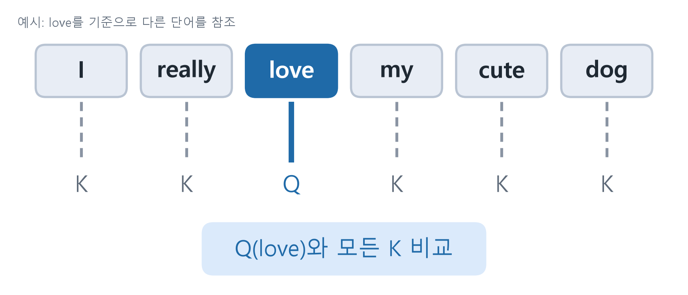{width=88% fig-alt="love의 쿼리를 모든 키와 비교"}
:::
::: {.figcap}
**그림 9-6** 문장 속 쿼리와 키. 현재 위치인 `love`가 쿼리 $Q$가 되어 모든 단어의 키 $K$와 비교됩니다. 이 비교의 결과가 어텐션 가중치입니다.
:::

비교는 내적으로 하고, 키의 차원 $d_k$에 대해 $\sqrt{d_k}$로 나눈 뒤 softmax를 취해 합이 1인 가중치를 얻습니다. 이 가중치로 값 $V$를 가중합한 것이 새로운 표현입니다.

$$
\text{Attention}(Q,K,V)=\text{softmax}\!\left(\frac{QK^\top}{\sqrt{d_k}}\right)V.
$$

가중치가 `I` 0.10, `really` 0.15, `love` 0.10, `my` 0.05, `cute` 0.10, `dog` 0.50이라는 (설명을 위한 가상의) 값을 얻었다면, $\mathbf z_{\text{love}}=0.10\,\mathbf v_{I}+0.15\,\mathbf v_{\text{really}}+\cdots+0.50\,\mathbf v_{\text{dog}}$가 됩니다. `love`의 새 표현에는 가장 큰 가중치를 받은 `dog`의 정보가 많이 섞입니다. $\sqrt{d_k}$로 나누는 이유는 4장에서 보았듯, $d_k$가 클수록 내적의 크기도 $\sqrt{d_k}$배로 커져 softmax가 한 곳으로 쏠리고 기울기가 거의 0이 되기 때문입니다.

**코드 9-4** 스케일드 닷-프로덕트 어텐션을 구현합니다.

```python
import math, torch

def attention(Q, K, V, mask=None):
    scores = Q @ K.transpose(-2, -1) / math.sqrt(Q.size(-1))
    if mask is not None:                       # 가릴 자리는 -inf
        scores = scores.masked_fill(mask == 0, float("-inf"))
    weights = scores.softmax(dim=-1)           # 행 합 = 1
    return weights @ V, weights                # (…, T, d_k), (…, T, T)
```

`mask`가 0인 자리는 $-\infty$로 바꾸어, softmax를 거치면 가중치가 0이 됩니다. 이 장치가 뒤에서 디코더의 인과 마스크가 됩니다.

**멀티 헤드 어텐션**은 이 어텐션을 $h$개 병렬로 두는 구조입니다. 임베딩을 $h$개의 하위 공간으로 나눠 각각 어텐션을 계산하고 결과를 이어 붙입니다. 헤드마다 서로 다른 관계(문법, 의미, 가까운 단어 등)를 보며, 각 헤드의 차원이 $d_k=d_{\text{model}}/h$이므로 계산량은 단일 어텐션과 거의 같습니다.

$$
\text{MultiHead}(X)=\text{Concat}(\text{head}_1,\dots,\text{head}_h)\,W_O.
$$

**코드 9-5** 멀티 헤드 어텐션을 구현합니다.

```python
import torch.nn as nn

class MHA(nn.Module):
    def __init__(self, d, h):
        super().__init__()
        self.h, self.dk = h, d // h
        self.wq, self.wk, self.wv, self.wo = (
            nn.Linear(d, d) for _ in range(4))

    def forward(self, q, k, v, mask=None):
        B = q.size(0)
        def split(x, w):                 # (B,T,d) -> (B,h,T,dk)
            x = w(x).view(B, -1, self.h, self.dk)
            return x.transpose(1, 2)
        out, _ = attention(split(q, self.wq), split(k, self.wk),
                           split(v, self.wv), mask)   # 헤드별 어텐션
        out = out.transpose(1, 2)                     # (B,T,h,dk)
        out = out.reshape(B, -1, self.h * self.dk)    # 헤드 이어붙이기
        return self.wo(out)
```

`view`와 `transpose`로 $(B,T,d)$를 $(B,h,T,d_k)$로 바꾸면 모든 헤드를 한 번에 계산할 수 있습니다. `forward`가 `q, k, v`를 따로 받는 것은 뒤의 **교차 어텐션**에서 키와 값이 인코더에서 오기 때문입니다.

## 위치 인코딩 {#sec-positional}

### 왜 필요한가

셀프 어텐션은 모든 토큰을 동시에 계산합니다. 어떤 토큰이 몇 번째에 있는지는 계산에 들어가지 않습니다. 그래서 단어의 순서를 바꿔도 출력은 순서만 바뀐 채 같은 값이 나옵니다. 모델 입장에서 "개가 사람을 물었다"와 "사람이 개를 물었다"가 같은 단어 묶음입니다. 순환 신경망은 시점을 차례로 처리하는 구조 자체가 순서를 담았지만, 트랜스포머는 그렇지 않으므로 순서 정보를 입력에 따로 넣어야 합니다. 이것이 위치 인코딩입니다. 위치마다 고유한 벡터를 만들어 임베딩에 **더합니다.** 더하는 이유는 차원 $d$가 늘지 않으면서 두 정보가 함께 레이어에 들어가기 때문입니다. 이어 붙이면 차원이 커져 이후 모든 층의 크기가 바뀝니다.

### 단순한 방식의 한계

가장 단순한 방법은 위치 번호 $p=0,1,2,\dots$를 그대로 더하는 것입니다. 이 방식은 위치가 커질수록 값이 끝없이 커져서 임베딩 값을 압도하고, 두 위치의 관계가 스칼라 하나의 차이로만 표현됩니다. 값을 0과 1 사이로 줄이는 정규화 방식 $p/(N-1)$은 크기 문제를 줄이지만, 시퀀스 길이 $N$에 따라 같은 위치의 값이 달라집니다. 위치 1의 값은 $N=4$일 때 $1/3\approx0.33$이고 $N=9$일 때 $1/8=0.125$입니다. 문장 길이가 다르면 같은 위치가 다른 의미를 갖게 되어 일관성이 없습니다.

### 사인·코사인 위치 인코딩

Vaswani 등이 제안한 방식은 서로 다른 주파수의 사인과 코사인을 겹쳐 위치마다 벡터를 만듭니다. 위치 $pos$와 차원 인덱스 $i$에 대해 다음과 같습니다.

$$
PE_{(pos,2i)}=\sin\!\left(\frac{pos}{10000^{2i/d}}\right),\qquad
PE_{(pos,2i+1)}=\cos\!\left(\frac{pos}{10000^{2i/d}}\right).
$$

차원마다 주파수가 다르다는 점이 핵심입니다. 낮은 차원은 위치가 바뀔 때 값이 빠르게 진동하고, 높은 차원은 천천히 변합니다. 그림 9-7이 차원 0, 8, 16, 24의 사인 곡선입니다.

::: {.figbody}
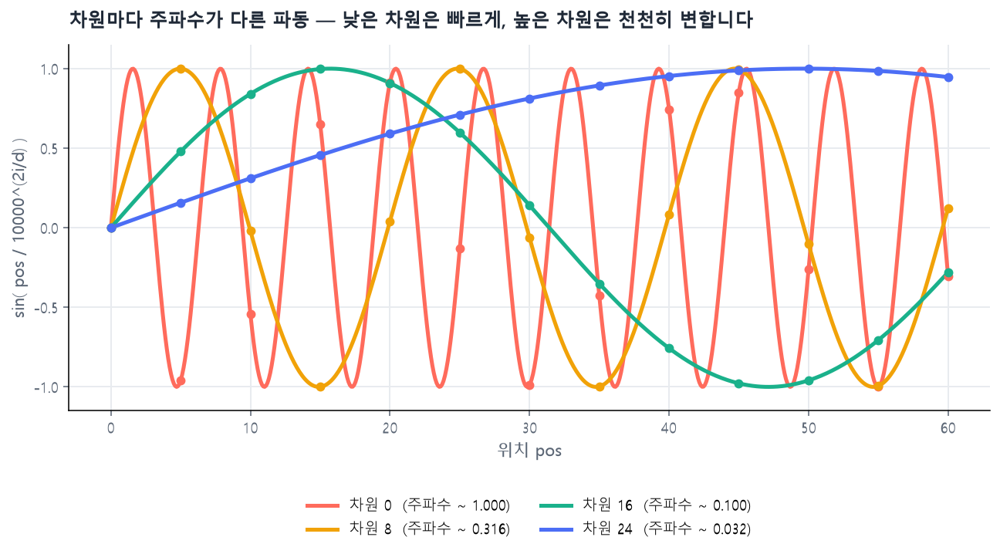{width=100% fig-alt="차원마다 주파수가 다른 사인 곡선"}
:::
::: {.figcap}
**그림 9-7** 사인 위치 인코딩의 차원별 곡선($d=64$). 차원 0(빨강)은 위치가 1 변할 때마다 값이 크게 바뀌고, 차원 24(파랑)는 60 위치에 걸쳐 천천히 변합니다. 빠른 파동은 가까운 위치를, 느린 파동은 먼 거리를 구분합니다. 점은 5 간격 위치의 값입니다.
:::

여러 속도로 도는 바늘이 한 시각을 정하는 시계와 같은 원리입니다. 초침만으로는 한 바퀴 이후를 구분할 수 없지만, 분침과 시침이 함께 있으면 긴 시간도 구분됩니다. 값이 항상 $[-1,1]$ 안에 머물고, 학습 때 보지 못한 긴 문장에도 식으로 계산할 수 있다는 장점도 있습니다.

$d=4$일 때 위치 0~3의 값을 직접 계산해 보면 다음과 같습니다.

| $pos$ | $\sin(pos)$ | $\cos(pos)$ | $\sin(pos/100)$ | $\cos(pos/100)$ |
|:--:|:--:|:--:|:--:|:--:|
| 0 | 0.000 | 1.000 | 0.000 | 1.000 |
| 1 | 0.841 | 0.540 | 0.010 | 1.000 |
| 2 | 0.909 | −0.416 | 0.020 | 1.000 |
| 3 | 0.141 | −0.990 | 0.030 | 1.000 |

앞쪽 두 차원은 주파수가 1이라 위치마다 값이 빠르게 변하고, 뒤쪽 두 차원은 주파수가 $1/100$이라 거의 변하지 않습니다. 이제 그림 9-1의 첫 두 토큰에 이 값을 더해 보겠습니다. 토큰 임베딩이 $E[\text{Transform}]=(0.60,\,-0.30,\,0.90,\,0.10)$(설명을 위한 예시 값)이면 위치 0의 벡터 $P[0]=(0,1,0,1)$을 더해 $(0.60,\,0.70,\,0.90,\,1.10)$이 됩니다. 두 번째 토큰은 $E[\texttt{\#\#ers}]=(-0.20,\,0.50,\,0.30,\,-0.40)$에 $P[1]=(0.841,\,0.540,\,0.010,\,1.000)$를 더해 $(0.641,\,1.040,\,0.310,\,0.600)$이 됩니다. 같은 토큰이 다른 위치에 오면 $P[i]$가 다르므로 다른 벡터가 됩니다.

**코드 9-6** 사인·코사인 위치 인코딩을 만듭니다.

```python
import math, torch

def sinpe(T, d):
    pe = torch.zeros(T, d)
    pos = torch.arange(T).unsqueeze(1).float()      # (T, 1)
    div = torch.exp(torch.arange(0, d, 2).float()
                    * (-math.log(10000.0) / d))     # 1/10000^(2i/d)
    pe[:, 0::2] = torch.sin(pos * div)              # 짝수 차원
    pe[:, 1::2] = torch.cos(pos * div)              # 홀수 차원
    return pe                                       # (T, d)

print(sinpe(4, 4).round(decimals=3))
```

출력은 위 손계산 표와 같습니다. 이 값은 학습 파라미터가 없는 고정 함수의 결과입니다.

### 학습하는 위치 임베딩

위치마다 벡터를 파라미터로 두고 학습하는 방식도 널리 쓰입니다. BERT와 GPT-2가 이 방식입니다. 데이터의 분포에 맞게 위치 표현이 최적화되지만, 학습 때 정한 최대 길이(BERT는 512)를 넘는 위치는 표현할 수 없습니다. 이 밖에 두 위치의 상대적 거리를 인코딩하는 방식, 회전 변환으로 상대 위치를 넣는 RoPE도 있고, 긴 문맥을 다루는 최근 모델에서 많이 쓰입니다.

| 방식 | 장점 | 한계 | 어울리는 데이터 |
|---|---|---|---|
| 정수 | 구현이 가장 쉽다 | 값이 무한히 커지고 관계 표현이 약하다 | 거의 쓰지 않음 |
| 정규화 | 값 범위가 일정하다 | 길이마다 같은 위치의 값이 달라진다 | 거의 쓰지 않음 |
| 사인·코사인 | 파라미터가 없고 길이에 제한이 없다 | 데이터에 맞춰 바뀌지 않는다 | 규칙적·주기적 패턴 |
| 학습 가능 | 데이터 분포에 맞게 학습된다 | 학습한 최대 길이를 넘기 어렵다 | 비정형·문맥이 유연한 텍스트 |

## 인코더 레이어 {#sec-enc-layer}

위치 정보까지 더한 입력 행렬 $(T,d)$는 인코더 레이어에 들어갑니다. 인코더 레이어는 두 단계입니다. 첫째는 멀티 헤드 셀프 어텐션이고, 둘째는 피드포워드 네트워크입니다. 각 단계를 **잔차 연결**과 **층 정규화**가 감쌉니다(그림 9-8).

::: {.figbody}
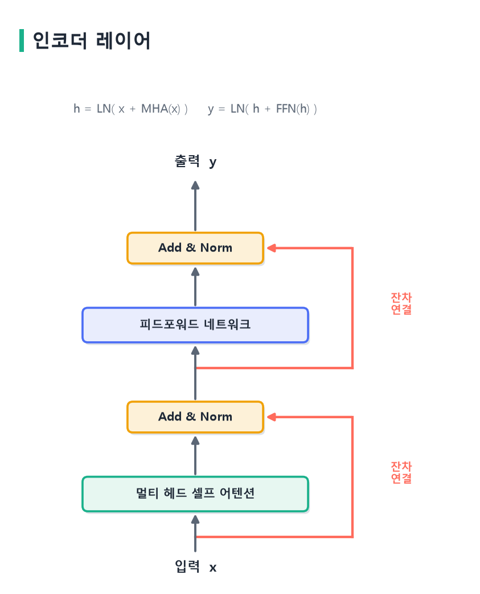{width=58% fig-alt="인코더 레이어 구조"}
:::
::: {.figcap}
**그림 9-8** 인코더 레이어. 멀티 헤드 셀프 어텐션과 피드포워드 네트워크가 각각 Add & Norm으로 감싸입니다. 붉은 선은 서브층을 우회해 입력을 더하는 잔차 연결입니다. 이 그림은 원 논문의 Post-LN 배치입니다.
:::

식으로 쓰면 다음과 같습니다. $\text{LN}$은 층 정규화입니다.

$$
\mathbf h=\text{LN}\big(\mathbf x+\text{MHA}(\mathbf x)\big),\qquad
\mathbf y=\text{LN}\big(\mathbf h+\text{FFN}(\mathbf h)\big).
$$

어텐션은 위치 **사이**에서 정보를 섞고, 피드포워드는 각 위치 **안**에서 정보를 가공합니다. 피드포워드 네트워크는 선형 변환 두 개 사이에 비선형 활성화 하나를 둔 구조이고, 모든 위치에 같은 가중치를 따로따로 적용합니다. 중간 차원은 보통 $d_{\text{model}}$의 4배로 넓힙니다. 원 논문의 기본 모델은 $d_{\text{model}}=512$, 중간 차원 2048, 헤드 8개, 레이어 6개입니다.

잔차 연결은 서브층의 출력에 입력을 그대로 더합니다. 역전파 때 기울기가 서브층을 거치지 않고 지름길로 흐를 수 있어서, 층을 깊게 쌓아도 기울기가 소실되지 않습니다. 5장에서 ResNet이 이 발상을 이미지 쪽에 도입했고, 트랜스포머도 같은 원리를 씁니다. 층 정규화는 각 위치의 특성 벡터를 평균 0, 분산 1로 맞춰 학습을 안정시킵니다. 배치 정규화와 달리 배치 크기에 의존하지 않아서 길이가 제각각인 문장에 적합합니다.

정규화의 위치는 두 가지가 있습니다. 위 식과 그림처럼 더한 뒤에 정규화하는 것이 원 논문의 **Post-LN**이고, 서브층 앞에서 정규화하는 것이 **Pre-LN**입니다. 두 배치 모두 쓰입니다. Xiong 등(2020)은 Pre-LN이 학습률 워밍업 없이도 안정적으로 학습된다고 보였고, 최근의 큰 모델은 대체로 Pre-LN을 씁니다. 이 장의 구현은 원 논문을 따라 Post-LN입니다.

**코드 9-7** 인코더 레이어를 구현합니다.

```python
class EncLayer(nn.Module):
    def __init__(self, d, h, ff):
        super().__init__()
        self.att = MHA(d, h)
        self.ffn = nn.Sequential(
            nn.Linear(d, ff), nn.ReLU(), nn.Linear(ff, d))
        self.n1, self.n2 = nn.LayerNorm(d), nn.LayerNorm(d)

    def forward(self, x, mask=None):
        x = self.n1(x + self.att(x, x, x, mask))   # MHA+잔차+정규화
        return self.n2(x + self.ffn(x))            # FFN+잔차+정규화
```

`forward`의 두 줄이 위 두 식을 그대로 옮긴 것입니다. `self.att(x, x, x)`처럼 쿼리·키·값에 모두 같은 $x$를 넘기므로 **셀프** 어텐션입니다.

## 디코더 레이어와 마스크 {#sec-dec-layer}

### 디코더는 두 가지를 더합니다

디코더 레이어는 인코더 레이어에 두 가지가 추가됩니다. 첫째는 **마스크드 셀프 어텐션**이고, 둘째는 **인코더–디코더 어텐션(교차 어텐션)**입니다. 서브층은 마스크드 셀프 어텐션, 교차 어텐션, 피드포워드의 세 개이고, 각각 Add & Norm으로 감싸입니다(그림 9-9).

::: {.figbody}
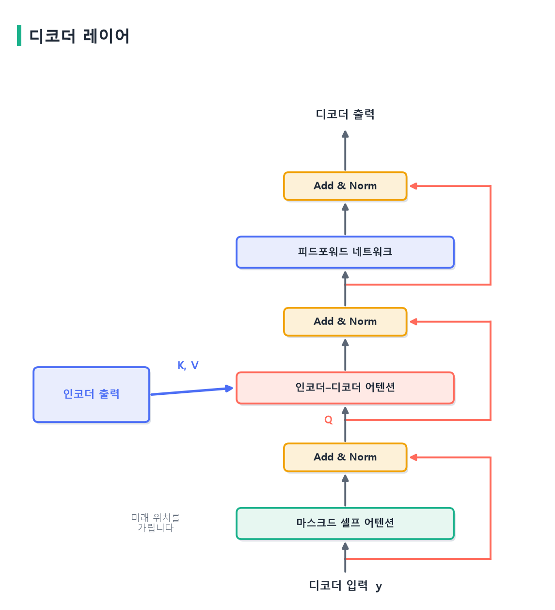{width=66% fig-alt="디코더 레이어 구조"}
:::
::: {.figcap}
**그림 9-9** 디코더 레이어. 아래에서 위로 마스크드 셀프 어텐션, 인코더–디코더 어텐션, 피드포워드가 이어지고 각각 Add & Norm이 뒤따릅니다. 교차 어텐션의 키와 값은 인코더 출력에서 오고, 쿼리는 아래 서브층(디코더)에서 옵니다.
:::

### 마스크드 셀프 어텐션

디코더는 문장을 한 토큰씩 생성합니다. 위치 $t$의 토큰을 예측할 때는 $t$보다 앞의 토큰만 알 수 있어야 합니다. 그런데 학습 때는 정답 문장 전체를 디코더에 한꺼번에 넣어 병렬로 계산합니다. 3장에서 본 교사 강요와 같은 방식입니다. 마스크가 없으면 위치 $t$를 예측하면서 정답인 $t+1$번째 이후 토큰을 직접 볼 수 있어서, 모델은 맞히는 법을 배우는 대신 정답을 베껴 쓰게 됩니다. 학습 점수는 높아지지만 실제 생성에서는 미래 토큰이 없으므로 성능이 무너집니다.

그래서 어텐션 점수에서 미래 위치를 $-\infty$로 바꿉니다. softmax를 거치면 그 위치의 가중치가 0이 되어, 각 위치는 자신과 앞쪽 토큰만 참조합니다. 이를 **인과 마스크(causal mask)**라 하며, 하삼각 행렬로 만듭니다.

```python
mask = torch.tril(torch.ones(4, 4))
# [[1,0,0,0],
#  [1,1,0,0],
#  [1,1,1,0],
#  [1,1,1,1]]
```

1은 볼 수 있는 위치, 0은 가려진 위치입니다. 그림 9-10의 오른쪽이 이 마스크이고, 왼쪽은 마스크가 없는 양방향 어텐션입니다. 두 그림의 차이가 뒤에서 BERT와 GPT의 가장 큰 차이가 됩니다.

::: {.figbody}
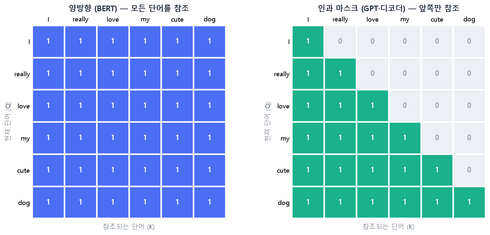{width=100% fig-alt="양방향 어텐션과 인과 마스크 비교"}
:::
::: {.figcap}
**그림 9-10** 어텐션 마스크의 비교. 행은 현재 단어(쿼리), 열은 참조되는 단어(키)이고 1은 참조할 수 있다는 뜻입니다. 왼쪽 양방향 어텐션은 모든 단어를 참조하고, 오른쪽 인과 마스크는 자신과 앞쪽 단어만 참조합니다. 마스크가 있느냐가 인코더형 모델(BERT)과 디코더형 모델(GPT)을 가릅니다.
:::

### 교차 어텐션

교차 어텐션은 디코더가 인코더의 출력을 참조하는 서브층입니다. 쿼리는 디코더에서, 키와 값은 인코더 출력에서 옵니다. 디코더가 "지금까지 쓴 문장"으로 질의를 던지면, 인코더가 이해한 "입력 문장 전체"에서 필요한 부분을 찾아옵니다. 번역에서 원문과 번역문의 대응이 이 서브층에서 학습됩니다. 세 가지 어텐션을 비교하면 쿼리·키·값의 출처가 서로 다릅니다.

| 어텐션 | 위치 | $Q$ 출처 | $K, V$ 출처 | 마스크 |
|---|---|---|---|---|
| 셀프 어텐션 | 인코더 | 인코더 입력 | 인코더 입력 | 없음 |
| 마스크드 셀프 어텐션 | 디코더 ① | 디코더 입력 | 디코더 입력 | 인과 마스크 |
| 교차 어텐션 | 디코더 ② | 디코더 | 인코더 출력 | 없음 |

연산의 형태는 셋 모두 같고, 쿼리·키·값이 어디서 오는지와 마스크의 유무만 다릅니다.

**코드 9-8** 디코더 레이어를 구현합니다.

```python
class DecLayer(nn.Module):
    def __init__(self, d, h, ff):
        super().__init__()
        self.self_att, self.cross = MHA(d, h), MHA(d, h)
        self.ffn = nn.Sequential(
            nn.Linear(d, ff), nn.ReLU(), nn.Linear(ff, d))
        self.n1, self.n2, self.n3 = (nn.LayerNorm(d) for _ in range(3))

    def forward(self, y, enc, tgt_mask, src_mask=None):
        a = self.self_att(y, y, y, tgt_mask)    # ① 마스크드
        y = self.n1(y + a)
        c = self.cross(y, enc, enc, src_mask)   # ② 교차: K,V = 인코더
        y = self.n2(y + c)
        return self.n3(y + self.ffn(y))         # ③ FFN
```

`self.cross(y, enc, enc, ...)`의 쿼리는 디코더 `y`, 키와 값은 인코더 출력 `enc`입니다. 서브층이 세 개이므로 정규화 층도 세 개입니다.

### 트랜스포머 조립과 확인

인코더 레이어와 디코더 레이어를 $N$개씩 쌓고, 임베딩과 위치 인코딩, 마지막 선형 층을 붙이면 트랜스포머가 됩니다.

**코드 9-9** 인코더–디코더 트랜스포머를 조립합니다.

```python
class Transformer(nn.Module):
    def __init__(self, vocab, d=32, h=4, ff=64, N=2):
        super().__init__()
        self.d = d
        self.emb = nn.Embedding(vocab, d)
        self.register_buffer("pe", sinpe(100, d))
        self.enc = nn.ModuleList(EncLayer(d, h, ff) for _ in range(N))
        self.dec = nn.ModuleList(DecLayer(d, h, ff) for _ in range(N))
        self.out = nn.Linear(d, vocab)

    def embed(self, x):
        return self.emb(x) * math.sqrt(self.d) + self.pe[:x.size(1)]

    def forward(self, src, tgt):
        tgt_mask = torch.tril(torch.ones(tgt.size(1), tgt.size(1)))
        e = self.embed(src)
        for layer in self.enc: e = layer(e)
        y = self.embed(tgt)
        for layer in self.dec: y = layer(y, e, tgt_mask)
        return self.out(y)                      # (B, T_tgt, vocab)
```

이 클래스에서 두 줄을 짚어 두겠습니다. `self.emb = nn.Embedding(vocab, d)`는 앞에서 본 임베딩 층이고, 토큰 ID를 $d$차원 벡터로 바꿉니다. `self.register_buffer("pe", sinpe(100, d))`는 위치 인코딩 표 $(100, d)$를 미리 계산해 모델에 붙여 둡니다. 사인·코사인 위치 인코딩은 학습할 값이 없는 고정 함수이므로 파라미터가 아니라 **버퍼**로 등록합니다. 버퍼는 `parameters()`에 잡히지 않아 옵티마이저가 갱신하지 않지만, 모델의 일부이므로 `.to(device)`를 하면 함께 이동하고 `state_dict`에도 저장됩니다. `self.pe = sinpe(...)`처럼 일반 속성으로 두면 둘 다 되지 않아서, GPU 모델에서 임베딩과 더할 때 장치가 달라 오류가 납니다. `100`은 지원하는 최대 토큰 수이고, `embed`에서 `pe[:T]`로 앞쪽 $T$개만 잘라 씁니다.

마스크가 정말 미래를 막는지 확인해 보겠습니다. 디코더 입력의 마지막 토큰을 바꿔도, 앞쪽 위치의 출력은 달라지지 않아야 합니다.

**코드 9-10** 출력 모양과 인과성을 확인합니다.

```python
torch.manual_seed(0)
m = Transformer(vocab=50).eval()
src = torch.randint(0, 50, (2, 7))      # 원문 7토큰
tgt = torch.randint(0, 50, (2, 5))      # 번역문 5토큰

out = m(src, tgt)
print(tuple(out.shape))                 # (2, 5, 50)

# 미래 토큰(마지막)을 바꿔도 앞 4개 위치의 출력은 같아야 한다
tgt2 = tgt.clone(); tgt2[:, -1] = (tgt2[:, -1] + 1) % 50
with torch.no_grad():
    a, b = m(src, tgt), m(src, tgt2)
print(torch.allclose(a[:, :4], b[:, :4], atol=1e-5))   # True
```

출력 `(2, 5, 50)`은 배치 2, 번역문 5토큰, 각 위치마다 어휘 50개의 점수입니다. 두 번째 출력이 `True`이므로 마지막 토큰을 바꿔도 앞 위치의 출력이 그대로이고, 마스크가 미래를 차단하고 있습니다.

## BERT {#sec-bert}

### 인코더만 쌓은 모델

**BERT(Bidirectional Encoder Representations from Transformers)**는 Devlin 등이 2018년에 발표한 모델로, 인코더 레이어만 쌓고 마스크를 쓰지 않습니다. 모든 위치가 서로를 보므로 한 토큰의 표현이 왼쪽과 오른쪽 문맥을 모두 반영합니다. 앞의 `배가 고프다`와 `배가 출항한다`에서 `배`의 뜻은 뒤에 오는 말이 정합니다. 왼쪽만 보는 모델은 이 단서를 쓸 수 없지만 BERT는 쓸 수 있습니다.

| 모델 | 층 | 차원 | 헤드 | 파라미터 |
|---|:--:|:--:|:--:|:--:|
| BERT-base | 12 | 768 | 12 | 약 1.1억 |
| BERT-large | 24 | 1024 | 16 | 약 3.4억 |

BERT에는 디코더가 없습니다. 입력 문장의 토큰마다 문맥이 반영된 벡터를 만드는 것이 역할이고, 그 벡터 위에 과제별 작은 헤드를 얹어 분류나 추출을 합니다. 전체 구조는 그림 9-11과 같습니다.

::: {.figbody}
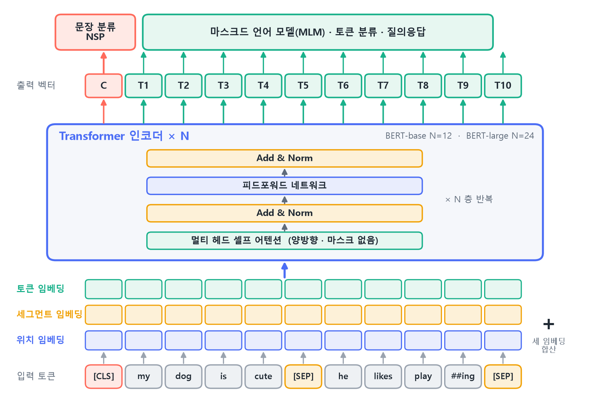{width=92% fig-alt="BERT 아키텍처"}
:::
::: {.figcap}
**그림 9-11** BERT 아키텍처. 입력 토큰마다 토큰·세그먼트·위치 임베딩을 더해 인코더 $N$층에 넣습니다(base는 12층, large는 24층). 인코더에는 마스크가 없습니다. 출력에서 `[CLS]` 위치의 벡터 $C$는 문장 분류나 NSP 헤드로, 나머지 토큰 벡터 $T_i$는 마스크드 언어 모델·토큰 분류·질의응답 헤드로 갑니다.
:::

### 입력 표현

BERT는 두 문장을 한 줄로 이어서 넣습니다. 문장 A와 B를 `[CLS] A [SEP] B [SEP]` 형태로 잇고, 토큰마다 입력 벡터를 **세 임베딩의 합**으로 만듭니다.

$$
\text{입력}_i=E^{\text{token}}_i+E^{\text{segment}}_i+E^{\text{position}}_i.
$$

| | | | | | | | | | | | |
|:-------------|:-----:|:-----:|:-----:|:-----:|:-----:|:-----:|:-----:|:-----:|:-----:|:-----:|:-----:|
| **토큰** | `[CLS]` | my | dog | is | cute | `[SEP]` | he | likes | play | `##ing` | `[SEP]` |
| **세그먼트** | 0 | 0 | 0 | 0 | 0 | 0 | 1 | 1 | 1 | 1 | 1 |
| **위치** | 0 | 1 | 2 | 3 | 4 | 5 | 6 | 7 | 8 | 9 | 10 |

토큰 임베딩은 어떤 토큰인지를, 세그먼트 임베딩은 문장 A(0)와 B(1) 중 어디에 속하는지를, 위치 임베딩은 몇 번째 토큰인지를 나타냅니다. 위치 임베딩은 사인·코사인이 아니라 학습되는 임베딩이고, 최대 길이는 512입니다. `[CLS]`는 문장 전체를 요약하는 자리, `[SEP]`는 문장의 경계입니다.

### 사전학습 ①: 마스크드 언어 모델

양방향 모델은 "다음 단어 맞히기"로 학습할 수 없습니다. 모든 위치가 서로를 보므로 정답이 이미 입력에 있기 때문입니다. BERT는 대신 토큰을 **가려 놓고 맞히게** 합니다. 이를 마스크드 언어 모델(MLM)이라 합니다.

1. 토큰의 15%를 무작위로 고릅니다.
2. 고른 토큰을 아래 규칙으로 바꿉니다.
3. 바뀐 입력에서 원래 토큰을 예측합니다.
4. 손실은 고른 위치에서만 계산합니다.

고른 토큰의 80%는 `[MASK]`로 바꾸고, 10%는 임의의 다른 토큰으로 바꾸고, 10%는 그대로 둡니다(그림 9-12). 왜 이렇게 섞을까요. 파인튜닝할 때의 입력에는 `[MASK]`가 없기 때문입니다. 사전학습 입력이 항상 `[MASK]`를 포함하면 사전학습과 파인튜닝의 입력이 달라지는 불일치가 생깁니다. 일부를 임의 토큰이나 원래 토큰으로 남겨 두면 모델이 모든 입력 토큰을 의심하며 문맥을 쓰게 됩니다.

::: {.figbody}
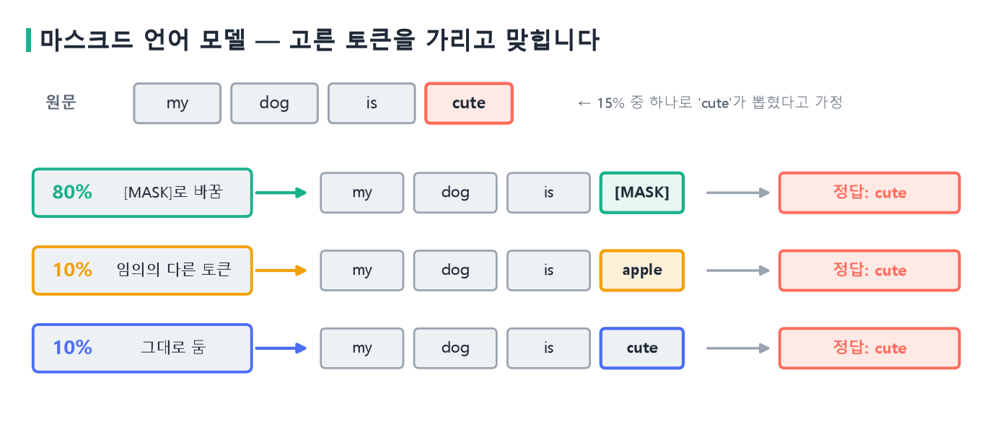{width=100% fig-alt="마스크드 언어 모델의 마스킹 규칙"}
:::
::: {.figcap}
**그림 9-12** MLM의 마스킹. 15%로 뽑힌 토큰 `cute`는 80%의 경우 `[MASK]`로, 10%는 임의의 토큰(`apple`)으로, 10%는 그대로 바뀝니다. 세 경우 모두 모델이 맞혀야 하는 정답은 원래 토큰 `cute`입니다.
:::

**코드 9-11** MLM 입력을 만드는 마스킹 함수를 구현합니다.

```python
import torch.nn.functional as F

def mask_tokens(ids, mask_id, vocab, p=0.15):
    labels = ids.clone()
    chosen = torch.rand(ids.shape) < p       # 15%의 위치를 고른다
    labels[~chosen] = -100                   # 안 고른 곳은 손실에서 제외
    r = torch.rand(ids.shape)
    out = ids.clone()
    out[chosen & (r < 0.8)] = mask_id        # 80% → [MASK]
    rnd = chosen & (r >= 0.8) & (r < 0.9)    # 10% → 임의의 토큰
    out[rnd] = torch.randint(vocab, ids.shape)[rnd]
    return out, labels                       # 나머지 10%는 그대로
```

`labels`의 `-100`은 "손실에서 제외"를 뜻하는 표시이고, 교차 엔트로피의 `ignore_index=-100`이 이 자리를 건너뜁니다. 난수 `r` 하나로 80, 10, 10을 나누어, $r<0.8$이면 `[MASK]`, $0.8\le r<0.9$이면 임의 토큰, 그보다 크면 원래 토큰으로 둡니다.

### 사전학습 ②: 다음 문장 예측

BERT는 두 번째 과제로 **다음 문장 예측(NSP)**도 함께 학습했습니다. 문장 A와 B를 이어 붙이고, B가 A의 실제 다음 문장인지를 `[CLS]` 위치의 벡터로 분류합니다. 절반은 실제 다음 문장(`IsNext`)이고 나머지 절반은 말뭉치에서 뽑은 무작위 문장(`NotNext`)입니다. 이후 Liu 등의 RoBERTa 같은 연구가 NSP를 빼고도 성능이 같거나 좋아진다고 보고했고, 요즘의 BERT 계열은 대부분 MLM만 씁니다. 두 과제 모두 라벨이 없는 텍스트에서 만들 수 있어서, 사람이 정답을 달 필요가 없다는 점이 사전학습의 장점입니다. BERT는 BooksCorpus와 영어 위키백과의 대규모 텍스트로 사전학습되었습니다.

### BERT 구현

앞에서 만든 `EncLayer`를 그대로 쓰면 BERT의 인코더가 됩니다. 달라지는 것은 입력 표현이 세 임베딩의 합이라는 점과 마스크를 쓰지 않는다는 점뿐입니다.

**코드 9-12** BERT 인코더를 구현합니다.

```python
class TinyBERT(nn.Module):
    def __init__(self, vocab, d=32, h=4, ff=64, N=2, max_len=64):
        super().__init__()
        self.tok = nn.Embedding(vocab, d)     # 토큰 임베딩
        self.seg = nn.Embedding(2, d)         # 문장 A/B 구분
        self.pos = nn.Embedding(max_len, d)   # 학습 가능한 위치 임베딩
        self.layers = nn.ModuleList(
            EncLayer(d, h, ff) for _ in range(N))
        self.mlm = nn.Linear(d, vocab)        # 마스크 위치의 토큰 예측

    def forward(self, ids, seg):
        pos = torch.arange(ids.size(1))
        x = self.tok(ids) + self.seg(seg) + self.pos(pos)
        for layer in self.layers:
            x = layer(x)                      # 마스크 없음 → 양방향
        return x                              # (B, T, d)
```

GPT식 디코더는 `tgt_mask`를 넘기지만, BERT는 `layer(x)`에 마스크 인자를 주지 않으므로 모든 위치가 서로를 봅니다. 위치 임베딩이 `nn.Embedding(max_len, d)`인 것도 사인·코사인과 다른 점입니다. 이제 마스킹한 입력으로 손실을 계산하고, `[CLS]` 벡터에 분류 헤드를 얹어 보겠습니다.

**코드 9-13** MLM 손실과 문장 분류 헤드를 계산합니다.

```python
V, MASK = 100, 99                       # 어휘 100개, 99번이 [MASK]
torch.manual_seed(0)
ids = torch.randint(0, 98, (4, 20))     # 4문장, 20토큰
seg = torch.zeros_like(ids)
inp, labels = mask_tokens(ids, MASK, V)

bert = TinyBERT(V)
h = bert(inp, seg)                      # (4, 20, 32)
logits = bert.mlm(h)                    # (4, 20, 100)
loss = F.cross_entropy(logits.view(-1, V), labels.view(-1),
                       ignore_index=-100)
print(tuple(h.shape), round(loss.item(), 2))   # (4, 20, 32) 4.81

clf = nn.Linear(32, 2)                  # 문장 분류 헤드
print(tuple(clf(h[:, 0]).shape))        # (4, 2)  [CLS]만 사용
```

초기 손실 4.81은 어휘 100개를 무작위로 찍을 때의 $\ln 100\approx4.6$ 근처입니다. 학습하면 이 값이 내려갑니다. `h[:, 0]`은 0번 위치, 곧 `[CLS]`의 벡터이고, 문장 전체의 표현으로 보고 분류 헤드에 넣습니다.

### 파인튜닝

사전학습이 끝난 BERT는 과제마다 작은 헤드만 바꿔서 쓰입니다. 사전학습한 본체를 유지하고 헤드를 붙인 뒤, 전체를 낮은 학습률로 학습합니다. 5장의 전이학습과 같은 발상입니다.

| 과제 | 입력 | 사용하는 출력 | 헤드 ($C$ = 클래스 수) |
|---|---|---|---|
| 문장 분류 (감성, 스팸) | `[CLS]` 문장 `[SEP]` | `[CLS]` 벡터 1개 | `Linear(d, C)` |
| 문장쌍 분류 (함의, 유사도) | `[CLS]` A `[SEP]` B `[SEP]` | `[CLS]` 벡터 1개 | `Linear(d, C)` |
| 토큰 분류 (개체명 인식) | `[CLS]` 문장 `[SEP]` | 모든 토큰 벡터 | 토큰마다 `Linear` |
| 질의응답 (범위 추출) | `[CLS]` 질문 `[SEP]` 본문 | 본문 토큰 벡터 | 답의 시작·끝 위치 점수 |

BERT 논문이 권장한 파인튜닝 설정은 학습률 $2\times10^{-5}$~$5\times10^{-5}$, 에폭 2~4, 배치 크기 16 또는 32입니다.

### BERT와 GPT

같은 어텐션 블록을 쓰는데도 BERT와 GPT는 쓰임새가 갈립니다. 차이는 마스크 한 장과 사전학습 과제입니다.

| | **BERT** | **GPT** |
|---|---|---|
| 구성 | 인코더만 | 디코더만 |
| 어텐션 | 양방향 (마스크 없음) | 왼쪽→오른쪽 (인과 마스크) |
| 사전학습 과제 | 가린 토큰 맞히기 (MLM) | 다음 토큰 맞히기 |
| 위치 정보 | 학습 가능한 임베딩 | 학습 가능한 임베딩 (GPT-2까지) |
| 잘하는 일 | 이해·분류·추출 | 문장 생성 |
| 출력 | 토큰마다 문맥 벡터 | 다음 토큰의 확률 |

BERT는 모든 위치가 서로를 보기 때문에 문장을 이해하는 데 강하지만, 한 토큰씩 이어 붙이는 생성에는 맞지 않습니다. 생성에는 앞의 토큰만 보는 인과 마스크가 필요하기 때문입니다. 입력을 이해할지, 출력을 생성할지, 둘 다인지가 구조를 고르는 기준입니다. 인코더만 쓰면 이해에, 디코더만 쓰면 생성에, 둘을 함께 쓰면 번역·요약처럼 한 시퀀스를 다른 시퀀스로 바꾸는 과제에 어울립니다.
