# 1. 이론 {#sec-ch10}

## 트랜스포머를 어떻게 조합하는가 {#sec-configs}

앞 장에서 인코더 레이어와 디코더 레이어를 따로 구현했고, 인코더만 쌓은 BERT까지 보았습니다. 이 장은 같은 부품을 다르게 조합한 **디코더 기반 대규모 언어 모델(LLM)**에서 출발합니다. 그리고 사전학습한 LLM을 내 목적에 맞추는 두 가지 방법, 곧 모델의 가중치를 바꾸는 **파인튜닝**과 모델은 그대로 두고 필요한 자료를 건네주는 **RAG**를 다룹니다.

트랜스포머의 조합 방식은 세 가지입니다(그림 10-1). 인코더만 쓰면 입력 전체를 양방향으로 읽어 문장의 의미를 파악하는 모델이 됩니다. 분류, 개체명 인식, 문장 임베딩이 이 계열의 일입니다. 디코더만 쓰면 앞쪽 토큰만 보고 다음 토큰을 예측하는 모델이 되어 문장을 이어 쓰는 생성에 쓰입니다. 인코더와 디코더를 함께 쓰면 입력을 해석한 뒤 그것을 참조해 새 문장을 만드는 번역이나 요약에 맞습니다.

::: {.figbody}
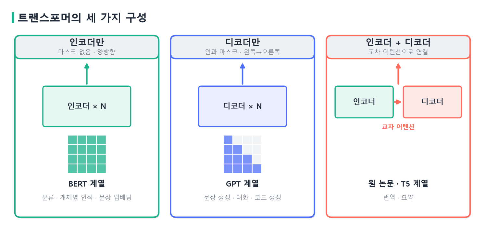{width=100% fig-alt="트랜스포머의 세 가지 구성"}
:::
::: {.figcap}
**그림 10-1** 트랜스포머의 세 가지 구성. 인코더만 쓰는 모델은 마스크가 없어 모든 토큰이 서로를 봅니다. 디코더만 쓰는 모델은 인과 마스크 때문에 각 토큰이 앞쪽만 봅니다. 인코더와 디코더를 함께 쓰는 모델은 교차 어텐션으로 둘을 연결합니다. 작은 격자는 어텐션 마스크이고, 색이 칠해진 칸이 참조할 수 있는 위치입니다.
:::

세 구성의 차이는 부품이 아니라 **마스크**와 **연결 방식**입니다. 앞 장에서 확인했듯 마스크가 없으면 정답이 입력에 이미 들어 있어서 "다음 단어 맞히기"로 학습할 수 없고, 그래서 BERT는 가려진 토큰을 맞히는 방식을 썼습니다. 반대로 인과 마스크를 쓰면 다음 토큰 맞히기가 곧바로 학습 목표가 되고, 생성할 때도 학습 때와 같은 조건이 유지됩니다. 오늘날 이름이 알려진 대부분의 대화형 모델은 이 두 번째 계열, 곧 디코더만 쓰는 모델입니다.

이 모든 구성이 트랜스포머라는 부품 위에 서 있는 이유는 **병렬 처리**에 있습니다. 순환 신경망은 이전 시점의 은닉 상태가 다음 시점 계산의 필수 입력이어서 첫 토큰, 둘째 토큰, 셋째 토큰을 차례로 처리해야 합니다. 문장이 길어질수록 계산이 시간 축을 따라 길게 이어지고, 많은 연산을 동시에 하는 GPU의 장점을 살리기 어렵습니다. 먼 단어의 정보는 여러 단계를 거치면서 약해지기도 합니다. 반면 셀프 어텐션은 모든 위치 쌍의 관계를 한 번에 계산합니다. 각 토큰이 앞뒤 토큰을 기다리지 않고 전체 입력의 모든 토큰과 직접 유사도를 구하므로, 멀리 떨어진 단어도 한 번의 어텐션으로 직접 이어집니다. 문맥 길이가 $n$이면 점수가 $n\times n$개이므로 연산량은 $n^2$에 비례해 늘어납니다. 그러나 이 계산들은 서로 의존하지 않아서 행렬 곱으로 한꺼번에 처리할 수 있고, GPU나 TPU에서 매우 효율적으로 실행됩니다. 이 덕분에 대규모 데이터로 학습하고 모델을 키울 수 있었고, 트랜스포머가 대규모 언어 모델의 기본 구조가 되었습니다.

## GPT 아키텍처와 자기회귀 생성 {#sec-gpt}

### 디코더 블록만 반복합니다

GPT는 디코더 레이어에서 **교차 어텐션을 뺀** 구조입니다. 인코더가 없으니 참조할 인코더 출력도 없기 때문입니다. 한 블록은 마스크드 멀티 헤드 셀프 어텐션, 피드포워드 네트워크, 잔차 연결과 층 정규화로 이루어지고, 이 블록을 $N$번 쌓습니다. 질문과 답처럼 여러 부분으로 된 입력도 하나의 시퀀스로 이어 붙여 같은 구조에 넣습니다. 이 단순함이 GPT의 특징입니다. 과제마다 모델 구조를 바꾸지 않고, 입력을 어떻게 이어 붙이느냐만 바꿉니다.

이 장에서 쓰는 GPT-2 small은 12개 층, 768차원, 12개 헤드, 어휘 50,257개이며 파라미터는 124,439,808개입니다. 요즘의 LLM에 비하면 작은 모델이지만 구조는 같아서, 한 대의 GPU에서 직접 돌려 보며 원리를 확인하기에 알맞습니다.

파라미터가 어디에 있는지 직접 더해 보겠습니다. 토큰 임베딩이 $50{,}257\times768=38{,}597{,}376$개, 위치 임베딩이 $1{,}024\times768=786{,}432$개입니다. 블록 하나에는 어텐션의 `c_attn`(1,771,776개)과 출력 투영(590,592개), 피드포워드의 두 선형층(2,362,368개와 2,360,064개), 층 정규화 두 개(3,072개)가 있어 7,087,872개이고, 12개 블록이면 85,054,464개입니다. 마지막 층 정규화 1,536개까지 합하면 124,439,808개로 위의 총합과 정확히 일치합니다. 출력 직전의 선형층은 토큰 임베딩 행렬과 가중치를 공유하므로 따로 세지 않습니다. 파라미터의 약 68%가 블록에, 약 31%가 토큰 임베딩에 있는 셈입니다.

### 다음 토큰의 확률

언어 모델은 문장의 확률을 다음 토큰의 조건부 확률의 곱으로 나눕니다.

$$
p(x_1,\dots,x_T)=\prod_{t=1}^{T} p\big(x_t\mid x_1,\dots,x_{t-1}\big).
$$

모델이 하는 일은 이 조건부 확률 $p(x_t\mid x_{<t})$를 계산하는 것입니다. 입력 토큰열이 디코더를 통과하면 각 위치에 $d$차원의 출력이 생기고, 마지막 선형층이 이를 어휘 크기만큼의 점수(logits)로 바꿉니다. 새 토큰을 고르는 데는 **마지막 위치**의 점수만 쓰고, softmax로 확률을 만듭니다.

**코드 10-1** GPT-2에서 `Artificial intelligence will` 다음에 올 토큰의 확률을 확인합니다.

```python
import torch
from transformers import GPT2Tokenizer, GPT2LMHeadModel

device = torch.device("cuda" if torch.cuda.is_available() else "cpu")
tokenizer = GPT2Tokenizer.from_pretrained("gpt2")
model = GPT2LMHeadModel.from_pretrained("gpt2").to(device).eval()

ids = tokenizer.encode("Artificial intelligence will", return_tensors="pt").to(device)
print(tokenizer.convert_ids_to_tokens(ids[0]))
# ['Art', 'ificial', 'Ġintelligence', 'Ġwill']

with torch.no_grad():
    logits = model(ids).logits              # (1, 4, 50257)
probs = logits[0, -1].softmax(dim=-1)       # 마지막 위치의 다음 토큰 확률
for p, i in zip(*probs.topk(5)):
    print(f"{p.item():.3f}  {tokenizer.decode(i)!r}")
# 0.156  ' be'    0.043  ' become'    0.032  ' also'    0.031  ' help'    0.031  ' soon'
```

토크나이저는 문장을 `Art`, `ificial`, `Ġintelligence`, `Ġwill` 네 토큰으로 나눕니다. `Ġ`는 앞에 공백이 있다는 표시입니다. `logits`의 모양 $(1,4,50257)$은 네 위치마다 어휘 전체의 점수가 있다는 뜻이고, 다음 토큰을 정하는 데는 `logits[0, -1]`만 씁니다. 1순위인 `be`의 확률이 15.6%에 그친다는 점에 주목하겠습니다. 확률이 한 곳에 몰려 있지 않고 여러 후보에 퍼져 있으므로, 어떤 규칙으로 하나를 고르느냐가 결과를 좌우합니다. 이는 뒤에서 디코딩으로 다룹니다.

### 자기회귀 생성

토큰 하나를 고르고 나면 그 토큰을 입력 끝에 이어 붙이고 같은 계산을 다시 합니다. 이를 종료 토큰이 나오거나 길이 한도에 닿을 때까지 반복하는 것이 **자기회귀(autoregressive) 생성**입니다(그림 10-2). 한 번에 토큰 하나씩 만들기 때문에 긴 답변은 그만큼 오래 걸립니다. 그리디로 돌리면 `Artificial intelligence will` 뒤에 `be`, `able`, `to`, `do` 순으로 토큰이 하나씩 붙습니다. 매 단계마다 전체 입력을 다시 읽는 것처럼 보이지만, 실제 구현은 이전 단계에서 계산한 키와 값을 저장해 두었다가 재사용하는 **KV 캐시**를 써서 새 토큰의 계산만 추가로 합니다. 결과는 같고 속도만 빨라집니다.

::: {.figbody}
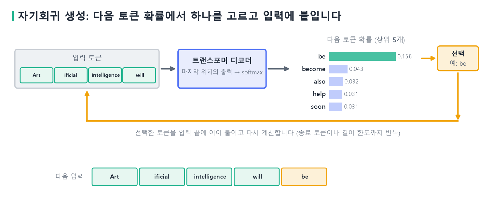{width=100% fig-alt="자기회귀 생성 과정"}
:::
::: {.figcap}
**그림 10-2** 자기회귀 생성. 입력 토큰열의 마지막 위치에서 다음 토큰의 확률을 구하고(막대는 코드 10-1의 실제 값), 하나를 선택해 입력 끝에 붙인 뒤 다시 계산합니다.
:::

학습할 때는 사정이 다릅니다. 정답 문장 전체를 한꺼번에 넣고 모든 위치의 다음 토큰을 동시에 예측하되, 인과 마스크로 각 위치가 앞쪽만 보게 합니다. 이렇게 하면 한 번의 계산으로 모든 위치의 손실을 구할 수 있습니다. 이것이 GPT가 병렬 계산에 유리한 이유입니다. 생성할 때는 이 병렬성을 쓸 수 없지만, 마스크 덕분에 학습 때와 같은 조건이 유지됩니다. 인과 마스크가 실제로 미래를 막는지는 GPT-2에서도 확인할 수 있습니다.

**코드 10-2** 입력의 마지막 토큰을 바꿔도 앞쪽 위치의 출력이 같은지 확인합니다.

```python
a = tokenizer.encode("The cat sat on the mat", return_tensors="pt").to(device)
b = a.clone()
b[0, -1] = tokenizer.encode(" floor")[0]          # 마지막 토큰만 바꾼다

with torch.no_grad():
    la, lb = model(a).logits, model(b).logits

print(torch.allclose(la[:, :-1], lb[:, :-1], atol=1e-4))   # True: 앞쪽 위치는 그대로
print(torch.allclose(la[:, -1], lb[:, -1], atol=1e-4))     # False: 바뀐 토큰의 위치
```

앞쪽 위치의 출력은 같고, 바꾼 토큰이 있는 마지막 위치만 달라집니다. 각 위치가 자기보다 뒤의 토큰을 보지 않는다는 뜻입니다.

## 사전학습과 대규모 언어 모델 {#sec-llm}

### 사전학습: 라벨 없는 텍스트로 다음 토큰을 맞힙니다

GPT의 사전학습 목표는 앞에서 쓴 조건부 확률의 로그 우도를 최대화하는 것입니다.

$$
\max_\theta \sum_{t}\log p_\theta\big(x_{t+1}\mid x_{\le t}\big).
$$

정답은 텍스트 자체입니다. 입력을 한 칸 민 것이 정답이므로 사람이 라벨을 달 필요가 없고, 그래서 인터넷 규모의 텍스트로 학습할 수 있습니다. 이 과정에서 모델은 문법, 사실 관계, 문체, 어느 정도의 추론 패턴까지 파라미터에 저장합니다. 이렇게 학습한 모델을 **기반(base) 모델**이라 부릅니다. 기반 모델은 문장을 이어 쓰는 데는 능하지만 "이 질문에 답하라"는 지시를 따르도록 만들어지지는 않았습니다. 질문을 주면 답하는 대신 비슷한 질문을 이어서 쓸 수도 있습니다.

사전학습이 다양한 작업에 두루 쓰이는 이유는 작업들이 겉보기와 달리 같은 기반 능력을 요구하기 때문입니다. 감정 분석은 문장의 감정을 분류하고, 번역은 한 언어의 문장을 다른 언어로 바꾸고, 요약은 긴 글의 핵심을 압축합니다. 그러나 셋 모두 단어의 의미, 문장 구조, 문맥의 흐름, 지시 관계, 논리적 연결을 이해해야 합니다. 다음 토큰 예측을 라벨 없이 반복하면 모델은 어떤 단어가 어떤 문맥에서 자주 나오는지, 어떤 표현이 자연스러운지, 문장이 어떻게 이어지는지를 자연 텍스트의 통계적 구조로부터 직접 배웁니다. 이렇게 형성된 일반적인 표현 능력은 새로운 작업으로 옮겨 갑니다. 새 작업을 처음부터 배울 필요가 없어서 프롬프트만으로 시키거나 적은 데이터로 파인튜닝해도 좋은 성능이 나오고, 하나의 모델이 번역, 요약, 질의응답, 글쓰기, 코드 생성을 모두 해냅니다.

### 규모의 효과

Kaplan 등(2020)은 모델 크기, 학습 데이터 양, 연산량이 늘수록 손실이 거듭제곱 법칙에 가깝게 꾸준히 줄어든다는 것을 경험적으로 보였습니다. 이 관계를 **스케일링 법칙**이라 합니다. 성능이 규모에 따라 예측 가능하게 변하므로, 큰 모델을 학습하는 투자의 근거가 됩니다. Hoffmann 등(2022)은 같은 연산량이라면 모델 크기만 키울 것이 아니라 학습 토큰 수도 함께 늘려야 한다고 보고했습니다. 모델이 작아도 데이터를 충분히 보면 더 큰 모델보다 나을 수 있다는 뜻입니다.

규모가 어느 선을 넘으면 작은 모델에서는 거의 안 보이던 능력이 갑자기 나타나는 것처럼 보이는 현상을 **창발적 능력**이라 부릅니다(Wei 등, 2022). 다만 이를 두고 해석이 갈립니다. Schaeffer 등(2023)은 정답이냐 오답이냐만 보는 불연속적인 평가 지표 때문에 급격한 변화처럼 보이는 것일 수 있다고 지적했습니다. 연속적인 지표로 보면 성능이 완만하게 오르는 경우가 많다는 것입니다. 이 장에서는 "규모가 커질수록 성능이 오르고, 일부 능력은 어느 규모부터 두드러진다" 정도로 이해하면 충분합니다.

### in-context 학습

GPT-3(Brown 등, 2020)가 보인 중요한 성질이 **in-context 학습**입니다. 모델의 가중치를 바꾸지 않고, 프롬프트에 과제의 설명과 예시를 넣는 것만으로 새 과제를 수행하게 하는 방식입니다. 예시가 없으면 zero-shot, 하나면 one-shot, 여러 개면 few-shot이라 부릅니다(그림 10-3).

::: {.figbody}
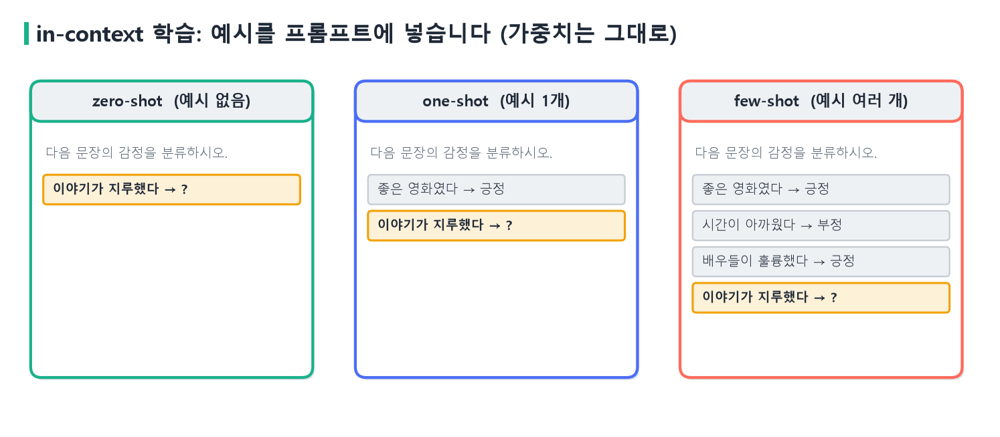{width=100% fig-alt="zero-shot, one-shot, few-shot 프롬프트"}
:::
::: {.figcap}
**그림 10-3** in-context 학습. 같은 감정 분류 과제를 예시의 수만 달리해 프롬프트로 표현했습니다. 마지막 줄이 모델이 답해야 하는 입력이며, 세 경우 모두 모델의 가중치는 바뀌지 않습니다.
:::

in-context 학습은 파라미터를 갱신하지 않으므로 비용이 거의 들지 않고 곧바로 쓸 수 있습니다. 하지만 예시가 프롬프트의 길이를 차지하고, 작은 모델에서는 효과가 약합니다. 모델이 클수록, 예시가 많을수록 정확도가 오르는 경향이 보고되었습니다. 과제가 단순하다면 프롬프트로 충분하고, 그렇지 않을 때 파인튜닝이나 RAG를 고려합니다.

### 사전학습 이후의 단계

기반 모델이 사용자의 지시를 따르려면 추가 학습이 필요합니다. 흔히 세 단계로 설명합니다(그림 10-4). 첫째는 사전학습이고, 둘째는 (지시, 응답) 쌍으로 학습하는 **지도 미세조정(SFT, supervised fine-tuning)**입니다. 이 단계의 손실도 응답 토큰의 다음 토큰 예측이어서 사전학습과 같은 형태입니다. 데이터만 대규모 일반 텍스트에서 사람이 쓴 지시와 응답으로 바뀝니다. 셋째는 **선호 정렬**로, 같은 질문에 대한 여러 응답 가운데 사람이 더 낫다고 고른 것을 따르게 합니다.

::: {.figbody}
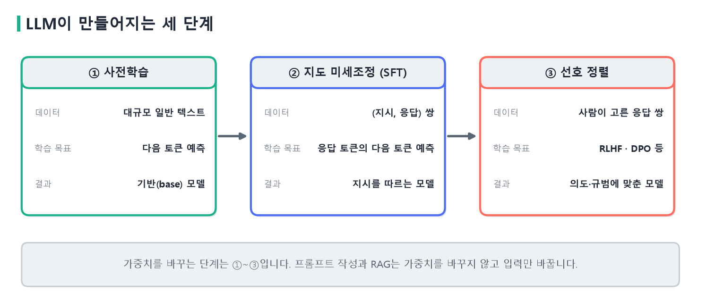{width=100% fig-alt="LLM이 만들어지는 세 단계"}
:::
::: {.figcap}
**그림 10-4** LLM이 만들어지는 세 단계. 사전학습 → 지도 미세조정 → 선호 정렬 순으로 가중치를 갱신합니다. 프롬프트 작성과 RAG는 가중치를 바꾸지 않고 입력만 바꿉니다.
:::

선호 정렬의 대표적인 방법이 **RLHF**입니다. InstructGPT(Ouyang 등, 2022)는 사람이 매긴 응답 선호도로 보상 모델을 학습하고, 이 보상을 높이도록 언어 모델을 강화학습으로 조정했습니다. Rafailov 등(2023)의 **DPO**는 보상 모델과 강화학습 없이 선호 쌍으로 직접 최적화하는 더 간단한 방법을 제안했습니다. 강화학습의 자세한 내용은 이후 단원에서 다룹니다.

### 한계

사전학습과 정렬을 마친 LLM에도 한계가 있습니다. 모르는 것을 그럴듯하게 지어내는 **환각(hallucination)**이 있고, 학습 시점 이후의 정보나 공개되지 않은 내부 문서는 알지 못합니다. 그리고 지식이 파라미터에 흩어져 있어서 출처를 댈 수 없고, 특정 지식을 고쳐 쓰려면 재학습이 필요합니다. 이 한계를 보완하는 길이 두 가지입니다. 모델의 가중치를 바꾸는 **파인튜닝**과, 모델은 그대로 두고 필요한 자료를 입력에 넣어 주는 **RAG**입니다. 이 두 방법의 차이는 이 장의 마지막 절에서 정리합니다.

## 디코딩 전략 {#sec-decoding}

### 그리디와 샘플링

다음 토큰의 확률이 주어졌을 때 하나를 고르는 규칙이 **디코딩 전략**입니다. 가장 단순한 것은 매번 확률이 가장 높은 토큰을 고르는 **그리디 디코딩**입니다. 같은 입력에는 항상 같은 결과가 나오지만, 코드 10-1에서 보았듯 1순위의 확률도 15.6%에 불과해서 그리디가 항상 좋은 문장으로 이어지지는 않고, 같은 표현을 반복하는 경향이 있습니다. 확률에 따라 무작위로 뽑는 **샘플링**은 결과가 다양하지만 실행할 때마다 달라집니다. 시드를 고정하면 샘플링도 재현할 수 있습니다.

### temperature와 top-p

샘플링의 분포를 조절하는 두 손잡이가 있습니다. **temperature** $T$는 softmax에 들어가는 점수를 $T$로 나눕니다.

$$
p_i=\frac{\exp(z_i/T)}{\sum_j \exp(z_j/T)}.
$$

$T<1$이면 점수의 차이가 커져 분포가 뾰족해지고, $T>1$이면 차이가 줄어 분포가 평평해집니다. 왜 그런지는 두 토큰의 확률 비율을 구하면 분명해집니다. 분모 $\sum_j e^{z_j/T}$는 모든 토큰에 공통이어서 비율에서 약분되고, 점수의 차이만 남습니다.

$$
\frac{p_1}{p_2}=\frac{e^{z_1/T}}{e^{z_2/T}}=e^{(z_1-z_2)/T}.
$$

$z_1=2$, $z_2=1$이라면 $T=1$일 때 $p_1/p_2=e^{(2-1)/1}=e\approx2.72$이고, $T=0.5$일 때는 $e^{(2-1)/0.5}=e^{2}\approx7.39$입니다. 온도를 1에서 0.5로 낮추면 첫째 토큰이 둘째 토큰보다 뽑힐 확률의 비율이 2.72배에서 7.39배로 커집니다. 점수 차이가 $1/T$배로 증폭되는 셈이어서, $T$가 작을수록 1위 토큰에 확률이 쏠리고 클수록 평평해집니다. 그림 10-5가 GPT-2의 실제 점수로 계산한 결과입니다. $T=0.5$에서 `be`의 확률은 0.686으로 몰리고, $T=1.0$에서는 0.156, $T=1.5$에서는 0.040으로 줄면서 확률이 여러 후보로 퍼집니다. 낮은 값은 안전하지만 단조로운 문장을, 높은 값은 다양하지만 흐트러진 문장을 낳습니다.

::: {.figbody}
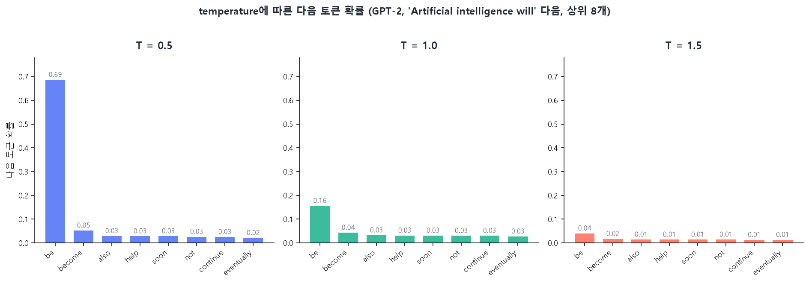{width=100% fig-alt="temperature에 따른 다음 토큰 확률"}
:::
::: {.figcap}
**그림 10-5** temperature에 따른 다음 토큰 확률. GPT-2의 `Artificial intelligence will` 다음 위치에서 상위 8개 토큰의 확률입니다. 세 그림의 세로축을 같게 맞추었습니다. $T$가 작으면 한 토큰에 몰리고, 크면 평평해집니다.
:::

**top-p**(nucleus sampling, Holtzman 등, 2020)는 확률이 높은 순서로 더해 누적 확률이 $p$에 이르는 후보만 남기고 그 안에서 뽑습니다. 확률이 아주 낮은 엉뚱한 토큰이 뽑히는 일을 막습니다. 실무에서는 `temperature`와 `top_p`를 함께 조절하며, 정확한 답이 필요한 과제는 낮게, 창작에는 높게 잡습니다.

설명을 위한 가상의 분포로 보겠습니다. 후보 A, B, C, D, E, F의 확률이 0.50, 0.30, 0.10, 0.05, 0.03, 0.02이고 $p=0.9$이면, 누적 확률이 0.50, 0.80, 0.90이 되는 A, B, C까지만 남습니다. 남은 셋의 확률을 합이 1이 되도록 다시 정규화해(0.556, 0.333, 0.111) 그 안에서 뽑습니다. 고정된 개수만 남기는 top-k와 달리, 분포의 모양에 따라 후보의 수가 달라집니다.

**코드 10-3** 그리디와 샘플링, temperature를 비교합니다.

```python
gen = dict(max_new_tokens=30, pad_token_id=tokenizer.eos_token_id)

out = model.generate(ids, do_sample=False, **gen)              # 그리디: 항상 같은 결과
print(tokenizer.decode(out[0], skip_special_tokens=True))

for seed in (0, 1, 0):                                         # 같은 시드는 같은 결과
    torch.manual_seed(seed)
    out = model.generate(ids, do_sample=True, top_p=0.9, temperature=0.8, **gen)
    print(seed, tokenizer.decode(out[0], skip_special_tokens=True))

for temp in (0.3, 0.8, 1.5):                                   # temperature 비교
    torch.manual_seed(0)
    out = model.generate(ids, do_sample=True, top_p=1.0, temperature=temp, **gen)
    print(temp, tokenizer.decode(out[0], skip_special_tokens=True))
```

시드 0, 1, 0으로 돌리면 첫째와 셋째 결과가 같고 둘째는 다릅니다. `temperature`가 0.3이면 같은 구절을 반복하는 단조로운 문장이 나오고, 1.5이면 표현은 다양해지지만 일관성이 떨어질 위험이 커집니다. 이 밖에 여러 후보 문장을 동시에 추적하는 빔 서치도 있습니다. 번역처럼 정답에 가까운 출력이 바람직한 과제에서 쓰이고, 대화나 창작에는 샘플링이 더 흔합니다.

## 파인튜닝 {#sec-finetuning}

### 파인튜닝이란

**파인튜닝(fine-tuning)**은 사전학습한 모델의 가중치를 특정 목적의 데이터로 추가 학습하는 것입니다. 지식을 새로 집어넣는 용도보다는 모델의 **행동**을 조정하는 데 더 효과적이라는 것이 일반적인 이해입니다. 응답의 형식, 말투, 도메인 문체, 특정 과제의 수행 방식이 파인튜닝이 잘 맞는 대상입니다. 앞 절의 지도 미세조정이 바로 이것이며, 이 장의 실습도 같은 방식으로 다음 토큰 예측 손실을 씁니다.

### 전체 파인튜닝이 비싼 이유

모델의 모든 가중치를 학습하려면 메모리에 올려야 하는 것이 가중치만이 아닙니다. 역전파에는 파라미터마다 기울기가 필요하고, Adam 옵티마이저는 파라미터마다 1차·2차 모멘트 두 개를 더 저장합니다. 혼합 정밀도로 학습하면 FP16 가중치(2바이트)와 FP16 기울기(2바이트) 외에, 정밀도를 유지하기 위한 FP32 가중치 사본(4바이트)과 모멘트 두 개(각 4바이트)가 필요합니다. 합하면 파라미터당 대략 16바이트입니다(Rajbhandari 등, 2020). 파라미터가 70억 개이면 약 112GB로, 한 장의 GPU에 올라가지 않습니다(그림 10-6). 여기에 배치와 시퀀스 길이에 비례하는 활성값이 더해지고, 과제마다 모델 전체의 사본을 따로 저장해야 합니다.

::: {.figbody}
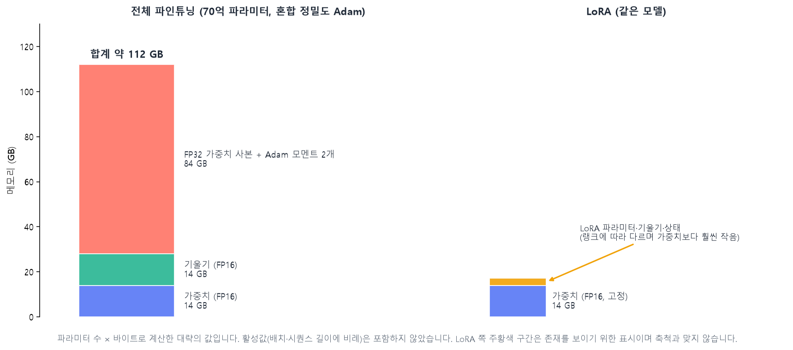{width=100% fig-alt="전체 파인튜닝과 LoRA의 메모리 비교"}
:::
::: {.figcap}
**그림 10-6** 70억 파라미터 모델의 학습 메모리. 전체 파인튜닝은 가중치 14GB, 기울기 14GB, FP32 사본과 Adam 모멘트 84GB로 합계 약 112GB가 듭니다. LoRA는 가중치를 고정하고 작은 행렬만 학습하므로 기울기와 옵티마이저 상태의 부담이 크게 줄어듭니다. 대략의 계산이며 활성값은 포함하지 않았습니다.
:::

이 부담을 줄이는 방향은 세 가지입니다. 여러 장치로 계산을 나누는 **분산 학습**, 계산 정밀도를 낮추는 **혼합 정밀도**, 학습하는 파라미터 자체를 줄이는 **PEFT**입니다.

### 분산 학습과 혼합 정밀도

분산 학습은 여러 GPU나 노드에 계산 부하를 나누는 것으로, 방식이 셋입니다. **데이터 병렬**은 같은 모델을 장치마다 복제하고 서로 다른 미니배치를 처리한 뒤 기울기를 모아 갱신합니다. 구조를 바꾸지 않고 쓸 수 있는 가장 기본적인 방식입니다. **모델 병렬**은 모델 자체를 쪼개 여러 장치에 나누어 저장합니다. 층 하나가 한 장치에 안 올라갈 만큼 클 때 씁니다. **파이프라인 병렬**은 층을 여러 단계로 나누어 장치마다 맡기고, 배치를 마이크로배치로 쪼개 연달아 투입해 장치가 놀지 않게 합니다. 실제 대형 모델은 이들을 섞어 쓰며, 장치 사이의 통신 속도가 성능을 좌우합니다. ZeRO처럼 옵티마이저 상태를 장치에 나누어 저장하는 방법도 있습니다. 이 수업의 실습은 GPU 한 장에서 하므로 원리만 이해하면 됩니다.

혼합 정밀도(Micikevicius 등, 2018)는 연산을 32비트(FP32) 대신 16비트(FP16 또는 BF16)로 수행해 속도를 높이고 메모리를 줄입니다. 문제는 FP16이 표현할 수 있는 범위가 좁다는 점입니다. 최댓값이 약 65,504이고, 아주 작은 기울기는 0으로 사라지는 **언더플로우**가 생겨 학습이 멈춘 것처럼 보일 수 있습니다. 해결책이 **손실 스케일링**입니다. 손실에 큰 값을 곱해 기울기를 키운 채 계산하고, 갱신하기 전에 다시 나누어 되돌립니다. 스케일은 학습 중에 동적으로 조절합니다. **BF16**은 FP16과 같은 16비트이지만 지수 비트를 FP32와 같게(8비트) 두어 표현 범위가 넓고, 대신 가수 정밀도가 낮습니다. 범위가 넓어 손실 스케일링이 필요 없어서 최근에는 BF16을 지원하는 GPU에서 널리 씁니다. 수치에 민감한 연산은 FP32로 남기고 나머지만 16비트로 바꾸는 선택을 프레임워크의 자동 혼합 정밀도(AMP)가 대신 해 줍니다.

세 형식의 비트 구성을 비교하면 다음과 같습니다. 지수 비트가 표현 범위를, 가수 비트가 정밀도를 정합니다. 부호는 모두 1비트입니다.

| 형식 | 전체 비트 | 지수 | 가수 | 특징 |
|:--|:--:|:--:|:--:|:--|
| FP32 | 32 | 8 | 23 | 기준 형식, 범위와 정밀도가 모두 넉넉함 |
| FP16 | 16 | 5 | 10 | 정밀하지만 범위가 좁음(최댓값 약 65,504) |
| BF16 | 16 | 8 | 7 | 범위는 FP32와 같고 정밀도는 낮음 |

## 효율적 파인튜닝(PEFT) {#sec-peft}

### 세 갈래

**PEFT(Parameter-Efficient Fine-Tuning)**는 사전학습한 가중치를 고정하고 작업에 필요한 변화만 소수의 파라미터로 주입하는 방법입니다. 전체를 다시 학습하는 비용을 크게 줄이고, 과제마다 작은 부품만 저장하면 됩니다. 서비스 환경에서도 실용적입니다. 거대한 기반 모델 하나를 서버에 올려 두고 고객이나 작업에 따라 작은 LoRA 모듈이나 Adapter만 바꿔 끼우면 되므로, 모델 전체의 사본을 여러 개 저장할 필요가 없고 배포와 갱신도 간단해집니다. 변화를 넣는 위치에 따라 세 갈래로 나눌 수 있습니다(그림 10-7).

::: {.figbody}
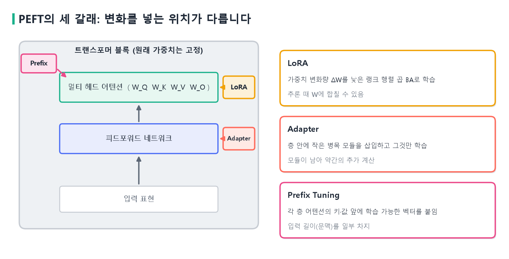{width=100% fig-alt="PEFT의 세 갈래"}
:::
::: {.figcap}
**그림 10-7** PEFT의 세 갈래. LoRA는 가중치 행렬의 변화량을 낮은 랭크 행렬로 학습합니다. Adapter는 층 안에 작은 모듈을 삽입합니다. Prefix Tuning은 어텐션의 키와 값 앞에 학습 가능한 벡터를 붙입니다. 세 방식 모두 원래 가중치는 고정합니다.
:::

**Adapter**(Houlsby 등, 2019)는 트랜스포머 층 안에 작은 병목 모듈을 끼워 넣습니다. 모듈은 차원을 줄이는 선형층, 비선형 함수, 차원을 되돌리는 선형층으로 이루어지고 잔차 연결이 있습니다. 주 경로에 직렬로 넣거나 원래 연산과 나란한 보조 경로로 둘 수 있습니다. 원래 가중치는 건드리지 않고 이 모듈만 학습합니다. 다만 모듈이 추론 때도 남아 있어서 약간의 추가 계산이 생깁니다. 수식으로는 $h\leftarrow h+f(hW_{\text{down}})W_{\text{up}}$이며, $W_{\text{down}}$이 $d$차원을 $m$차원($m\ll d$)으로 줄이고 $W_{\text{up}}$이 되돌립니다. 잔차 연결이 있어서 모듈의 출력이 작으면 층의 동작이 거의 바뀌지 않습니다. 이렇게 원래의 계산 경로를 훼손하지 않고 작은 보정 신호만 더하기 때문에 사전학습한 언어 이해 능력이 유지되고, 전체를 수정할 때보다 이전에 배운 것을 잃어버리는 **파국적 망각(catastrophic forgetting)** 위험이 줄어듭니다. 작업별 Adapter를 따로 저장하거나 바꿔 끼울 수도 있습니다. $d=768$, $m=64$이면 모듈 하나가 $2\times768\times64=98{,}304$개에 편향을 더해 약 10만 개의 파라미터입니다.

**Prefix Tuning**(Li와 Liang, 2021)은 각 층의 어텐션에서 키와 값의 앞쪽에 학습 가능한 벡터를 붙입니다. 입력 문장은 그대로 두고, 어텐션이 무엇에 주목할지를 층 내부에서 조정하는 방식입니다. 붙인 벡터가 문맥 길이의 일부를 차지한다는 점이 단점입니다. 붙이는 벡터를 $P_K$, $P_V$라 하면 어텐션은 $K'=[P_K;K]$, $V'=[P_V;V]$를 쓰고, 접두의 길이가 $l$이면 층마다 $2\,l\,d$개의 파라미터가 늘어납니다. 예를 들어 $l=10$, $d=768$이면 층당 15,360개입니다(논문의 재매개변수화는 제외한 단순한 계산입니다).

### LoRA

**LoRA(Low-Rank Adaptation, Hu 등, 2021)**는 세 방식 가운데 가장 널리 쓰입니다. 발상은 이렇습니다. 사전학습한 가중치 $W\in\mathbb R^{d\times k}$를 파인튜닝하면 $W+\Delta W$가 되는데, 이 변화량 $\Delta W$가 $d\times k$ 전체를 쓰지 않고 낮은 차원에서 일어난다고 가정합니다. 그러면 $\Delta W$를 두 작은 행렬의 곱으로 근사할 수 있습니다.

$$
h = Wx + \Delta W x = Wx + \frac{\alpha}{r}\,B A x,\qquad
B\in\mathbb R^{d\times r},\; A\in\mathbb R^{r\times k},\; r\ll\min(d,k).
$$

$W$는 고정하고 $A$와 $B$만 학습합니다. $r$은 **랭크**이고, $\alpha$는 변화량의 크기를 조절하는 계수여서 실제 곱해지는 값은 $\alpha/r$입니다. 초기화는 $A$를 작은 무작위 값으로, $B$를 0으로 합니다. 그래서 학습을 시작하는 순간 $\Delta W=BA=0$이고, 모델은 사전학습한 원래 모델과 똑같이 동작합니다. 파인튜닝이 사전학습한 지식을 처음부터 흩뜨리지 않고 출발한다는 점이 중요합니다. 그림 10-8이 이 구조입니다.

왜 하나의 행렬이 아니라 $B$와 $A$ 둘로 나누는지는 크기를 보면 분명해집니다. $d=k=2048$인 행렬에서 랭크를 $r=16$으로 정한다는 것은 $B$($2048\times16$)와 $A$($16\times2048$)가 맞닿는 가운데 차원을 16으로 줄인다는 뜻입니다. 변화량 $\Delta W$($2048\times2048$)를 그대로 학습하면 원소 4,194,304개를 학습해야 합니다. 두 행렬로 나누면 $2048\times16+16\times2048=65{,}536$개, 곧 전체의 약 1.56%만 학습하면 됩니다. 정보가 폭이 16인 좁은 통로를 지나기 때문에 표현할 수 있는 변화의 종류는 제한되지만, 파인튜닝에 필요한 변화는 대체로 이 범위 안에 들어간다는 것이 LoRA의 가정입니다. 두 행렬의 모양이 $\Delta W$는 정사각형, $B$는 길쭉한 세로형, $A$는 납작한 가로형이어서, 곱하면 다시 정사각형이 됩니다.

::: {.figbody}
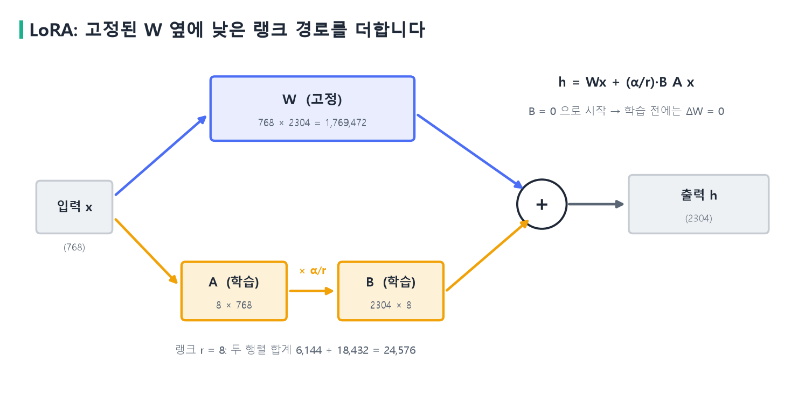{width=100% fig-alt="LoRA 구조"}
:::
::: {.figcap}
**그림 10-8** LoRA의 구조. 입력 $x$는 고정된 $W$와 낮은 랭크 경로 $A\to B$로 나뉘어 계산되고, 두 결과를 더해 출력이 됩니다. 숫자는 GPT-2 어텐션의 `c_attn`(입력 768, 출력 2304)에 $r=8$을 적용한 값입니다.
:::

아주 작은 숫자로 먼저 확인해 보겠습니다. $d=k=3$, $r=1$, $\alpha/r=1$이고 $A=(1,\,0,\,-1)$, $B=(2,\,1,\,0)^\top$이면 변화량은

$$
\Delta W=BA=\begin{pmatrix}2&0&-2\\1&0&-1\\0&0&0\end{pmatrix}
$$

입니다. 입력 $x=(1,2,3)^\top$에 대해 $Ax=1\cdot1+0\cdot2+(-1)\cdot3=-2$이므로 $B(Ax)=(-4,-2,0)^\top$이고, $\Delta Wx$를 직접 곱해도 같은 값이 나옵니다. 전체 변화량은 $3\times3=9$개이지만 LoRA는 $3+3=6$개이고, $\Delta W$의 모든 행이 $(1,0,-1)$의 배수여서 랭크가 1입니다. 실제 구현은 $BA$를 먼저 곱해 큰 행렬을 만드는 대신 $A$를 $x$에 먼저 곱하는 순서로 계산합니다.

파라미터 수를 직접 계산해 보겠습니다. GPT-2 어텐션에서 쿼리·키·값을 한 번에 만드는 `c_attn`은 입력 768차원, 출력 2304차원($=3\times768$)이어서 $W$의 원소가 $768\times2304=1{,}769{,}472$개입니다. $r=8$이면 $A$는 $8\times768=6{,}144$개, $B$는 $2304\times8=18{,}432$개로 합쳐 24,576개이고, 이는 전체의 약 1.4%입니다. 12개 층 모두에 적용하면 $24{,}576\times12=294{,}912$개로, GPT-2 전체 파라미터 124,734,720개의 0.24%입니다(그림 10-9). 모델이 커질수록 비율은 더 작아집니다. 예를 들어 $d=k=4096$이고 $r=8$이면 $W$는 16,777,216개, LoRA는 $8\times(4096+4096)=65{,}536$개로 약 0.39%입니다.

::: {.figbody}
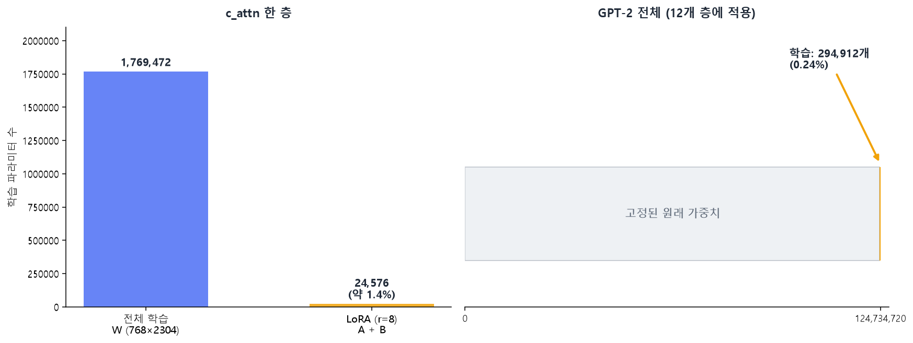{width=100% fig-alt="LoRA의 학습 파라미터 수"}
:::
::: {.figcap}
**그림 10-9** LoRA의 학습 파라미터 수. 왼쪽은 `c_attn` 한 층에서 전체 학습(1,769,472개)과 LoRA(24,576개)를 비교한 것이고, 오른쪽은 12개 층에 적용했을 때 GPT-2 전체에서 학습하는 파라미터(294,912개, 0.24%)의 비율입니다.
:::

랭크 $r$을 키우면 표현할 수 있는 변화가 늘어나지만 파라미터도 $r$에 비례해 늘어납니다. 논문은 $r$이 매우 작아도 충분한 경우가 많다고 보고했고, 실무에서는 4~64 사이의 값을 많이 씁니다. 적용할 층도 선택 사항입니다. 원 논문은 어텐션의 $W_Q$와 $W_V$에 적용했고, 요즘은 피드포워드의 선형층까지 넓히는 경우도 많습니다.

학습이 끝나면 $W'=W+\frac{\alpha}{r}BA$로 합쳐 하나의 행렬로 만들 수 있습니다. 합친 모델은 원래 모델과 구조가 같아서 **추론 때 추가 계산이 전혀 없습니다.** Adapter와 구별되는 LoRA의 장점입니다. 과제마다 $A$, $B$만 따로 저장해 두었다가 필요할 때 바꿔 끼울 수도 있습니다.

**코드 10-4** LoRA를 파이토치로 직접 구현하고 동작을 확인합니다.

```python
import torch, torch.nn as nn

class LoRALinear(nn.Module):
    def __init__(self, base: nn.Linear, r=8, alpha=32):
        super().__init__()
        self.base = base
        for p in self.base.parameters():
            p.requires_grad = False                 # 원래 가중치는 고정
        self.A = nn.Parameter(torch.randn(r, base.in_features) * 0.01)
        self.B = nn.Parameter(torch.zeros(base.out_features, r))   # B = 0
        self.scale = alpha / r

    def forward(self, x):
        return self.base(x) + (x @ self.A.T @ self.B.T) * self.scale

base = nn.Linear(768, 2304)
lora = LoRALinear(base)
x = torch.randn(4, 768)

print(torch.allclose(base(x), lora(x)))                 # True: B=0이면 원래와 같다
print(sum(p.numel() for p in lora.parameters() if p.requires_grad))   # 24576

lora.B.data.normal_(0, 0.02)                            # 학습이 일어났다고 가정
W = base.weight + lora.scale * (lora.B @ lora.A)        # W' = W + (α/r) B A
print(torch.allclose(lora(x), x @ W.T + base.bias, atol=1e-4))        # True: 합쳐도 같다
```

`self.base`의 파라미터에는 `requires_grad=False`를 주어 기울기가 계산되지 않게 했고, 학습되는 것은 `A`와 `B`뿐입니다. 파라미터 수는 앞에서 손으로 계산한 24,576개와 일치합니다. 첫 번째 출력이 `True`인 것은 $B=0$이라 $\Delta W=0$임을, 마지막 출력이 `True`인 것은 합친 행렬 $W'$로 계산한 결과가 LoRA 경로를 따로 계산한 결과와 같음을 보여 줍니다.

### 라이브러리로 파인튜닝하기

실무에서는 이 구조를 직접 짜지 않고 `peft` 라이브러리를 씁니다. 모델에서 LoRA를 붙일 층의 이름만 알려 주면 해당 층을 찾아 바꿔 줍니다.

**코드 10-5** `peft`로 GPT-2에 LoRA를 적용합니다.

```python
from peft import LoraConfig, get_peft_model

tokenizer.pad_token = tokenizer.eos_token        # GPT-2에는 패딩 토큰이 없다

config = LoraConfig(
    r=8,
    lora_alpha=32,
    target_modules=["c_attn"],      # 어텐션의 Q, K, V를 한 번에 만드는 층
    lora_dropout=0.05,
    bias="none",
    fan_in_fan_out=True,            # GPT-2의 Conv1D 층이므로 필요
)
lora_model = get_peft_model(model, config)
lora_model.print_trainable_parameters()
# trainable params: 294,912 || all params: 124,734,720 || trainable%: 0.2364

layer = lora_model.base_model.model.transformer.h[0].attn.c_attn
print(layer.lora_A["default"].weight.shape)         # torch.Size([8, 768])
print(layer.lora_B["default"].weight.shape)         # torch.Size([2304, 8])
print(layer.lora_B["default"].weight.abs().sum())   # tensor(0.) : B의 초기값은 0
```

출력된 학습 파라미터 수 294,912개와 비율 0.2364%는 앞에서 계산한 값과 같습니다. `target_modules`는 모델마다 층 이름이 다르므로 모델 구조를 확인해서 지정해야 합니다. $A$는 $8\times768$, $B$는 $2304\times8$이며 $B$의 합이 0이어서 학습 전에는 원래 모델과 같습니다.

학습은 일반적인 언어 모델 학습과 같습니다. 이 실습에서는 LoRA 주제의 짧은 문장 12개로 모델이 그 문체와 내용을 따르게 합니다. 데이터가 아주 작아서 실제 성능 개선을 노리는 실험이 아니라, 학습으로 출력이 달라지는 과정을 확인하는 시연입니다.

**코드 10-6** 12개 문장으로 LoRA 파라미터를 학습하고 출력을 비교합니다.

```python
texts = [
    "Large language models are pretrained on huge amounts of text.",
    "Large language models need careful fine-tuning for each task.",
    "Large language models can be adapted with a small number of trainable parameters.",
    "LoRA freezes the pretrained weights and trains two small low-rank matrices.",
    "LoRA enables efficient fine-tuning with low-rank matrices.",
    "LoRA reduces the memory needed to fine-tune a large language model.",
    "Fine-tuning changes the behavior of a language model with new examples.",
    "Parameter-efficient fine-tuning updates only a small part of the model.",
    "A LoRA adapter is small and can be swapped for each task.",
    "The base model stays frozen while the adapter learns the new task.",
    "Low-rank updates approximate the change in the weight matrix.",
    "Retrieval can add new knowledge, while fine-tuning adapts the model behavior.",
]
enc = tokenizer(texts, padding=True, truncation=True, max_length=32, return_tensors="pt")
ids_t = enc["input_ids"].to(device)
mask = enc["attention_mask"].to(device)
labels = ids_t.clone()
labels[mask == 0] = -100                         # 패딩은 손실에서 제외

def generate(m, prompt):
    m.eval()
    x = tokenizer.encode(prompt, return_tensors="pt").to(device)
    with torch.no_grad():
        o = m.generate(x, max_new_tokens=30, do_sample=False,
                       pad_token_id=tokenizer.eos_token_id)
    return tokenizer.decode(o[0], skip_special_tokens=True)

trainable = [p for p in lora_model.parameters() if p.requires_grad]
optimizer = torch.optim.AdamW(trainable, lr=5e-4)

print("학습 전:", generate(lora_model, "Large language models"))

lora_model.train()
for epoch in range(1, 81):
    optimizer.zero_grad()
    loss = lora_model(input_ids=ids_t, attention_mask=mask, labels=labels).loss
    loss.backward()
    optimizer.step()
    if epoch == 1 or epoch % 20 == 0:
        print(f"epoch {epoch:2d}  loss = {loss.item():.4f}")

print(generate(lora_model, "Large language models"))
```

두 가지를 짚겠습니다. 첫째, 옵티마이저에는 `requires_grad=True`인 파라미터만 넘겼습니다. LoRA 행렬 외에는 갱신하지 않는다는 뜻입니다. 둘째, `labels`는 입력과 같은 텐서이고 모델 안에서 한 칸씩 밀려 "다음 토큰 예측"의 정답이 됩니다. 패딩 위치의 라벨을 `-100`으로 바꾸면 교차 엔트로피가 그 자리를 무시합니다.

손실은 에폭 1에서 5.2 안팎이던 것이 80에폭에서 0.5 이하까지 내려갑니다(그림 10-10은 한 번의 실행 기록입니다). 같은 프롬프트로 학습 전에 얻은 문장은 `Large language models are not available for the following languages:` 같은 학습 주제와 무관한 내용이었는데, 학습 뒤에는 `Large language models need careful fine-tuning for each task.`처럼 학습 문장을 닮은 문장이 나옵니다. 12문장을 80번 반복했으므로 문장을 거의 외운 상태이고, 같은 구절이 반복되기도 합니다. 시드를 고정하지 않으면 초기화와 드롭아웃 때문에 실행할 때마다 손실 값과 생성된 문장이 조금씩 달라집니다. 코드 10-6을 직접 실행해 보면 그림의 값과 소수점 아래가 다르게 나옵니다.

::: {.figbody}
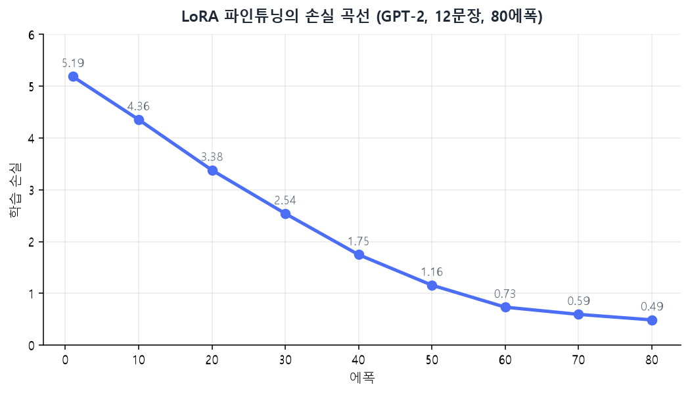{width=70% fig-alt="LoRA 학습 손실 곡선"}
:::
::: {.figcap}
**그림 10-10** LoRA 파인튜닝의 손실 곡선. GPT-2에 12개 문장을 80에폭 학습한 실제 실행 결과입니다. 294,912개의 파라미터만 학습했는데도 손실이 5점대에서 0.5 안팎으로 내려갑니다.
:::

**코드 10-7** 어댑터만 저장해 크기를 비교하고, 원래 가중치에 합칩니다.

```python
import os, tempfile

with tempfile.TemporaryDirectory() as d:
    lora_model.save_pretrained(d)                         # LoRA 행렬만 저장
    adapter_mb = sum(os.path.getsize(os.path.join(d, f)) for f in os.listdir(d)) / 1e6
full_mb = sum(p.numel() * p.element_size() for p in model.parameters()) / 1e6
print(f"어댑터 {adapter_mb:.1f} MB / 전체 모델 {full_mb:.1f} MB")   # 1.2 MB / 498.9 MB

lora_model.eval()
x = tokenizer.encode("Large language models", return_tensors="pt").to(device)
with torch.no_grad():
    before = lora_model(x).logits
merged = lora_model.merge_and_unload()                    # W <- W + (α/r) B A
with torch.no_grad():
    after = merged(x).logits
print(torch.allclose(before, after, atol=1e-3))           # True
```

어댑터의 크기는 1.2MB로 전체 모델 498.9MB의 0.3% 남짓입니다. 과제마다 어댑터를 따로 두고 바꿔 끼우는 일이 부담스럽지 않은 이유입니다. 그리고 `merge_and_unload()`로 합치기 전과 후의 출력이 같으므로, 학습이 끝난 모델은 추가 계산 없이 배포할 수 있습니다.

### QLoRA와 데이터의 중요성

**QLoRA**(Dettmers 등, 2023)는 LoRA를 더 가볍게 만든 방법입니다. 기반 모델의 가중치를 4비트로 양자화해 고정하고, 그 위에 LoRA 행렬만 높은 정밀도로 학습합니다. 가중치가 차지하는 메모리가 크게 줄어서 한 장의 GPU로 훨씬 큰 모델을 파인튜닝할 수 있습니다.

PEFT가 학습 비용을 낮춰 주지만, 결과의 품질은 여전히 데이터가 좌우합니다. 파인튜닝은 적은 데이터로도 되지만, 그만큼 데이터 한 건 한 건의 품질이 결과에 크게 반영됩니다. 형식이 제각각인 데이터, 잘못된 정답, 중복이 섞이면 모델은 그것을 그대로 따라 합니다. 데이터를 **정제**해 노이즈와 중복을 줄이고, 여러 출처의 데이터를 일관된 형식과 기준으로 **정렬**하고, 과제의 분포에 맞게 **구성**하는 일이 모델 구조를 바꾸는 것만큼 중요합니다. 모델이 이미 충분히 강력하므로 이제는 데이터가 성능을 제한한다는 관점을 데이터 중심 AI라고 부릅니다. 이 장의 실습에서 12개 문장을 같은 주제와 형식으로 맞춘 것도 이 때문입니다.

## RAG: 검색으로 보강한 생성 {#sec-rag}

### 정의와 필요성

**RAG(Retrieval-Augmented Generation, 검색 증강 생성)**는 질문에 답하기 전에 외부 문서에서 관련 내용을 **검색**해 모델의 입력에 포함하고, 모델이 그 내용을 근거로 답하게 하는 방식입니다. Lewis 등(2020)이 파라미터에 저장된 지식과 외부 문서에서 가져오는 지식을 결합하는 구조로 제안했습니다. 원 논문은 검색기(DPR)와 생성기(BART)를 함께 학습했지만, 요즘 LLM 응용에서 RAG라고 하면 사전학습한 모델을 학습 없이 그대로 쓰고 프롬프트로 연결하는 구성을 가리키는 경우가 대부분입니다. 이 장도 후자를 다룹니다.

RAG가 필요한 이유는 LLM의 한계에서 나옵니다. 학습 이후의 정보와 내부 문서는 모델이 모르고, 모르는 것을 지어내기도 하며, 지식을 갱신하려면 재학습해야 합니다. RAG는 모델을 건드리지 않고 **문서만 교체**해서 이 문제를 풉니다. 시험을 볼 때 참고 자료를 같이 주는 것에 비유할 수 있습니다. 모델이 공부를 다시 하는 것이 아니라, 답에 필요한 자료를 눈앞에 펼쳐 주는 것입니다.

### 전체 흐름

RAG는 문서를 미리 검색 가능한 형태로 만들어 두는 **색인** 단계와, 질문이 들어올 때마다 수행하는 **질의** 단계로 나뉩니다(그림 10-11). 색인에서는 문서를 모아 의미 단위로 자르고(청킹), 각 조각을 임베딩 모델로 벡터화해 벡터 저장소에 저장합니다. 질의에서는 질문을 같은 임베딩 모델로 벡터화하고, 저장된 벡터와 비교해 가까운 조각을 찾습니다. 찾은 조각을 지시와 질문을 담은 프롬프트에 넣고, LLM이 그것을 근거로 답을 만듭니다.

::: {.figbody}
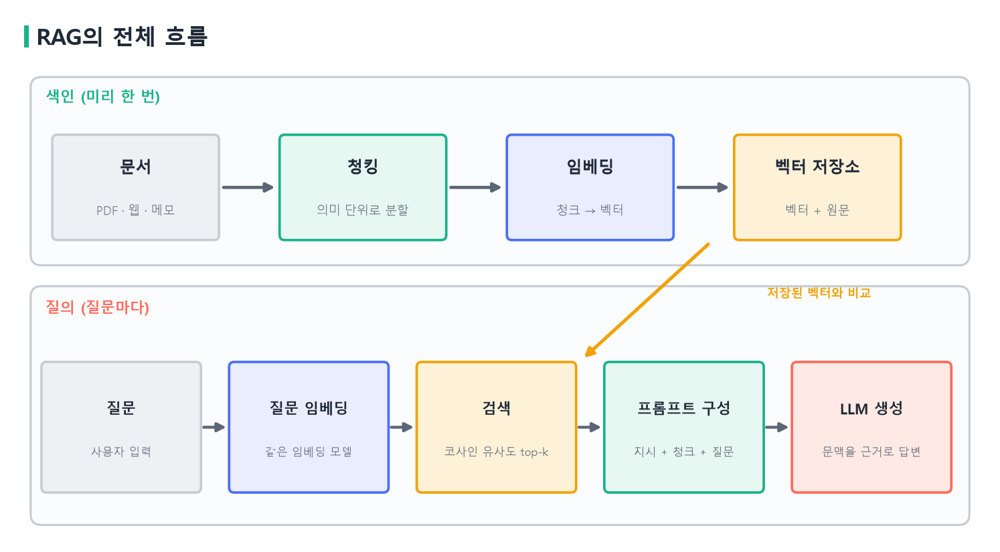{width=100% fig-alt="RAG의 전체 흐름"}
:::
::: {.figcap}
**그림 10-11** RAG의 전체 흐름. 위쪽은 문서를 미리 한 번 처리하는 색인 단계이고, 아래쪽은 질문마다 수행하는 질의 단계입니다. 검색 단계에서 질문 벡터를 저장된 벡터와 비교합니다.
:::

### 색인: 청킹과 임베딩

**청킹(chunking)**은 긴 문서를 검색의 단위인 조각으로 나누는 일입니다. 조각이 너무 길면 한 조각 안에 여러 주제가 섞여 질문과의 유사도가 흐려지고, 프롬프트에 넣을 수 있는 조각의 수도 줄어듭니다. 너무 짧으면 문맥이 끊겨 조각만 봐서는 무슨 내용인지 알 수 없습니다. 인접한 조각이 일부 겹치게 자르면 경계에서 문장이 잘려 나가는 손실을 줄일 수 있습니다. 정해진 정답은 없고, 문서의 종류에 따라 문단이나 항목 단위로 자르거나 일정한 길이로 자른 뒤 검색 결과를 보며 조정합니다. 예를 들어 "A. 휴가: 연차는 입사 1년 후 15일이 부여됩니다. B. 재택근무: 주 2회까지 가능합니다. C. 경비: 영수증을 7일 이내 제출합니다."라는 문서(설명을 위한 가상의 내용)는 A, B, C 항목 단위로 자르면 한 조각이 하나의 주제를 담아 질문과 비교하기 쉽습니다.

각 조각은 임베딩 모델로 벡터가 됩니다. 앞 장에서 배운 문장 임베딩이 여기서 쓰입니다. 중요한 조건은 **질문과 문서에 같은 임베딩 모델을 쓰는 것**입니다. 서로 다른 모델이 만든 벡터는 공간이 달라서 비교할 수 없습니다. 벡터와 원문, 출처 같은 메타데이터를 함께 벡터 저장소(FAISS, Chroma 등)에 저장하면, 검색된 벡터에서 원문과 출처를 바로 꺼낼 수 있어 답변의 근거를 제시하기 쉽습니다.

### 검색: 코사인 유사도로 가까운 조각을 찾습니다

질의가 들어오면 질문 벡터 $\mathbf q$와 각 조각 벡터 $\mathbf d$의 코사인 유사도를 계산합니다.

$$
\cos(\mathbf q,\mathbf d)=\frac{\mathbf q\cdot\mathbf d}{\|\mathbf q\|\,\|\mathbf d\|}.
$$

유사도가 높은 상위 $k$개 조각을 가져오는데, 이 $k$가 `similarity_top_k`입니다. 문서가 수백만 개로 늘어나면 모든 조각과 일일이 비교할 수 없으므로 근사 최근접 이웃(ANN) 검색을 써서 속도를 확보합니다. 의미 기반 검색은 질문과 문서에 같은 단어가 없어도 뜻이 가까우면 찾아 줍니다. 반대로 고유명사나 코드, 숫자처럼 정확한 문자열이 중요한 경우는 키워드 검색(BM25)이 더 낫기도 해서, 둘을 섞는 **하이브리드 검색**을 쓰기도 합니다. 가져온 후보를 더 정교한 모델로 다시 정렬하는 **재순위화(reranking)**도 정확도를 높이는 흔한 방법입니다.

### 증강과 생성

검색된 조각은 프롬프트에 들어가 모델의 문맥이 됩니다. 이 단계에서 정할 것이 지시 문구, 조각의 순서와 개수, 질문의 위치입니다. 다음은 이 장의 실습에서 쓴 프롬프트의 구조입니다.

```text
[system] 아래 [문맥]은 사용자에 대한 메모다. 이 메모를 근거로 사용자의 질문에
         한국어로 짧게 답하라. 메모에 관련 내용이 전혀 없을 때만 '알 수 없습니다'라고 답하라.
[user]   [문맥]  (검색된 조각 2개)
         [질문]  나는 몇 시에 운동해?
```

"문맥에 답이 없으면 모른다고 답하라"는 지시는 환각을 줄이는 데 도움이 됩니다. 다만 지시를 지나치게 엄격하게 쓰면 소형 모델이 문맥에 답이 있는데도 모른다고 답하는 일이 생깁니다. 이 실습에서도 처음에는 "문맥만 근거로 한 문장으로 답하고 없으면 모른다고 하라"고 썼더니 운동 시간을 묻는 질문에 "알 수 없습니다"라고 답했고, 지시를 위처럼 완화하자 정상적으로 답했습니다. 프롬프트 설계가 결과에 영향을 주므로 모델에 맞춰 시험해 보아야 합니다.

### 실습: 개인 메모로 질의응답하기

네 개의 짧은 문서로 RAG를 구현해 보겠습니다. 사용자가 오목을 좋아한다, 차를 선호한다, 매일 6시에 헬스장에 간다, AI 대학원 프로젝트를 진행하고 있다는 내용입니다. 이 코드는 LlamaIndex의 `VectorStoreIndex`를 씁니다.

**코드 10-8** 문서를 임베딩해 인덱스를 만들고 질문과 가까운 문서를 검색합니다.

```python
from llama_index.core import VectorStoreIndex, Document
from llama_index.embeddings.huggingface import HuggingFaceEmbedding

personal_docs = [
    "사용자는 게임 오목을 좋아하며 주로 5x5 미니게임을 즐긴다.",
    "사용자는 커피보다 차(茶)를 선호한다.",
    "사용자는 매일 6시에 헬스장을 간다.",
    "사용자는 최근 AI 관련 대학원 프로젝트를 진행하고 있다.",
]

embed_model = HuggingFaceEmbedding(
    model_name="sentence-transformers/paraphrase-multilingual-MiniLM-L12-v2")
docs = [Document(text=d) for d in personal_docs]
index = VectorStoreIndex.from_documents(docs, embed_model=embed_model)
retriever = index.as_retriever(similarity_top_k=2)     # 문서 4개 중 2개만 가져온다

for n in retriever.retrieve("나는 몇 시에 운동해?"):
    print(f"{n.score:.3f}  {n.node.get_content()}")
# 0.306  사용자는 매일 6시에 헬스장을 간다.
# 0.106  사용자는 게임 오목을 좋아하며 주로 5x5 미니게임을 즐긴다.
```

질문에는 "운동"이라는 단어가 있고 문서에는 "헬스장"이 있습니다. 같은 단어가 없는데도 헬스장 문서의 유사도가 0.306으로 가장 높습니다. 키워드 검색이라면 찾지 못했을 문서를 의미 기반 검색이 찾아 준 것입니다. `similarity_top_k`를 문서 수(4)보다 작은 2로 둔 것도 의도적입니다. 문서가 4개인데 3개를 가져오면 거의 전부를 가져오는 셈이어서 검색이 잘 되는지 알 수 없습니다.

### 임베딩 모델이 검색을 좌우합니다

이 실습의 바탕이 된 출판 교재의 예제 코드는 영어 중심의 임베딩 모델 `all-MiniLM-L6-v2`를 씁니다. 같은 문서와 같은 질문 네 개로 두 모델을 비교하면 결과가 크게 다릅니다.

**코드 10-9** 두 임베딩 모델의 검색 결과를 비교합니다.

```python
from sentence_transformers import SentenceTransformer, util

queries = ["나는 어떤 음료를 좋아해?", "나는 몇 시에 운동해?",
           "요즘 무슨 프로젝트를 하고 있어?", "내 취미 게임이 뭐야?"]
gold = [1, 2, 3, 0]                      # 각 질문에 맞는 문서의 번호

for name in ["sentence-transformers/all-MiniLM-L6-v2",
             "sentence-transformers/paraphrase-multilingual-MiniLM-L12-v2"]:
    m = SentenceTransformer(name)
    D = m.encode(personal_docs, convert_to_tensor=True)
    hit = sum(int(util.cos_sim(m.encode(q, convert_to_tensor=True), D)[0].argmax()) == g
              for q, g in zip(queries, gold))
    print(f"{hit} / 4   {name}")
# 1 / 4   sentence-transformers/all-MiniLM-L6-v2
# 4 / 4   sentence-transformers/paraphrase-multilingual-MiniLM-L12-v2
```

영어 중심 모델은 4개 질문 중 1개만 정답 문서를 1순위로 찾았습니다. 거의 모든 질문에서 "커피보다 차를 선호한다" 문서가 1위였습니다. 질문 "나는 몇 시에 운동해?"로 보면 영어 모델은 차 문서에 0.70을 주어 정답인 헬스장 문서(0.53)보다 높게 평가했고, 다국어 모델은 헬스장 문서에 0.31, 나머지에 0.03~0.11을 주었습니다(그림 10-12). 한국어를 충분히 학습하지 않은 모델은 한국어 문장의 의미를 구분하지 못하는 것입니다. 앞 장에서 임베딩이 학습으로 의미를 담는다고 했는데, 학습하지 않은 언어에서는 그 의미가 만들어지지 않습니다. 문서가 4개이고 질문이 4개인 작은 실험이어서 정확도 수치 자체를 일반화할 수는 없지만, **RAG의 성능이 임베딩 모델에 크게 의존한다**는 점은 분명하게 드러납니다.

::: {.figbody}
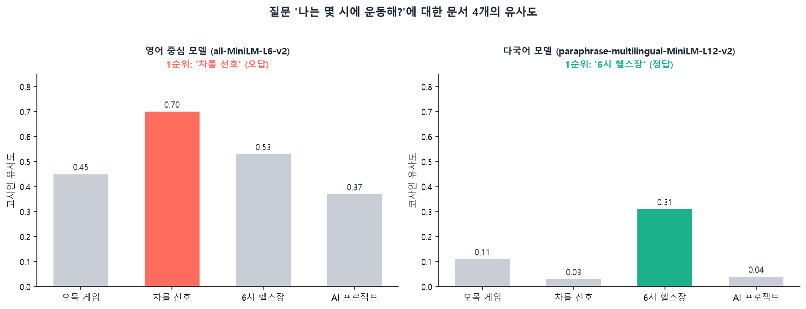{width=100% fig-alt="임베딩 모델에 따른 검색 점수"}
:::
::: {.figcap}
**그림 10-12** 임베딩 모델에 따른 검색 점수. 질문 `나는 몇 시에 운동해?`와 문서 4개의 코사인 유사도입니다. 영어 중심 모델은 "차를 선호" 문서를 1순위로 골라 틀렸고, 다국어 모델은 "6시 헬스장" 문서를 1순위로 골랐습니다.
:::

검색이 틀리면 생성도 틀립니다. 모델에 엉뚱한 문서가 문맥으로 들어가면, 모델은 근거가 없어 모른다고 답하거나 문맥과 무관한 내용을 섞어 답합니다. 실제로 원본 예제의 설정(영어 모델, 상위 3개)에서는 "요즘 무슨 프로젝트를 하고 있어?"에 프로젝트 문서가 상위 3개에도 들지 못해 "알 수 없다"는 답이 나왔습니다.

**코드 10-10** 검색한 문서를 문맥으로 붙여 LLM이 답하게 합니다.

```python
from transformers import AutoModelForCausalLM, AutoTokenizer

llm_name = "Qwen/Qwen2.5-1.5B-Instruct"            # 소형 LLM
tok = AutoTokenizer.from_pretrained(llm_name)
llm = AutoModelForCausalLM.from_pretrained(llm_name).to(device).eval()

SYSTEM = ("아래 [문맥]은 사용자에 대한 메모다. 이 메모를 근거로 사용자의 질문에 한국어로 "
          "짧게 답하라. 메모에 관련 내용이 전혀 없을 때만 '알 수 없습니다'라고 답하라.")

def generate_llm_answer(query, context):
    messages = [{"role": "system", "content": SYSTEM},
                {"role": "user", "content": f"[문맥]\n{context}\n\n[질문] {query}"}]
    prompt = tok.apply_chat_template(messages, tokenize=False, add_generation_prompt=True)
    t = tok(prompt, return_tensors="pt").to(device)
    with torch.no_grad():
        out = llm.generate(**t, max_new_tokens=64, do_sample=False)
    return tok.decode(out[0][t["input_ids"].shape[1]:], skip_special_tokens=True).strip()

def answer_with_rag(query):
    nodes = retriever.retrieve(query)                          # 1. 검색
    context = "\n".join(n.node.get_content() for n in nodes)   # 2. 문맥 구성
    return generate_llm_answer(query, context)                 # 3. 생성

print(answer_with_rag("나는 몇 시에 운동해?"))     # 당신은 매일 6시에 헬스장에 갑니다.
print(generate_llm_answer("나는 몇 시에 운동해?", "(없음)"))   # 알 수 없습니다 ...
```

`answer_with_rag`가 RAG의 세 단계를 한 함수로 묶습니다. 검색, 문맥 구성, 생성입니다. 마지막 두 줄이 RAG의 효과를 보여 줍니다. 검색한 문맥을 주면 "당신은 매일 6시에 헬스장에 갑니다."라고 답하고, 문맥 없이 같은 질문을 하면 사용자의 정보를 알 수 없으므로 모른다고 답합니다. 네 개 질문(음료, 운동 시간, 프로젝트, 취미 게임)은 모두 문서의 내용대로 답했고, 문서에 없는 "내 고향이 어디야?"에는 "알 수 없습니다"라고 시작했습니다. 다만 소형 모델이라 모른다고 한 뒤에도 문맥의 내용을 길게 덧붙이는 경우가 있었습니다. 모델이 작을수록 지시를 정확히 지키는 능력이 떨어진다는 점을 감안해야 합니다.

### 설계 요소와 한계

RAG는 하나의 모델이 아니라 여러 모듈을 이은 시스템이어서, 각 모듈의 품질이 전체를 좌우합니다. 청킹 기준, 임베딩 모델, 검색 방식(밀집·키워드·하이브리드), 후보의 재순위화, 몇 개를 가져올지($k$), 프롬프트 구성, 생성 모델의 문맥 처리 능력이 모두 설계 요소입니다. 성능을 평가할 때도 단계를 나누어 봅니다. 검색은 정답 문서가 상위 $k$개 안에 들어오는 비율로, 생성은 답변이 검색된 근거에 충실한지와 질문에 맞는지로 평가합니다. 어느 단계에서 틀렸는지 나누어야 고칠 곳을 알 수 있기 때문입니다.

RAG의 한계도 분명합니다. 첫째, 검색이 틀리면 답도 틀립니다. 관련 없는 문서를 근거로 삼으면 오히려 방해가 됩니다. 둘째, 검색에는 본질적인 불확실성이 있어서 환각의 위험이 완전히 사라지지 않습니다. 셋째, 프롬프트에 넣을 수 있는 길이(컨텍스트 윈도우)에 한도가 있어 긴 문서를 다루기 어렵고, 청킹이 부적절하면 의미가 왜곡된 조각으로 생성하게 됩니다. 넷째, 검색 단계가 추가되어 응답이 느려집니다. 마지막으로 RAG는 모델이 아는 정보를 바꿀 뿐, 모델의 말투나 출력 형식, 추론 능력 자체는 바꾸지 못합니다.

## 파인튜닝과 RAG: 무엇을 쓸 것인가 {#sec-choice}

두 방법은 서로를 대체하지 않고, 바꾸는 대상이 다릅니다. 파인튜닝은 모델의 **가중치**를 바꿔 행동을 조정하고, RAG는 모델이 참조하는 **정보**를 바꿉니다. 그래서 선택은 "모델이 무엇을 바꿔야 하는가"에서 출발합니다(그림 10-13).

::: {.figbody}
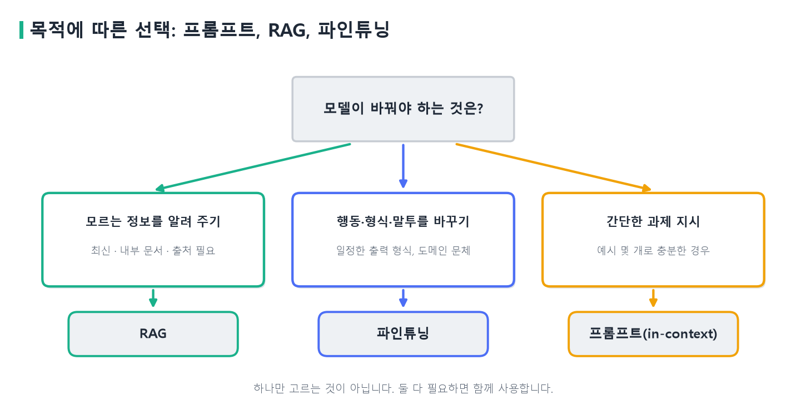{width=100% fig-alt="프롬프트, RAG, 파인튜닝의 선택"}
:::
::: {.figcap}
**그림 10-13** 목적에 따른 선택. 모르는 정보를 알려 주어야 하면 RAG, 행동·형식·말투를 바꾸어야 하면 파인튜닝, 단순한 과제는 프롬프트(in-context)로 충분합니다. 둘 이상이 필요하면 함께 씁니다.
:::

| | 프롬프트 | 파인튜닝 | RAG |
|:--|:--|:--|:--|
| 바뀌는 것 | 입력 문구 | 모델 가중치 | 입력에 넣는 정보 |
| 지식 갱신 | 어려움 | 재학습 필요 | 문서만 교체 |
| 출처 제시 | 해당 없음 | 어려움 | 가능 |
| 필요한 자원 | 거의 없음 | 학습 데이터, GPU | 문서, 임베딩 모델, 벡터 저장소 |
| 잘 맞는 경우 | 단순한 과제 | 일정한 출력 형식, 도메인 문체 | 최신·내부 지식에 대한 질의응답 |

예를 들어 규정이 자주 바뀌는 회사의 내부 질의응답 챗봇을 만든다고 해 보겠습니다. 규정이 바뀔 때마다 모델을 재학습하는 것은 비효율적이고, 답변에 어느 조항을 근거로 했는지 밝혀야 신뢰할 수 있으므로 RAG가 알맞습니다. 반면 고객 상담 답변을 항상 정해진 형식과 말투로 쓰게 하고 싶다면 지식이 아니라 행동의 문제이므로 파인튜닝이 알맞습니다. 두 요구가 함께 있으면 파인튜닝한 모델에 RAG를 붙여 씁니다. 새로운 사실을 모델에 가르치는 용도로 파인튜닝을 쓰는 것은 권하지 않습니다. 학습한 내용을 정확히 꺼내 쓴다는 보장이 없고 출처도 댈 수 없기 때문입니다.

::: {.keybox}
- LLM은 디코더만 쌓은 트랜스포머를 [다음 토큰 예측]{.key}으로 사전학습한 모델이고, 한 번에 토큰 하나씩 [자기회귀]{.key}로 생성합니다.
- 디코딩은 [그리디(고정)]{.key}와 [샘플링(temperature, top-p)]{.key}으로 나뉘며 다양성과 안정성을 조절합니다.
- 전체 파인튜닝은 가중치·기울기·옵티마이저 상태 때문에 메모리가 파라미터당 약 16바이트 듭니다. [PEFT]{.key}는 가중치를 고정하고 소수의 파라미터만 학습합니다.
- [LoRA]{.key}는 $\Delta W=\frac{\alpha}{r}BA$를 학습하며, $B=0$으로 시작하고 학습 후 $W$에 합치면 추론 비용이 늘지 않습니다.
- [RAG]{.key}는 색인(청킹·임베딩)과 질의(검색·증강·생성)로 이루어지며, 성능은 [임베딩 모델·청킹·프롬프트]{.key}에 좌우됩니다.
- 새 정보는 RAG, 행동과 형식은 파인튜닝으로 해결하고, 필요하면 함께 씁니다.
:::
