# 1. 이론 {#sec-ch11}

## 멀티모달 모델이란 {#sec-multimodal}

앞의 장들에서 다룬 모델은 대부분 한 종류의 데이터만 다루었습니다. 이미지 분류기는 픽셀만, 언어 모델은 토큰만 보았습니다. 이 한 종류의 데이터를 **모달리티(modality)**라고 부릅니다. 사람은 다르게 세계를 인식합니다. 눈으로 보고(시각), 귀로 듣고(청각), 본 것을 말로 설명합니다(언어). 한 감각만으로는 놓치는 정보가 다른 감각으로 채워지기 때문에, 여러 감각을 함께 쓸 때 이해가 깊어집니다. **멀티모달(multimodal) 모델**은 서로 다른 유형의 데이터를 하나의 모델 안에서 통합해 다루려는 연구 흐름입니다. 텍스트로 이미지를 만들고, 이미지를 보고 질문에 답하고, 이미지에 알맞은 글을 붙이는 일이 모두 여기에 속합니다.

서로 다른 모달리티를 한 모델이 다루려면 먼저 풀어야 할 문제가 있습니다. 이미지는 픽셀의 공간 격자이고 텍스트는 토큰의 순서열이어서 데이터의 모양도 성질도 다릅니다. 이미지는 공간적이고 시각적인 정보를 주고, 텍스트는 개념적이고 추상적인 정보를 줍니다. 이 이질적인 데이터를 비교하고 연결하려면 같은 척도 위에 올려야 합니다. 그래서 멀티모달 표현 학습의 핵심은 각 모달리티를 벡터로 바꾸고, 그 벡터들이 **하나의 공통된 의미 공간**에서 정렬되도록 학습하는 일입니다(그림 11-1).

::: {.figbody}
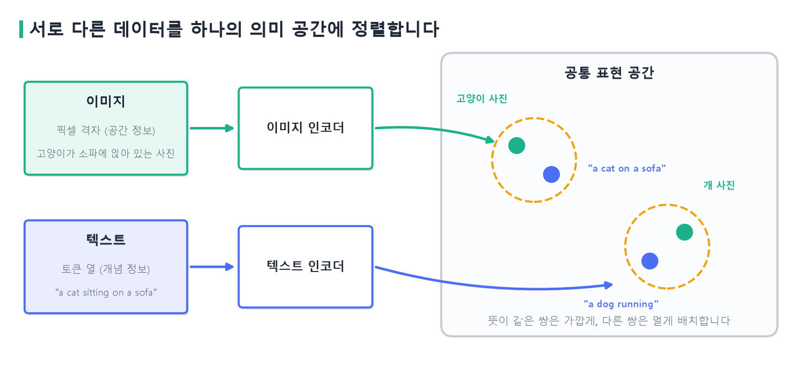{width=100% fig-alt="서로 다른 모달리티를 하나의 표현 공간에 정렬하는 그림"}
:::
::: {.figcap}
**그림 11-1** 서로 다른 데이터를 하나의 의미 공간에 정렬합니다. 이미지와 텍스트는 각자의 인코더를 거쳐 같은 공간의 점이 됩니다. 뜻이 맞는 쌍(고양이 사진과 `a cat on a sofa`)은 가깝게, 맞지 않는 쌍은 멀게 놓이는 것이 목표입니다.
:::

이 조건을 말로 풀면 다음과 같습니다. 이미지 인코더가 만든 벡터와 텍스트 인코더가 만든 벡터의 유사도를 **코사인 유사도**(두 벡터가 가리키는 방향이 같을수록 1에 가까워지는 값)로 잰다고 하겠습니다. 이상적인 정렬이란 **짝이 맞는 이미지와 텍스트의 유사도가, 짝이 맞지 않는 조합의 유사도보다 항상 큰 상태**입니다.

이 조건이 만족되면 텍스트로 이미지를 찾거나, 이미지에 가장 알맞은 설명을 고르는 일을 벡터 사이의 거리 비교로 바꿀 수 있습니다. 코사인 유사도는 9·10주차의 문장 임베딩에서 이미 쓴 도구입니다. 달라진 점은 비교하는 두 벡터가 서로 다른 모달리티에서 왔다는 것뿐입니다.

## CLIP: 대조 학습으로 이미지와 텍스트를 정렬합니다 {#sec-clip}

멀티모달 모델이 크게 발전한 계기는 대규모 사전학습과 트랜스포머 구조의 도입입니다. 그 대표가 OpenAI의 **CLIP**(Radford 등, 2021)입니다. CLIP은 이미지 인코더와 텍스트 인코더를 따로 두고, 인터넷에서 모은 약 4억 개의 (이미지, 설명 글) 쌍으로 두 인코더를 함께 학습합니다. 이미지 인코더는 ResNet이나 비전 트랜스포머이고, 텍스트 인코더는 트랜스포머입니다. 각 인코더의 출력은 같은 차원의 벡터로 맞추고 길이를 1로 정규화해서, 두 벡터의 내적이 곧 코사인 유사도가 되게 합니다.

학습 방식은 **대조 학습(contrastive learning)**입니다. 한 배치에 $N$개의 (이미지, 텍스트) 쌍을 넣으면 이미지 $N$개와 텍스트 $N$개가 생기고, 둘을 모두 짝지은 $N\times N$ 유사도 행렬을 만들 수 있습니다. 이 가운데 대각선의 $N$개만 진짜 쌍이고, 나머지 $N^2-N$개는 짝이 아닙니다(그림 11-2). CLIP은 대각선 값을 키우고 나머지는 줄이도록 학습합니다.

::: {.figbody}
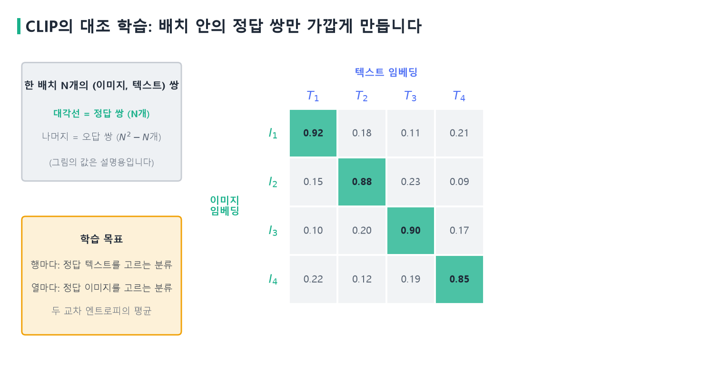{width=100% fig-alt="CLIP의 대조 학습 유사도 행렬"}
:::
::: {.figcap}
**그림 11-2** CLIP의 대조 학습. 배치 안의 이미지와 텍스트를 모두 짝지어 유사도 행렬을 만듭니다. 대각선(정답 쌍)의 값이 크고 나머지가 작아지도록 학습합니다. 그림의 값은 설명을 위한 가상의 숫자입니다.
:::

이를 손실로 바꾸면 분류 문제 두 개를 합친 모양입니다. 유사도 행렬의 **행** 하나는 이미지 한 장과 $N$개의 텍스트의 유사도이므로, "이 이미지에 맞는 텍스트는 $N$개 중 무엇인가"를 고르는 분류가 됩니다. **열** 하나는 반대로 텍스트 한 개에 대해 "이 텍스트에 맞는 이미지는 $N$개 중 무엇인가"를 고르는 분류입니다. 각각 9주차에서 본 소프트맥스와 교차 엔트로피로 정답을 맞히게 하고, 두 방향의 평균을 손실로 씁니다. 소프트맥스에 넣기 전에 유사도를 **온도**라는 값 $\tau$로 나누는데, 이것은 점수 차이를 얼마나 뾰족하게 반영할지 정하는 값이고 CLIP은 이 값도 학습으로 정합니다.

이렇게 하면 정답 쌍을 가깝게 만드는 힘과 오답 쌍을 멀게 만드는 힘이 한 번에 작동합니다. 정답 쌍의 점수가 오답 쌍들의 점수에 비해 클수록 손실이 작아지기 때문입니다. 배치가 클수록 오답 쌍이 많아져 구분하는 일이 어려워지고 학습이 더 풍부해집니다. 논문은 배치 크기를 32,768까지 키웠습니다.

CLIP을 학습하고 나면 새로운 분류 문제를 라벨 없이 풀 수 있습니다. 이를 **zero-shot 분류**라고 하며 세 단계로 이루어집니다. 먼저 분류할 클래스 이름을 `a photo of a cat`, `a photo of a dog`처럼 문장으로 만듭니다. 이 문장들을 텍스트 인코더에 넣어 클래스마다 벡터를 얻습니다. 마지막으로 분류할 이미지의 벡터와 가장 가까운 클래스 벡터를 고릅니다. 모델은 이 데이터셋의 라벨로 학습한 적이 없는데도, 논문은 ImageNet에서 라벨을 쓰고 학습한 ResNet-50과 비슷한 정확도(약 76%)를 보고했습니다. 이미지와 문장을 같은 공간에 놓았기 때문에 가능한 일입니다.

CLIP이 이 장에서 중요한 이유는 분류 능력이 아니라 **텍스트 쪽 인코더**에 있습니다. 문장을 의미가 담긴 벡터로 바꿔 주는 CLIP의 텍스트 인코더는 뒤에서 볼 스테이블 디퓨전이 "프롬프트를 이해하는 부품"으로 그대로 가져다 쓰기 때문입니다. 텍스트와 이미지가 같은 공간에 정렬되어 있으므로, 텍스트 벡터를 이미지 생성의 조건으로 쓸 수 있습니다.

## 확산 모델: 노이즈를 더하고 걷어 냅니다 {#sec-diffusion}

### 아이디어

생성 모델은 학습 데이터의 분포를 배워서, 그 분포를 따르는 새로운 데이터를 만들려는 모델입니다. 오토인코더 계열은 압축한 표현에서 복원하는 길을, GAN은 생성자와 판별자가 경쟁하는 길을 택했습니다. 7주차에서 짧게 소개한 **확산 모델(diffusion model)**은 전혀 다른 길을 갑니다. 깨끗한 데이터에 노이즈를 조금씩 더해 결국 알아볼 수 없게 만드는 과정을 먼저 정해 두고, 이 과정을 거꾸로 되돌리는 모델을 학습합니다. 노이즈를 더하는 쪽은 규칙으로 정하면 되므로 학습할 것이 없고, 학습하는 것은 노이즈를 걷어 내는 쪽뿐입니다.

생성할 때는 순수한 노이즈에서 시작해, 학습한 모델로 노이즈를 한 단계씩 덜어 냅니다. 처음에는 아무 형태도 없던 화면에서 점점 구조가 드러나고, 마지막에 선명한 이미지가 됩니다. 고차원 데이터를 한 번에 만들려 하지 않고 작은 단계로 나누어 반복하기 때문에, 하나하나의 단계는 쉬운 문제가 됩니다. 이 두 과정은 서로 짝을 이루어서 각각 **전방향 과정(forward process)**과 **역방향 과정(reverse process)**이라고 부릅니다.

### 전방향 과정: 노이즈를 단계적으로 더합니다

깨끗한 데이터를 $x_0$라 하고, 단계 $t=1,\dots,T$마다 가우시안 노이즈(정규분포에서 뽑은 무작위 값)를 조금씩 더해 $x_1,x_2,\dots,x_T$를 만듭니다. 한 단계의 규칙은 간단합니다. 직전 이미지를 살짝 줄이고, 그 위에 작은 가우시안 노이즈를 더합니다. 더하는 노이즈의 크기를 $\beta_t$라 하며, 작은 값에서 시작해 점점 커지도록 미리 정해 둡니다. 원 논문(Ho 등, 2020)은 $T=1000$단계, $\beta_t$를 $10^{-4}$에서 $0.02$까지 선형으로 키웠습니다.

이 과정에는 편리한 성질이 있습니다. 가우시안 노이즈를 여러 번 더한 결과도 가우시안이어서, $x_0$에서 단계 $t$의 이미지를 **한 번에** 만들 수 있습니다. 단계마다 남는 비율 $1-\beta_t$를 $t$단계까지 모두 곱한 값을 $\bar\alpha_t$라 하면 다음이 성립합니다.

$$
x_t=\sqrt{\bar\alpha_t}\,x_0+\sqrt{1-\bar\alpha_t}\,\epsilon,\qquad \epsilon\sim\mathcal N(0,\mathbf I).
$$

$\bar\alpha_t$는 원본이 얼마나 남았는지를 나타내는 비율이고, $\sqrt{\bar\alpha_t}$는 $x_t$에 섞인 신호의 크기, $\sqrt{1-\bar\alpha_t}$는 노이즈의 크기입니다. 학습할 때 1단계부터 $t$단계까지 일일이 계산하지 않고 이 식 하나로 원하는 $t$의 노이즈 이미지를 바로 만들 수 있다는 점이 학습을 효율적으로 만듭니다.

**코드 11-1** 위의 스케줄에서 $\bar\alpha_t$와 신호의 크기가 단계에 따라 어떻게 줄어드는지 계산합니다.

```python
import numpy as np

T = 1000
beta = np.linspace(1e-4, 0.02, T)        # 단계별 노이즈 크기 β_t (선형 스케줄)
alpha_bar = np.cumprod(1 - beta)         # ᾱ_t = (1-β_1)(1-β_2)...(1-β_t)

for t in (100, 250, 500, 750, 1000):
    a = alpha_bar[t - 1]
    print(t, f"{a:.4f}", f"{np.sqrt(a):.3f}")
# 100 0.8970 0.947
# 250 0.5241 0.724
# 500 0.0786 0.280
# 750 0.0034 0.058
# 1000 0.0000 0.006
```

단계 100에서는 신호가 아직 0.947배로 남아 이미지가 거의 그대로이지만, 단계 500에서는 0.280배로 줄어 노이즈가 지배합니다. 단계 1000에서는 신호가 0.006배만 남습니다. $\bar\alpha_{1000}\approx4\times10^{-5}$이므로 $x_{1000}$은 사실상 표준 가우시안 노이즈이고, 원래 이미지가 무엇이었든 거의 같은 분포가 됩니다. 이것이 생성할 때 "아무 정보 없는 순수 노이즈"에서 출발해도 되는 근거입니다. 그림 11-3이 이 값의 변화를, 그림 11-4가 실제 이미지에 이 식을 적용한 모습을 보여 줍니다.

::: {.figbody}
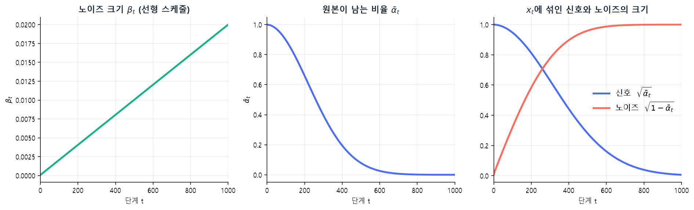{width=100% fig-alt="노이즈 스케줄과 신호 및 노이즈의 크기"}
:::
::: {.figcap}
**그림 11-3** 선형 스케줄에서 $\beta_t$, $\bar\alpha_t$, 그리고 $x_t$에 섞인 신호와 노이즈의 크기. 코드 11-1의 계산 결과입니다. 단계 250 근처에서 신호와 노이즈의 크기가 같아지고, 그 뒤로는 노이즈가 지배합니다.
:::

::: {.figbody}
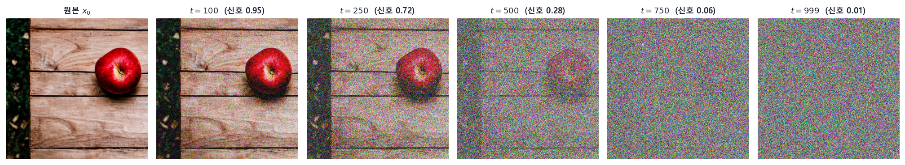{width=100% fig-alt="실제 이미지에 노이즈를 더한 전방향 과정"}
:::
::: {.figcap}
**그림 11-4** 전방향 과정. 스테이블 디퓨전으로 만든 사과 이미지에 위의 식으로 노이즈를 섞었습니다. $t=250$에서도 사과가 보이지만 $t=500$에서는 윤곽만 남고, $t=750$ 이후에는 순수한 노이즈와 구분되지 않습니다.
:::

### 역방향 과정과 DDPM: 노이즈를 예측해 걷어 냅니다

역방향 과정은 전방향 과정을 뒤집어 $x_T$에서 $x_0$로 되돌아가는 과정입니다. 직접 한 단계 전의 이미지를 예측하는 대신 **DDPM**(Denoising Diffusion Probabilistic Models, 노이즈 제거 확산 확률 모델)은 문제를 훨씬 단순하게 바꿉니다. $x_t$에는 원본 $x_0$와 노이즈 $\epsilon$이 섞여 있으므로, $x_t$에서 **섞인 노이즈 $\epsilon$이 무엇인지만 맞히게** 하는 것입니다. 노이즈를 알면 그만큼 걷어 내서 원본에 가까워질 수 있기 때문입니다.

학습의 목표 함수는 **정답 노이즈와 예측 노이즈의 평균 제곱 오차**입니다. 우리가 직접 섞은 노이즈이므로 정답을 정확히 알고 있다는 점이 이 방식의 장점입니다. 한 번의 학습 단계는 다섯 동작으로 정리됩니다(그림 11-5). 학습 데이터에서 깨끗한 이미지 $x_0$를 하나 뽑고, 단계 $t$와 노이즈 $\epsilon$을 무작위로 정합니다. 위의 식으로 $x_t$를 만들고, 신경망(U-Net)에 $x_t$와 $t$를 넣어 노이즈를 예측하게 한 뒤, 예측과 정답의 차이를 줄이도록 파라미터를 갱신합니다. 이 한 단계를 수많은 이미지와 수많은 $t$에 대해 반복합니다.

::: {.figbody}
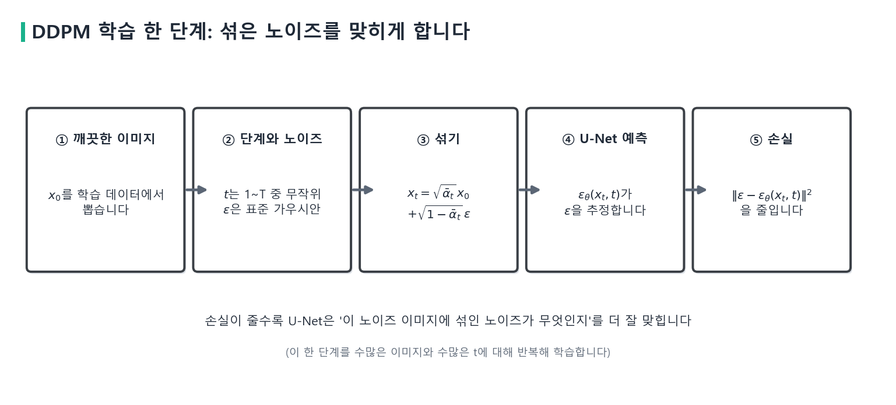{width=100% fig-alt="DDPM 학습 한 단계"}
:::
::: {.figcap}
**그림 11-5** DDPM 학습 한 단계. 깨끗한 이미지에 무작위 단계의 노이즈를 섞고, 네트워크가 섞인 노이즈를 맞히도록 평균 제곱 오차를 줄입니다.
:::

이 손실이 어느 정도의 값인지 감을 잡기 위해 작은 실험을 해 보겠습니다. 노이즈에 대해 아무 정보도 없는 예측기는 늘 0을 내놓는 것이 최선입니다. 표준 가우시안 노이즈의 제곱 평균은 1이므로 손실은 1 근처에 머뭅니다. 반대로 $x_0$를 알고 있다면 $x_t$에서 $\epsilon$을 정확히 역산할 수 있어 손실이 0이 됩니다. 신경망이 학습으로 줄여야 하는 폭이 바로 이 사이입니다.

**코드 11-2** 노이즈 예측 손실의 기준선을 확인합니다.

```python
rng = np.random.default_rng(0)
x0 = rng.standard_normal((1000, 64))         # 가상의 깨끗한 데이터 1000개 (64차원)
eps = rng.standard_normal(x0.shape)          # 섞을 노이즈(정답)
a = alpha_bar[500 - 1]                       # 단계 t=500
xt = np.sqrt(a) * x0 + np.sqrt(1 - a) * eps

loss_zero = np.mean((eps - 0) ** 2)                  # 늘 0을 예측하는 예측기
eps_hat = (xt - np.sqrt(a) * x0) / np.sqrt(1 - a)    # x0를 알면 노이즈를 역산할 수 있다
loss_oracle = np.mean((eps - eps_hat) ** 2)
print(round(loss_zero, 3), round(loss_oracle, 6))
# 1.006 0.0
```

학습이 끝난 네트워크로 이미지를 만드는 과정은 이렇습니다. 먼저 표준 가우시안에서 순수한 노이즈 $x_T$를 뽑습니다. 그리고 $t=T$부터 1까지 거꾸로 내려가며 세 동작을 반복합니다. 현재 이미지 $x_t$와 단계 $t$를 U-Net에 넣어 **노이즈를 예측**하고, 예측한 노이즈와 단계마다 정해 둔 계수로 노이즈를 **조금만** 덜어 내며, 마지막 단계를 빼고는 작은 무작위 노이즈를 **더해서** $x_{t-1}$을 만듭니다. 예측을 완벽히 믿고 한 번에 다 빼지 않고 조금씩 줄이며 매 단계 다시 예측하기 때문에, 중간의 오차가 뒤 단계에서 바로잡힙니다. 그림 11-6이 이 반복을 요약하고, 그림 11-7이 실제 생성에서 중간 단계를 꺼내 본 모습입니다.

::: {.figbody}
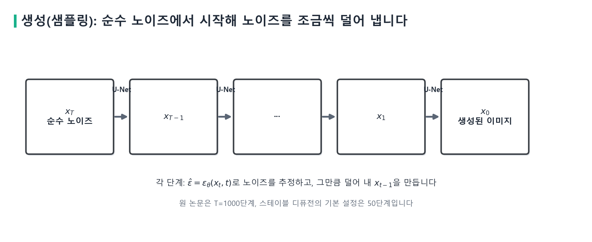{width=100% fig-alt="역방향 샘플링 과정"}
:::
::: {.figcap}
**그림 11-6** 생성(샘플링). 순수 노이즈에서 시작해 각 단계에서 노이즈를 예측하고 덜어 내 이미지를 만듭니다. 원 논문은 1000단계, 스테이블 디퓨전의 기본 설정은 50단계입니다.
:::

::: {.figbody}
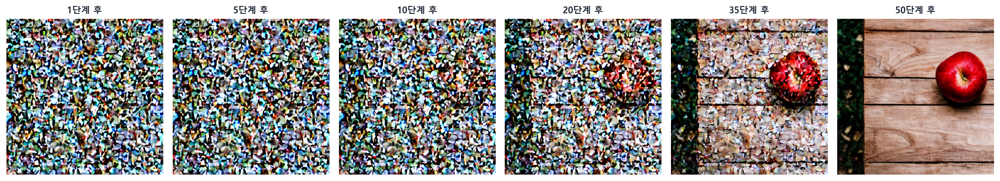{width=100% fig-alt="생성 중간 단계의 이미지"}
:::
::: {.figcap}
**그림 11-7** 스테이블 디퓨전이 이미지를 만드는 중간 모습. 50단계 중 해당 단계가 끝난 잠재를 이미지로 풀어 본 것입니다. 처음 10단계까지는 노이즈에서 크게 달라 보이지 않다가, 20단계 무렵 오른쪽에 붉은 덩어리가 나타나고, 35단계에서 사과와 나무 결이 드러납니다.
:::

노이즈를 예측하는 네트워크 $\epsilon_\theta$로는 **U-Net**을 씁니다. 이미지를 점점 작은 해상도로 줄이며 특징을 뽑는 인코더 경로와, 다시 원래 크기로 키우는 디코더 경로가 알파벳 U자 모양으로 이어져 있고, 같은 해상도의 층끼리는 건너뛰는 연결이 있습니다. 입력과 출력의 크기가 같아야 하는 노이즈 예측에 알맞은 구조입니다. 단계 $t$는 숫자 하나로 받아 임베딩으로 바꿔 각 층에 알려 줍니다. 같은 네트워크가 노이즈가 많은 단계와 적은 단계를 모두 다루기 때문에, 지금이 몇 번째 단계인지를 알아야 하기 때문입니다.

노이즈 예측 관점은 몇 가지 장점이 있습니다. 같은 손실을 쓰면서 네트워크 구조만 키우거나 바꿀 수 있고, 텍스트 같은 조건 정보를 네트워크의 입력으로 더하기 쉽습니다. 뒤에서 볼 잠재 공간 확산으로 옮겨 가도 학습의 본질은 그대로입니다. 생성이라는 어려운 문제를 "노이즈를 맞히는 회귀 문제"라는 안정적인 예측 문제로 바꾼 것이 DDPM의 핵심 아이디어입니다.

### 생성할 때 '이전 단계'란 무엇인가

앞 문단에서 "$x_{t-1}$을 만든다"고 했는데, 이 **이전 단계**라는 말은 헷갈리기 쉽습니다. 시간이 거꾸로 흐른다는 뜻이 아니라, 순방향에서 붙인 단계 번호를 기준으로 한 표현입니다. 순방향이 5단계라고 단순화해 봅시다. 순방향에서는 번호가 클수록 노이즈가 많아집니다. $x_0$는 깨끗한 원본이고 $x_1$은 노이즈가 조금 섞였으며 $x_5$는 거의 순수한 노이즈입니다. 생성은 반대로 $x_5$에서 출발해 $x_4,x_3,x_2,x_1,x_0$ 순서로 노이즈를 덜어 냅니다. 그래서 현재가 5단계라면 노이즈가 조금 줄어든 4단계 이미지가 '이전 단계 이미지'입니다(그림 11-8).

::: {.figbody}
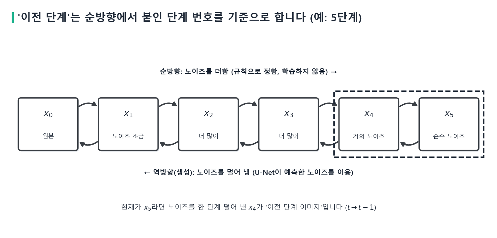{width=100% fig-alt="5단계 예시로 본 순방향과 역방향"}
:::
::: {.figcap}
**그림 11-8** '이전 단계'의 의미. 순방향(위)은 번호가 커질수록 노이즈를 더하고, 역방향(아래)인 생성은 번호를 하나씩 줄이며 노이즈를 덜어 냅니다. 현재가 $x_5$이면 이전 단계 이미지는 $x_4$입니다.
:::

### 학습할 때와 생성할 때 U-Net이 하는 일

U-Net이 하는 일은 학습할 때와 생성할 때 **같습니다**. 둘 다 노이즈가 섞인 이미지와 단계 정보를 받아 **섞인 노이즈를 예측**합니다. 달라지는 것은 그 예측 결과를 어디에 쓰느냐입니다(그림 11-9).

학습할 때는 깨끗한 이미지에 우리가 직접 노이즈를 섞기 때문에 정답 노이즈를 압니다. U-Net이 예측한 노이즈를 정답과 비교해 평균 제곱 오차를 구하고, 역전파로 가중치를 갱신합니다. 이때 1000단계에서 999, 998, ... 단계로 이미지를 하나씩 복원하며 배우는 것이 아닙니다. 보통은 **무작위로 고른 단계 하나**에서 노이즈를 얼마나 정확히 예측하는지를 배웁니다.

생성할 때는 순수한 노이즈에서 시작하므로 노이즈를 새로 섞지 않습니다. U-Net이 예측한 노이즈를 역방향 계산에 넣어 이전 단계 이미지를 만들고, 그 이미지를 다시 U-Net에 넣는 일을 반복합니다. 따라서 **U-Net이 이전 단계 이미지를 직접 출력하는 것이 아닙니다.** U-Net의 출력은 늘 예측한 노이즈이고, 이전 단계 이미지는 그 예측을 이용한 계산의 결과입니다. 원본 이미지를 직접 예측하도록 만든 확산 모델도 있지만, 기본 DDPM은 노이즈 예측 방식을 씁니다.

::: {.figbody}
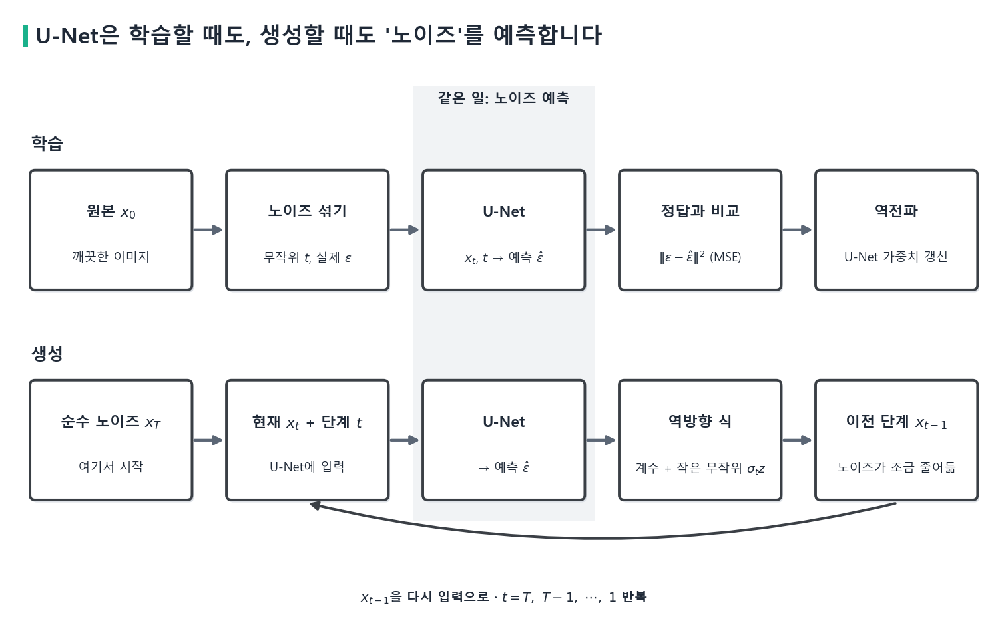{width=100% fig-alt="학습과 생성에서 U-Net이 하는 일"}
:::
::: {.figcap}
**그림 11-9** U-Net은 학습할 때도 생성할 때도 노이즈를 예측합니다(가운데 강조한 열). 학습에서는 그 예측을 정답과 비교해 가중치를 갱신하고, 생성에서는 예측을 이용해 이전 단계 이미지를 계산해 다시 입력으로 씁니다.
:::

| 구분 | 학습 | 이미지 생성 |
|:--|:--|:--|
| 시작점 | 원본 이미지 | 순수 노이즈 |
| 노이즈 추가 | 수행(정답을 알기 위해) | 수행하지 않음 |
| U-Net 입력 | 노이즈 이미지 + 단계 정보 | 현재 이미지 + 단계 정보 |
| U-Net 출력 | 예측 노이즈 | 예측 노이즈 |
| 예측 결과 활용 | 실제 노이즈와 비교해 학습 | 이전 단계 이미지 계산 |
| 반복 | 여러 이미지와 임의의 단계로 학습 | 단계 번호를 줄여 가며 생성 |

: 학습과 이미지 생성의 비교 {#tbl-train-gen}

한 문장으로 정리하면, DDPM은 **학습할 때 노이즈를 맞히는 능력을 배우고, 생성할 때는 그 능력으로 노이즈가 적은 이전 단계 이미지를 반복해서 계산하는 모델**입니다.

### DDIM: 적은 단계로 생성합니다

DDPM의 약점은 생성이 느리다는 것입니다. 단계마다 신경망을 한 번씩 계산하므로 1000단계면 신경망을 1000번 돌려야 합니다. **DDIM**(Song 등, 2021)은 같은 학습된 네트워크를 쓰면서 역방향 과정을 비마르코프 형태의 **결정론적** 경로로 바꾸었습니다. 단계마다 무작위성을 더하지 않으므로, 같은 출발 노이즈에서는 늘 같은 이미지가 나옵니다. 또 단계를 건너뛰며 큰 보폭으로 내려갈 수 있어서, 재학습 없이 훨씬 적은 단계로 비슷한 품질을 얻습니다. 지금의 이미지 생성 도구가 수십 단계로 충분한 것은 이런 가속 샘플러 덕분입니다.

### GAN과 무엇이 다른가

확산 모델이 GAN과 구별되는 점은 학습의 안정성입니다(그림 11-10). GAN은 생성자와 판별자가 서로를 이기려 경쟁하는 적대적 학습이어서 균형이 깨지기 쉽고, 생성자가 일부 유형의 데이터만 만드는 모드 붕괴가 생길 수 있습니다. 확산 모델의 학습은 노이즈를 맞히는 평균 제곱 오차를 줄이는 회귀 문제이므로 손실이 안정적이고, 데이터의 다양한 유형을 고르게 배웁니다. 이 때문에 고차원 데이터의 여러 모드를 포착하는 데 유리하고, 텍스트 조건, 특정 속성만의 조정, 원하는 스타일 유지 같은 복잡한 조건을 안정적으로 반영합니다.

::: {.figbody}
{width=100% fig-alt="확산 모델과 GAN의 비교"}
:::
::: {.figcap}
**그림 11-10** 확산 모델과 GAN. GAN은 한 번에 생성해 빠르지만 학습이 불안정하고, 확산 모델은 여러 단계를 반복해 느리지만 학습이 안정적이고 다양성이 좋습니다.
:::

대신 치르는 값은 속도입니다. 생성이 여러 단계의 반복이어서 GAN처럼 한 번에 만들지 못합니다. 또 이미지가 크면 단계마다 계산하는 U-Net의 비용이 커집니다. 이 두 번째 문제를 풀려고 나온 것이 다음에 볼 잠재 확산 모델입니다.

## 잠재 확산 모델 (LDM) {#sec-ldm}

512×512 크기의 컬러 이미지는 $512\times512\times3=786{,}432$개의 값입니다. 확산 모델을 이 픽셀 공간에서 그대로 돌리면 단계마다 이만한 크기의 텐서를 U-Net이 처리해야 합니다. 그런데 이미지의 픽셀 대부분은 눈에 거의 띄지 않는 세부 정보이고, 의미를 결정하는 구조는 훨씬 적은 정보로 표현됩니다. **잠재 확산 모델(Latent Diffusion Model, LDM)**(Rombach 등, 2022)은 이 점에 착안해, 이미지를 먼저 작고 의미적으로 조직화된 **잠재 공간**으로 압축하고 확산을 그 공간에서 수행합니다. 확산이 일어나는 공간 자체를 바꾸는 것이 핵심입니다(그림 11-11).

::: {.figbody}
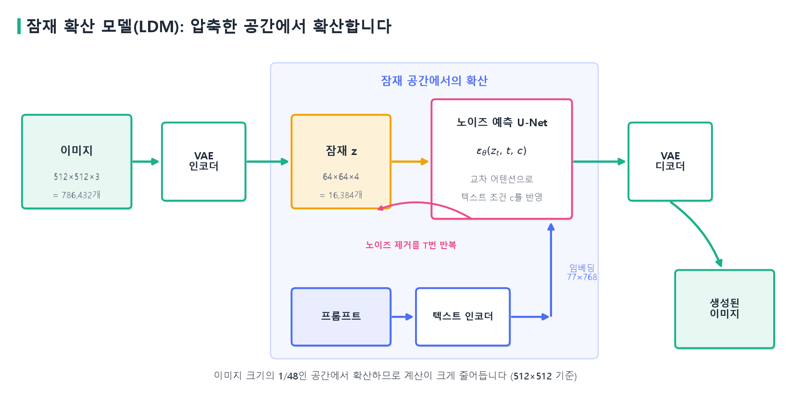{width=100% fig-alt="잠재 확산 모델의 구조"}
:::
::: {.figcap}
**그림 11-11** 잠재 확산 모델. VAE 인코더가 이미지를 작은 잠재로 압축하고, 확산은 잠재 공간에서 일어나며, VAE 디코더가 잠재를 이미지로 되돌립니다. 텍스트는 별도 인코더를 거쳐 U-Net에 조건으로 전달됩니다.
:::

압축과 복원은 사전학습한 **변이형 오토인코더(VAE)**가 맡습니다. 인코더는 입력 이미지를 저차원의 잠재 벡터로 바꾸고, 디코더는 압축해 둔 잠재를 사람이 볼 수 있는 이미지로 펼칩니다. 스테이블 디퓨전에서는 512×512×3 이미지가 64×64×4의 잠재가 되어, 가로세로가 8분의 1로 줄고 값의 수는 786,432개에서 16,384개로 **48분의 1**이 됩니다. 이 비율은 코드로 직접 확인할 수 있습니다.

**코드 11-3** 이미지를 VAE로 압축했다가 복원합니다.

```python
x = torch.from_numpy(np.asarray(img).astype(np.float32) / 127.5 - 1)   # 0~255 -> -1~1
x = x.permute(2, 0, 1)[None].to(device, torch.float16)                 # (1, 3, 512, 512)

with torch.no_grad():
    z = pipe.vae.encode(x).latent_dist.mean * pipe.vae.config.scaling_factor
    rec = pipe.vae.decode(z / pipe.vae.config.scaling_factor).sample

print(tuple(x.shape), "->", tuple(z.shape), "|", x.numel(), "->", z.numel())
# (1, 3, 512, 512) -> (1, 4, 64, 64) | 786432 -> 16384
# 복원 PSNR 32.8 dB
```

48분의 1로 압축했는데도 복원한 이미지의 PSNR이 32.8dB여서 눈으로는 거의 구분되지 않습니다(그림 11-12). 압축 과정에서 사라지는 것은 사람이 알아채기 어려운 세부이고, 구조와 색 같은 의미 정보는 잠재에 남기 때문입니다. 잠재의 네 채널을 그려 보면 이미지의 윤곽(사과의 둥근 모양, 탁자의 선)이 64×64 격자 위에 그대로 나타납니다. 확산을 이 공간에서 하는 이유가 여기 있습니다.

::: {.figbody}
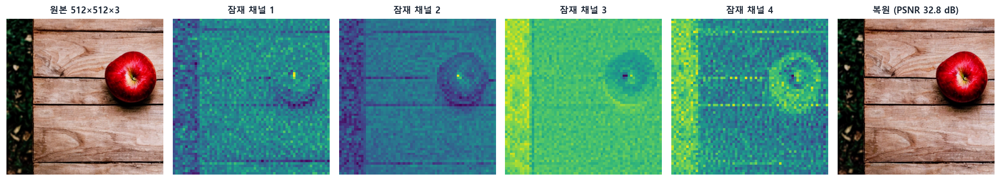{width=100% fig-alt="VAE의 압축과 복원 결과"}
:::
::: {.figcap}
**그림 11-12** VAE의 압축과 복원(코드 11-3). 512×512×3 이미지가 64×64×4 잠재가 되고, 잠재의 각 채널에는 원래 이미지의 구조가 남아 있습니다. 복원한 이미지는 PSNR 32.8dB로 원본과 거의 같습니다.
:::

확산 과정은 이 잠재에서 이루어집니다. 전방향 과정은 잠재 벡터에 가우시안 노이즈를 단계별 스케줄에 따라 주입하고, 역방향 과정은 이를 거꾸로 수행해 노이즈를 제거합니다. 식은 픽셀 공간과 같고 이미지가 잠재로 바뀐 것뿐입니다. 달라지는 점은 하나입니다. 텍스트 같은 조건(프롬프트)을 **텍스트 인코더**로 벡터로 바꾸어 U-Net의 입력에 더해 주는 것입니다. 학습 목표는 그대로 노이즈 예측의 평균 제곱 오차입니다. 단계 수가 같더라도 계산 비용이 크게 줄고, 역방향 과정의 최적화도 안정적으로 이루어집니다. 최종 이미지는 마지막에 VAE 디코더를 한 번만 통과시켜 얻습니다.

### 교차 어텐션으로 텍스트를 반영합니다

텍스트 조건은 U-Net 안의 **교차 어텐션**으로 이미지 생성에 들어갑니다. 교차 어텐션은 9·10주차의 디코더 레이어에서 본 것과 같은 구조입니다. 쿼리는 한쪽에서, 키와 값은 다른 쪽에서 가져옵니다. 여기서는 쿼리 $Q$가 잠재의 각 위치에서 오고, 키 $K$와 값 $V$가 프롬프트의 토큰별 임베딩에서 옵니다(그림 11-13). 어텐션의 계산 자체는 앞에서 본 것과 같습니다. 쿼리는 "무엇을 찾는가", 키는 각 항목의 "색인", 값은 "실제 내용"에 해당합니다.

잠재의 각 위치는 프롬프트의 모든 토큰과의 유사도를 계산하고, 관련이 큰 토큰의 값을 더 많이 가져옵니다. `a red apple on a wooden table`을 예로 들면, 사과가 놓일 위치에서는 `red`와 `apple`에 큰 가중치가 가고, 탁자 쪽 위치에서는 `wooden`과 `table`에 가중치가 갑니다. 텍스트는 잠재 공간의 구조를 바꾸는 의미적인 좌표축처럼 작동하는 셈입니다. 셀프 어텐션과 달리 두 입력의 출처가 다르다는 점을 기억해 두십시오.

::: {.figbody}
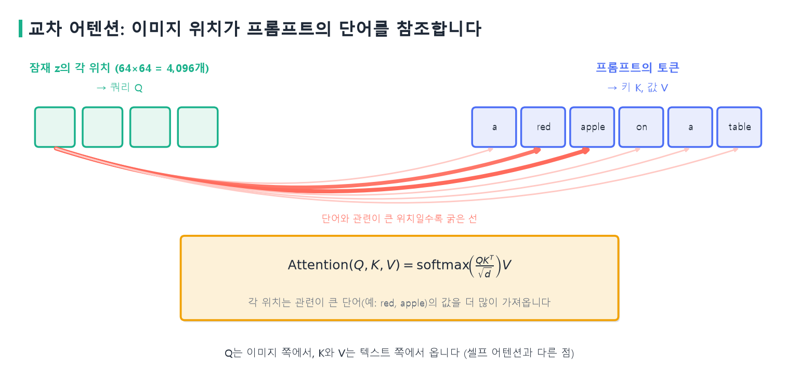{width=100% fig-alt="교차 어텐션으로 텍스트를 반영하는 그림"}
:::
::: {.figcap}
**그림 11-13** 교차 어텐션. 쿼리는 이미지 잠재의 위치에서, 키와 값은 프롬프트의 토큰에서 옵니다. 관련이 큰 단어(여기서는 `red`, `apple`)일수록 굵은 선으로 연결됩니다. 선의 굵기는 설명용입니다.
:::

LDM의 생성은 두 단계로 나눠 이해할 수 있습니다. 잠재 공간에서 이미지의 의미 구조를 만드는 단계와, 디코더가 그 구조에 시각적 세부를 입히는 단계입니다. 이 분업 덕분에 고해상도 이미지를 만들 때 효율과 품질을 함께 얻습니다.

## 스테이블 디퓨전 {#sec-sd}

**스테이블 디퓨전**은 LDM 구조를 바탕으로 만든 대표적인 이미지 생성 모델입니다. 세 부품이 하나의 파이프라인으로 연결되어 있습니다. 텍스트 인코더는 프롬프트를 임베딩으로 바꾸는데, 앞서 본 CLIP의 텍스트 인코더입니다. 프롬프트는 최대 77개 토큰으로 자르고, 토큰마다 768차원 벡터를 만들어 $77\times768$ 크기의 임베딩이 됩니다. U-Net은 단계마다 제거할 노이즈를 예측하며, 교차 어텐션으로 이 임베딩을 참조합니다. VAE는 이미지와 잠재 사이를 오갑니다.

**코드 11-4** `diffusers`로 스테이블 디퓨전 v1.5를 불러오고 구성을 확인합니다.

```python
import torch
from diffusers import StableDiffusionPipeline

device = torch.device("cuda")
pipe = StableDiffusionPipeline.from_pretrained(
    "runwayml/stable-diffusion-v1-5", torch_dtype=torch.float16).to(device)

count = lambda m: sum(p.numel() for p in m.parameters()) / 1e6
print(f"text_encoder {count(pipe.text_encoder):.1f}M  unet {count(pipe.unet):.1f}M  vae {count(pipe.vae):.1f}M")
print(type(pipe.scheduler).__name__, pipe.unet.config.cross_attention_dim, pipe.tokenizer.model_max_length)
# text_encoder 123.1M  unet 859.5M  vae 83.7M
# PNDMScheduler 768 77
```

세 부품의 파라미터를 합치면 약 10억 개이고, 그 가운데 U-Net이 8.6억 개로 대부분을 차지합니다. 생성에서 50번 반복되는 부분이 U-Net이므로 계산 시간도 대부분 여기서 쓰입니다. 이 모델의 U-Net 입력 채널이 4인 것은 잠재가 4채널이기 때문입니다. 프롬프트가 어떻게 토큰이 되는지도 확인할 수 있습니다. `a red apple on a wooden table`은 시작과 끝 표시를 포함해 9개 토큰이 되고, 나머지 68자리는 채움 토큰으로 채워져 텍스트 임베딩의 모양은 $(1,77,768)$입니다.

### 분류기 없는 가이던스

프롬프트를 얼마나 강하게 따를지 조절하는 장치가 **분류기 없는 가이던스(classifier-free guidance)**입니다(Ho와 Salimans, 2021). 학습 때 일정한 확률로 텍스트 조건을 비운 채(빈 문자열) 노이즈를 예측하게 합니다. 그러면 하나의 U-Net이 조건이 있을 때의 예측 $\epsilon(\text{조건})$과 조건이 없을 때의 예측 $\epsilon(\text{조건 없음})$을 모두 할 수 있게 됩니다. 생성할 때는 두 예측을 모두 구하고, 둘의 차이를 키워서 조건 쪽으로 더 멀리 나아갑니다.

$$
\tilde\epsilon=\epsilon_{\text{없음}}+s\,\big(\epsilon_{\text{조건}}-\epsilon_{\text{없음}}\big).
$$

여기서 $s$가 `guidance_scale`입니다(그림 11-14). $\epsilon_{\text{조건}}-\epsilon_{\text{없음}}$은 "프롬프트가 있어서 생긴 방향"이고, $s$는 그 방향을 몇 배로 반영할지 정합니다. $s=1$이면 조건 있는 예측 그대로이고, $s$가 클수록 조건이 만든 방향을 증폭합니다. 단계마다 U-Net을 조건 있음과 없음으로 두 번 돌리므로 계산량은 대략 두 배가 됩니다.

::: {.figbody}
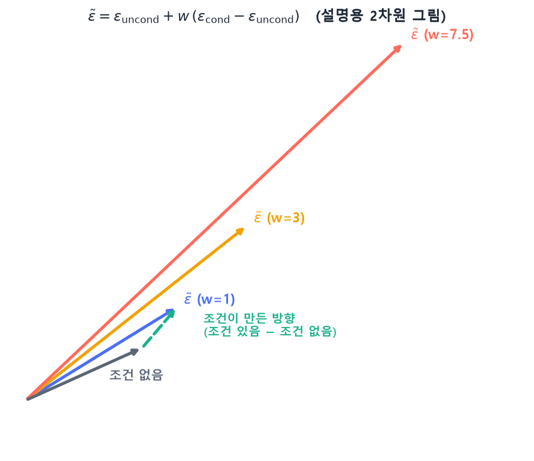{width=100% fig-alt="분류기 없는 가이던스의 벡터 그림"}
:::
::: {.figcap}
**그림 11-14** 분류기 없는 가이던스. 조건 없는 예측에서 조건 있는 예측으로 향하는 방향(점선)을 $s$배로 늘린 곳이 최종 예측이 됩니다. 값은 설명을 위한 가상의 2차원 벡터입니다.
:::

`guidance_scale`을 바꿔 가며 같은 시드로 생성한 결과를 그림 11-15에 실었습니다. `s=1`에서는 프롬프트의 대상인 사과가 나타나지 않고 탁자 위의 작은 조각들만 보입니다. `s=3`에서 작은 사과가 나타나고, 기본값인 `7.5`에서 사과가 뚜렷해지며, `15`에서는 색과 대비가 지나치게 진해집니다. 프롬프트를 약하게 따르면 어긋나고, 너무 강하게 따르면 부자연스러워지는 균형의 문제입니다. 한 시드로 본 경향이므로 시드를 바꾸면 세부는 달라집니다.

::: {.figbody}
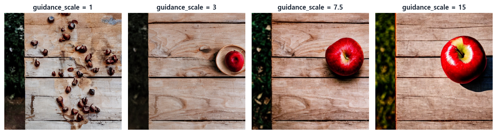{width=100% fig-alt="guidance scale에 따른 생성 결과"}
:::
::: {.figcap}
**그림 11-15** `guidance_scale`을 1, 3, 7.5, 15로 바꾸어 같은 시드·같은 프롬프트(`a red apple on a wooden table`)로 생성한 결과.
:::

**부정 프롬프트**는 같은 장치를 응용한 것입니다. 조건 없는 예측 자리에 빈 문자열 대신 피하고 싶은 특징(`blurry, distorted, low quality`)의 임베딩을 넣습니다. 그러면 앞의 식에서 "조건 없음" 자리가 "부정 프롬프트"로 바뀌어, 원하는 방향으로 가는 동시에 부정 프롬프트가 가리키는 방향에서 멀어집니다. 다만 이 계산은 생성 경로 전체를 바꾸기 때문에 효과가 균일하지 않습니다. 같은 시드에서 부정 프롬프트를 붙이면 세부가 달라지는 정도를 넘어 구도 자체가 달라지기도 합니다(그림 11-16).

::: {.figbody}
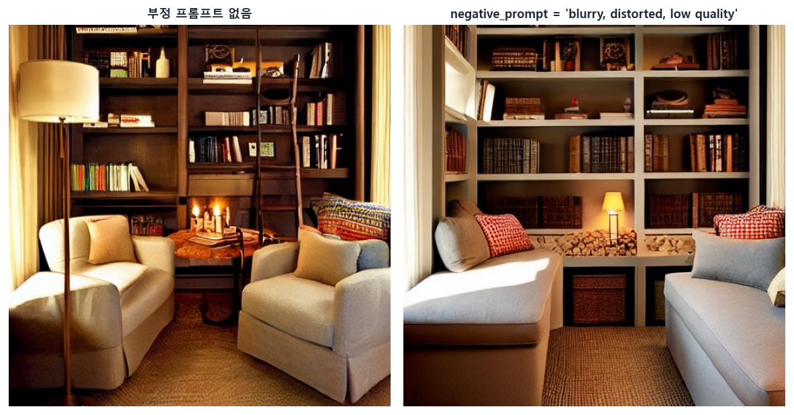{width=100% fig-alt="부정 프롬프트 사용 전후"}
:::
::: {.figcap}
**그림 11-16** 같은 시드에서 부정 프롬프트가 없을 때와 있을 때(`a cozy reading room with warm lighting`). 부정 프롬프트가 들어가면 가구의 배치와 서가의 모양이 달라졌습니다. 효과는 시드마다 다르므로 한 장만 보고 판단하기 어렵습니다.
:::

### 시드, 단계 수, 프롬프트

생성이 시작되는 초기 잠재는 무작위 노이즈이고, 이 노이즈를 정하는 것이 **시드**입니다. 시드가 같으면 초기 노이즈가 같고, 프롬프트와 설정이 같다면 이후의 계산에 무작위성이 없으므로 결과가 같습니다. 이 PC에서 같은 시드로 두 번 만든 이미지는 한 픽셀도 다르지 않았고, 시드를 0에서 1로 바꾸면 평균 픽셀 값이 약 70이나 달라졌습니다. 마음에 드는 시드를 기억해 두었다가 프롬프트만 바꿔 비교할 수 있는 이유입니다. 다만 GPU나 라이브러리 버전이 다르면 미세하게 달라질 수 있습니다.

::: {.figbody}
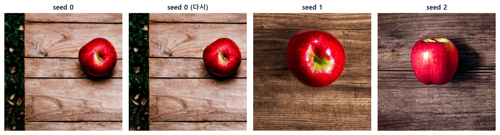{width=100% fig-alt="시드에 따른 생성 결과"}
:::
::: {.figcap}
**그림 11-17** 시드 0을 두 번 생성하면 같은 이미지가 나오고(왼쪽 두 장), 시드를 바꾸면 전혀 다른 이미지가 나옵니다(오른쪽 두 장).
:::

**추론 단계 수**(`num_inference_steps`)는 노이즈를 걷어 내는 반복 횟수로 기본값은 50입니다. 한 단계가 U-Net을 한 번 계산하는 것이어서 시간은 단계 수에 거의 비례합니다. 이 PC에서 50단계 한 장에 약 2.5~3초가 걸렸습니다. 단계를 줄이면 빨라지지만 노이즈가 덜 걷힙니다. 5단계에서는 사과의 형태가 잡히지 않았고, 20단계에서 사과가 나타났습니다. 같은 시드라도 단계 수에 따라 구도가 달라지는 점에도 주의해야 합니다. 그림 11-18에서 20단계는 사과가 두 개, 50단계는 한 개입니다.

::: {.figbody}
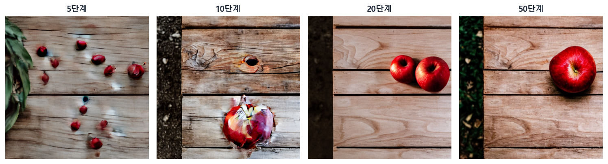{width=100% fig-alt="추론 단계 수에 따른 생성 결과"}
:::
::: {.figcap}
**그림 11-18** 추론 단계 수를 5, 10, 20, 50으로 바꾼 결과(같은 시드). 단계가 적으면 노이즈가 덜 걷혀 형태가 잡히지 않고, 단계 수에 따라 구도도 달라집니다.
:::

프롬프트는 결과를 정하는 가장 직접적인 손잡이입니다. 프롬프트 뒤에 스타일 단어를 붙이면 같은 대상이 다른 질감과 조명으로 바뀝니다. 텍스트 인코더가 단어마다 임베딩을 만들고, 교차 어텐션이 그 임베딩을 참조해 질감, 조명, 구도에 반영하기 때문입니다(그림 11-19). 한두 단어를 더하는 것만으로도 결과가 크게 달라지므로, 원하는 이미지를 얻으려면 프롬프트를 다듬으며 여러 번 시도하게 됩니다.

::: {.figbody}
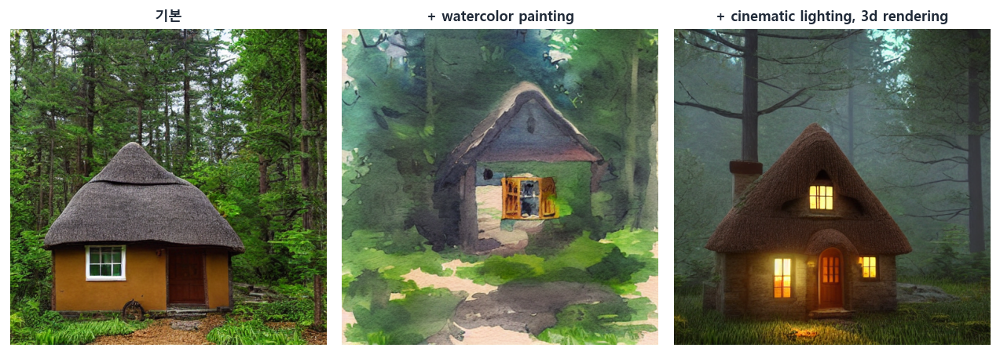{width=100% fig-alt="스타일 프롬프트에 따른 생성 결과"}
:::
::: {.figcap}
**그림 11-19** 같은 시드에서 프롬프트에 스타일 단어를 붙인 결과. 기본 프롬프트는 `a small cottage in a quiet forest`입니다. 같은 오두막이 수채화(가운데)와 영화 같은 3D 조명(오른쪽)으로 바뀝니다.
:::

**코드 11-5** 같은 시드를 쓰고 `guidance_scale`과 추론 단계 수만 바꾸어 생성합니다.

```python
def make(prompt, seed=0, **kw):
    g = torch.Generator(device).manual_seed(seed)      # 시드가 출발 노이즈를 정한다
    return pipe(prompt, generator=g, **kw).images[0]

base = "a red apple on a wooden table"
imgs = [make(base, guidance_scale=w) for w in (1.0, 3.0, 7.5, 15.0)]      # 그림 11-15
imgs = [make(base, num_inference_steps=n) for n in (5, 10, 20, 50)]       # 그림 11-18

a, b = make(base, 0), make(base, 0)
print(np.array_equal(np.asarray(a), np.asarray(b)))      # True: 같은 시드이면 같은 이미지
```

### 응용과 한계

스테이블 디퓨전은 텍스트로 이미지를 만드는 데서 끝나지 않고 여러 용도로 퍼졌습니다. 기존 이미지를 출발점으로 노이즈를 조금만 섞어 다시 걷어 내면 이미지를 바꾸거나 스타일을 변환할 수 있습니다. 이미지의 일부를 가리고 그 부분만 새로 채우는 인페인팅, 해상도를 키우는 초해상화도 같은 틀에서 나옵니다. 모두 확산이 "조건을 반영해 노이즈를 걷어 내는 과정"이라는 점을 이용합니다.

한계도 분명합니다. 이미지 한 장을 만드는 데 U-Net을 수십 번 계산해야 해서 GAN보다 느립니다. v1.5는 512×512로 학습되어서 크기를 크게 바꾸면 구도가 무너지기도 합니다. 결과는 프롬프트에 민감하고 시드에 따라 운이 섞이기 때문에, 원하는 결과를 얻으려면 시도를 반복해야 합니다. 학습 데이터에 섞인 편향이 이미지에 반영될 수도 있습니다. 생성한 이미지를 서비스에 쓸 때는 부적절한 이미지를 걸러 내는 안전 검사기를 켜 두어야 하는데, 이 장의 실습은 비교를 쉽게 하려고 이를 꺼 두었습니다.

::: {.figbody}
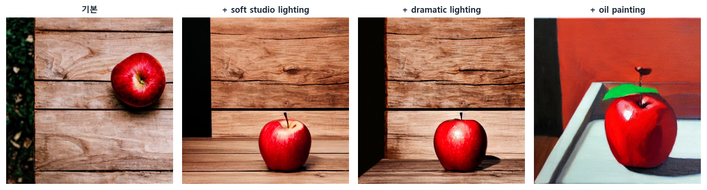{width=100% fig-alt="프롬프트 변화에 따른 생성 결과"}
:::
::: {.figcap}
**그림 11-20** 프롬프트를 조금씩 바꾼 결과(같은 시드). 기본 프롬프트에 조명이나 화풍을 나타내는 단어를 더하면 사과의 색감, 그림자, 탁자의 질감이 함께 달라집니다.
:::

::: {.keybox}
- [멀티모달]{.key} 모델은 서로 다른 모달리티를 [하나의 의미 공간]{.key}에 정렬해 함께 다룹니다. 이상적인 정렬은 짝이 맞는 쌍의 유사도가 맞지 않는 쌍보다 큰 상태입니다.
- [CLIP]{.key}은 배치 안의 정답 쌍만 가깝게 만드는 [대조 학습]{.key}으로 이미지와 텍스트 인코더를 함께 학습하며, 라벨 없는 [zero-shot 분류]{.key}가 가능합니다.
- [확산 모델]{.key}은 데이터에 노이즈를 단계적으로 더하는 [전방향 과정]{.key}과, 노이즈를 걷어 내며 복원하는 [역방향 과정]{.key}으로 이루어지고, 학습하는 것은 역방향뿐입니다.
- [DDPM]{.key}은 역방향 복원을 [노이즈 예측]{.key} 문제로 바꾸어 평균 제곱 오차로 학습하며, 이 예측을 [U-Net]{.key}이 맡습니다. U-Net은 학습할 때도 생성할 때도 노이즈를 예측하며, 생성에서는 그 예측으로 [이전 단계 이미지]{.key}를 계산합니다. [DDIM]{.key}은 결정론적 경로로 적은 단계 생성을 가능하게 합니다.
- 확산 모델은 GAN보다 [학습이 안정적]{.key}이고 다양한 모드를 포착하지만, 생성이 여러 단계의 반복이어서 느립니다.
- [LDM]{.key}은 VAE로 압축한 [잠재 공간]{.key}에서 확산해 계산을 줄입니다(스테이블 디퓨전은 512×512×3이 64×64×4, 48분의 1). 텍스트는 [교차 어텐션]{.key}으로 반영합니다.
- 스테이블 디퓨전은 [CLIP 텍스트 인코더·U-Net·VAE]{.key}로 이루어지고, [분류기 없는 가이던스]{.key}(CFG)의 `guidance_scale`로 프롬프트의 영향을 조절합니다.
- [시드]{.key}가 초기 노이즈를 정하므로 같은 시드와 설정에서는 같은 이미지가 나오고, 결과는 프롬프트, 가이던스 크기, 단계 수에 함께 좌우됩니다.
:::
