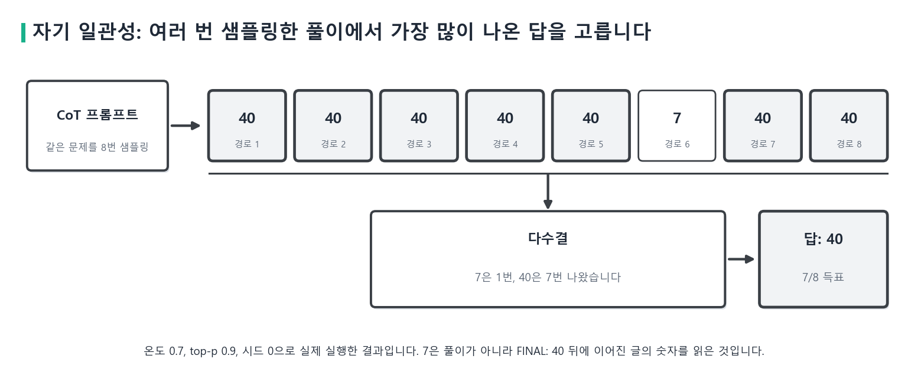
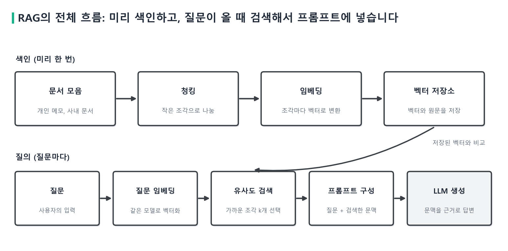

# 1. 이론 {#sec-ch12}

한 상자에 사과가 8개 들어 있을 때 상자 5개에는 사과가 몇 개일까요? 소형 언어 모델(Qwen2.5-1.5B-Instruct)에 이 문장을 그대로 넣으면 답을 말하지 않고 엉뚱한 글을 이어 씁니다. 그런데 풀이의 형식을 문장 몇 줄로 알려 주면 답이 나옵니다. 모델의 파라미터는 하나도 바꾸지 않았는데 출력이 달라진 것입니다. 입력을 어떻게 쓰느냐가 결과를 좌우한다는 뜻입니다.

더 어려운 질문도 있습니다. "사용자는 매일 몇 시에 헬스장을 가?"는 모델이 학습한 적이 없는 개인 정보입니다. 프롬프트를 아무리 잘 써도 모델이 모르는 사실은 답할 수 없습니다. 이 경우에는 모델 밖에 있는 지식을 찾아서 입력에 넣어 주어야 합니다. 이 장은 두 문제를 차례로 다룹니다. 하나는 입력을 어떻게 설계하는가이고, 다른 하나는 외부 지식을 어떻게 입력에 넣는가입니다.

## 프롬프트와 프롬프트 엔지니어링 {#sec-prompt}

### 프롬프트란 무엇인가

**프롬프트(prompt)**는 언어 모델이 수행할 작업과 필요한 맥락을 텍스트로 전달하는 입력입니다. 언어 모델은 입력된 문맥을 바탕으로 다음 토큰의 확률을 계산해 글을 만들어 갑니다. 따라서 입력이 바뀌면 출력이 달라집니다. 모델의 파라미터를 직접 고치지 않아도, 이미 학습된 모델이 어떤 방향으로 글을 이어 갈지를 프롬프트로 유도할 수 있습니다.

GPT-3 논문(Brown 등, 2020)은 이 점을 대규모 언어 모델의 핵심 능력으로 보여 주었습니다. 모델은 경사 갱신이나 파인튜닝 없이, 과제와 시연 예시를 텍스트로 지정하는 것만으로 여러 과제를 수행했습니다. 이처럼 프롬프트 안의 정보만으로 과제를 풀게 하는 방식을 **문맥 내 학습(in-context learning)**이라고 합니다. **프롬프트 엔지니어링(prompt engineering)**은 원하는 출력을 안정적으로 얻기 위해 프롬프트를 설계하고 다듬는 작업입니다.

### 프롬프트 설계의 네 가지 요소

좋은 프롬프트는 목표가 분명하고, 필요한 맥락이 들어 있고, 출력 형식이 정해져 있고, 해석이 하나로 정해집니다. 표 12-1은 이 네 요소를 약한 프롬프트와 개선한 프롬프트로 비교한 예시입니다.

**표 12-1** 프롬프트 설계의 네 가지 요소(설명용 예시)

| 요소 | 의미 | 약한 프롬프트 | 개선한 프롬프트 |
|:--|:--|:--|:--|
| 목표의 명확성 | 모델이 무엇을 해야 하는지 분명히 밝힙니다 | 이 글 좀 봐줘 | 다음 글을 세 문장으로 요약해 줘 |
| 맥락 제공 | 참고해야 할 범위와 상황을 줍니다 | 이 코드가 왜 안 돼? | 파이썬 3.10에서 아래 코드를 실행하면 IndexError가 납니다. 원인을 설명해 줘 |
| 출력 형식 지정 | 결과의 모양을 정합니다 | 장단점을 알려 줘 | 장단점을 각각 글머리표 세 개로 정리해 줘 |
| 모호성 최소화 | 해석이 여러 갈래로 갈리는 표현을 줄입니다 | 좋은 모델로 빠르게 학습해 줘 | 검증 정확도 90% 이상, 학습 시간 10분 이내를 목표로 모델을 제안해 줘 |

목표가 분명하면 모델이 사전학습에서 익힌 지식 가운데 어느 영역을 쓸지 좁혀집니다. 맥락은 문제의 범위를 제한해 출력을 일관되게 만듭니다. 출력 형식을 지정하면 모델의 자유도는 조금 줄지만, 결과를 다른 작업에 그대로 이어 쓰기 쉬워집니다. 모호한 입력은 모델이 여러 해석 가운데 하나를 임의로 고르게 하므로, 조건을 나누어 쓰고 요구 사항을 단계별로 밝혀야 합니다.

### 명령, 역할, 퓨샷

**명령 수행 프롬프팅**은 모델이 해야 할 작업을 직접 지시하는 방식입니다. "다음 문장을 영어로 번역하라."처럼 동사로 작업을 분명히 말합니다. **역할 기반 프롬프팅**은 모델에 특정한 역할과 그에 맞는 행동 기준을 부여합니다. "너는 10년 경력의 파이썬 강사다. 초보자도 이해할 수 있게 설명하라."라고 쓰면 어떤 관점과 표현을 우선할지가 정해집니다. 두 방식은 서로 보완합니다. 명령은 수행할 행동을 정하고, 역할은 그 행동에 필요한 관점과 기준을 정합니다.

명령 수행 프롬프팅이 잘 듣는 배경에는 모델을 지시문으로 학습시킨 연구가 있습니다. Wei 등(2022)은 60여 개 데이터셋을 자연어 지시문 형태로 바꿔 1,370억 개 파라미터 모델을 미세조정했습니다(FLAN). 이 모델은 학습에 없던 과제 25개 가운데 20개에서 제로샷 GPT-3(1,750억 개)보다 나았습니다. 같은 데이터를 지시문 없이(입력과 출력만 주거나 데이터셋 이름만 붙여) 학습하면 성능이 크게 낮았으므로, 과제를 지시문 형태로 학습하는 것이 핵심이었습니다. Ouyang 등(2022)은 사람이 쓴 시연과 사람이 매긴 출력 순위로 GPT-3를 미세조정해 지시를 따르게 했고, 13억 개 파라미터의 InstructGPT 출력이 1,750억 개 GPT-3보다 선호되었다고 보고했습니다.

역할 기반 프롬프팅은 효과가 과제와 역할에 따라 엇갈립니다. Kong 등(2024)은 ChatGPT(gpt-3.5-turbo)로 12개 추론 벤치마크를 평가했습니다. 대화 앞부분에서 역할을 정해 주면 일반 제로샷보다 10개에서 정확했고 2개(SingleEq, MultiArith)는 비슷했습니다. 수학 문장제 모음 AQuA는 53.5%에서 63.8%로 올랐습니다. 다만 어떤 역할이냐가 중요했습니다. AQuA에서 수학 교사는 63.8%, 의사는 56.3%였고, '수학 초보 학생'은 45.3%로 역할이 없을 때보다 낮았습니다. 반대로 Zheng 등(2024)은 162개 역할을 시스템 프롬프트에 넣어 사실 질문 2,410개를 평가했는데, 역할이 없을 때보다 정확도를 통계적으로 높인 역할은 없었습니다. 두 연구는 과제(추론과 사실 질문)와 역할을 넣는 위치가 다릅니다. 따라서 역할은 정확도를 올리는 장치가 아니라 관점과 표현의 기준을 정하는 장치로 쓰고, 과제에 맞는 역할인지 확인해야 합니다.

**퓨샷 프롬프팅(few-shot prompting)**은 입력과 출력의 예시를 프롬프트에 몇 개 포함시키는 방식입니다. 예시를 하나도 주지 않으면 제로샷, 하나를 주면 원샷, 여러 개를 주면 퓨샷이라고 부릅니다. 예시는 과제의 형태와 답변 방식을 모델에 직접 보여 주므로 영향이 큽니다. 그래서 어떤 예시를 고르느냐에 따라 결과가 크게 달라집니다. 예시가 지나치게 복잡하거나 핵심과 무관한 요소를 포함하면 모델의 추론이 불안정해질 수 있습니다. 예시는 과제의 본질적인 패턴만 드러나도록 단순하게 고릅니다.

## 고급 프롬프팅 기법 {#sec-advprompt}

### 생각의 사슬

**생각의 사슬(chain of thought, CoT)** 프롬프팅은 모델이 정답만 내놓지 않고 중간 추론 단계를 자연어로 함께 쓰도록 유도하는 기법입니다. 문제를 잘게 나누고 각 단계를 논리적으로 이어 가면 복잡한 문제를 푸는 데 도움이 됩니다. Wei 등(2022)은 단계별 풀이 예시를 8개만 프롬프트에 넣은 5400억 개 파라미터 모델이 수학 문장제 문제 모음(GSM8K)에서 당시 최고 정확도를 기록했고, 검증기를 붙여 파인튜닝한 GPT-3까지 앞섰다고 보고했습니다.

예시를 주지 않아도 효과가 있습니다. Kojima 등(2022)은 질문 뒤에 "Let's think step by step"(단계별로 생각해 보자) 한 문장을 붙이는 것만으로 InstructGPT 계열 모델(text-davinci-002)의 정확도가 MultiArith에서 17.7%에서 78.7%로, GSM8K에서 10.4%에서 40.7%로 올랐다고 보고했습니다. 이 수치들은 매우 큰 모델에서 얻은 것입니다. 이 장의 실습 모델은 규모가 훨씬 작으므로 논문의 수치와 직접 비교하지 않습니다.

먼저 실습에 쓸 모델을 불러오고, 프롬프트를 입력해 글을 생성하는 함수를 정의합니다. `do_sample=False`는 가장 확률이 높은 토큰을 고르는 탐욕적 방식으로, 같은 입력에는 같은 출력을 냅니다.

**코드 12-1** Qwen2.5-1.5B-Instruct를 불러오고 생성 함수를 정의합니다. (교재 코드 13-1, 13-2)

```python
import torch
from transformers import AutoTokenizer, AutoModelForCausalLM

device = torch.device("cuda" if torch.cuda.is_available() else "cpu")
name = "Qwen/Qwen2.5-1.5B-Instruct"
tokenizer = AutoTokenizer.from_pretrained(name)
model = AutoModelForCausalLM.from_pretrained(name).to(device)
model.eval()

def generate(prompt, max_new_tokens=64):
    inputs = tokenizer(prompt, return_tensors="pt").to(device)
    out = model.generate(**inputs, max_new_tokens=max_new_tokens, do_sample=False)
    return tokenizer.decode(out[0], skip_special_tokens=True)
```

다음 코드는 같은 문제를 기본 프롬프트와 CoT 프롬프트로 각각 풀게 합니다. CoT 프롬프트에는 풀 문제가 아니라 다른 문제(봉지와 사탕)의 풀이를 예시로 하나 넣었고, 풀 문제(상자와 사과) 뒤에는 `1.`만 붙여 풀이를 시작하게 했습니다. 프롬프트에는 사과 문제의 풀이도 답도 들어 있지 않습니다.

**코드 12-2** 기본 프롬프트와 CoT 프롬프트의 출력을 비교합니다. (교재 코드 13-2, 13-3에서 CoT 프롬프트의 예시를 다른 문제로 바꾼 것입니다.)

```python
problem = "한 상자에 사과가 8개 들어 있다. 상자 5개에는 사과가 모두 몇 개 있는가?"
print(generate(problem))

example = ("한 봉지에 사탕이 6개 들어 있다. 봉지 3개에는 사탕이 모두 몇 개 있는가?\n"
           "1. 봉지 하나에 6개가 있다.\n2. 봉지가 3개 있다.\n"
           "3. 따라서 총 사탕 개수는 6*3 = 18\nFINAL: 18\n\n")
cot = (example + problem + "\n생각의 사슬을 따라 단계적으로 추론하되, "
       "마지막 줄에만 정답을 다음 형식으로 출력하라.\nFINAL: <숫자>\n1.")
print(generate(cot))

# [기본 프롬프트의 출력]
# 한 상자에 사과가 8개 들어 있다. 상자 5개에는 사과가 모두 몇 개 있는가? - 위키문답
# 10개의 상자가 있고, 각 상자의 중량은 2kg이고, 이중 중량은 4kg이다. ...
# [CoT 프롬프트의 출력 끝부분]
# 1. 상자 하나에 8개가 있다.
# 2. 상자가 5개 있다.
# 3. 따라서 총 사과 개수는 8*5 = 40
# FINAL: 40
```

기본 프롬프트의 출력에는 답이 없습니다. 모델이 질문에 답하지 않고 문제 뒤에 다른 글을 이어 썼습니다. 반면 CoT 프롬프트에서는 예시의 풀이 형식을 따라 단계를 쓰고, 지정한 형식(`FINAL: 40`)으로 답을 냈습니다. 예시의 숫자는 6과 3, 18인데 출력의 숫자는 8과 5, 40입니다. 사과 문제의 풀이와 답은 프롬프트에 없었으므로, `8*5 = 40`은 모델이 문제에 맞게 쓴 풀이입니다.

다만 이 결과로 모델의 추론 능력 일반을 말할 수는 없습니다. 예시와 문제의 구조가 같아서 풀이의 틀을 따라 쓴 면이 있고, 하나의 문제를 작은 모델로 한 번 실행한 결과이기 때문입니다. 이 실습이 보여 주는 것은 예시 하나로 풀이의 형식과 답의 형식을 정할 수 있다는 점입니다.

### 자기 일관성

**자기 일관성(self-consistency)** 프롬프팅은 같은 문제에 대해 추론 경로를 여러 개 생성한 뒤, 가장 일관되게 나온 답을 최종 답으로 고르는 기법입니다. 한 번의 풀이는 우연한 언어적 편향이나 국소적인 판단 오류 때문에 잘못된 방향으로 흐를 수 있습니다. 여러 경로를 모아 다수결로 답을 정하면 이런 오류가 걸러집니다. Wang 등(2023)은 탐욕적 디코딩 대신 다양한 추론 경로를 샘플링하고, 그 경로들을 종합해 가장 일관된 답을 선택하는 방법을 제안했습니다. 논문의 초록은 CoT 프롬프팅에 비해 GSM8K(+17.9%), SVAMP(+11.0%), AQuA(+12.2%), StrategyQA(+6.4%), ARC-challenge(+3.9%)에서 성능이 향상되었다고 보고합니다.

경로를 다양하게 만들려면 다음 토큰을 고를 때 무작위성이 있어야 합니다. 이를 조절하는 값이 **온도(temperature)**와 **top-p**입니다. 온도가 높을수록 확률이 낮은 토큰도 선택될 가능성이 커지고, top-p는 누적 확률이 p가 될 때까지의 상위 토큰만 후보로 남깁니다. 다음 코드는 온도 0.7, top-p 0.9로 CoT 프롬프트를 8번 샘플링하고, 생성된 글에서 마지막 정수를 답으로 추출합니다.

**코드 12-3** 시드를 고정하고 8개의 추론 경로에서 답을 모읍니다. (교재 코드 13-4)

```python
import re
from collections import Counter

def extract_last_int(text):
    nums = re.findall(r"\d+", text)
    return int(nums[-1]) if nums else None

def sample(prompt, max_new_tokens=64, temperature=0.7, top_p=0.9):
    inputs = tokenizer(prompt, return_tensors="pt").to(device)
    out = model.generate(**inputs, max_new_tokens=max_new_tokens,
                         do_sample=True, temperature=temperature, top_p=top_p)
    return tokenizer.decode(out[0], skip_special_tokens=True)

for seed in (0, 1):
    torch.manual_seed(seed)                        # 재현을 위해 시드를 고정한다
    answers = [extract_last_int(sample(cot)) for _ in range(8)]
    print(seed, answers, Counter(answers).most_common(2))

# 0 [40, 40, 40, 40, 40, 7, 40, 40] [(40, 7), (7, 1)]
# 1 [40, 40, 40, 40, 40, 40, 40, 1] [(40, 7), (1, 1)]
```

::: {.figbody}
{width=100% fig-alt="자기 일관성 프롬프팅의 다수결 과정"}
:::
::: {.figcap}
**그림 12-1** 자기 일관성. 같은 CoT 프롬프트를 여러 번 샘플링해 얻은 답 가운데 가장 많이 나온 답을 고릅니다. 시드 0의 실제 실행 결과이며, 8번 중 7번이 40이었습니다.
:::

시드 0에서는 8개 경로 가운데 7개가 40이어서 다수결로 40이 선택됩니다(그림 12-1). 시드 1에서도 7개가 40입니다. 나머지 경로의 답인 7과 1은 풀이가 틀린 것이 아닙니다. 두 경로 모두 `FINAL: 40`까지 올바르게 쓴 뒤 글을 더 이어 썼고, 이 코드가 그 뒤에 나온 숫자를 마지막 정수로 읽은 것입니다. 시드 0의 7은 이어진 글 "…사과가 7개"의 숫자였고, 시드 1의 1은 이어진 목록의 번호 "1."이었습니다. 다수결이 걸러 낸 것은 모델의 계산 오류가 아니라 답을 읽는 과정의 오류입니다. 이 실습에서는 모델이 문제를 안정적으로 풀어서 표가 한 답으로 모였지만, 문제가 어렵거나 모델이 약하면 득표가 분산될 수 있습니다. 그때는 경로의 수를 늘려야 다수결이 의미 있습니다.

답을 추출하는 방식이 결과에 영향을 준다는 점은 이 실행에서 직접 확인됩니다. 이 코드는 생성된 글의 마지막 정수를 답으로 읽으므로, 답 뒤에 다른 숫자가 나오면 그 숫자가 답으로 읽힙니다. 실제로 서비스에서는 `FINAL:` 뒤의 값만 읽는 식으로 추출 규칙을 더 엄격하게 정합니다. 마지막으로, 자기 일관성은 같은 문제를 여러 번 풀기 때문에 비용도 경로의 수만큼 늘어납니다. 정확성이 중요한 고난도 추론 문제에 주로 씁니다.

### 추론 템플릿

CoT 프롬프트의 구조를 더 짜임새 있게 만들 수도 있습니다. 풀이의 절차를 단계 번호가 붙은 템플릿으로 보여 주고, 새 문제도 같은 절차로 풀게 하는 방식입니다. 다음 코드는 합이 17이고 차가 3인 두 수를 구하는 문제를 템플릿과 함께 입력합니다.

**코드 12-4** 명시적인 추론 템플릿을 프롬프트에 넣습니다. (교재 코드 13-5)

```python
template = ("문제를 단계별로 분석하자.\n"
            "문제: 두 수의 합은 17이고, 차는 3이다. 두 수를 구하라.\n"
            "해결 절차:\n1. 조건을 정리한다.\n"
            "2. 두 수 x,y에 대해 x+y=17, x-y=3이다.\n"
            "3. 두 식을 더하면 2x=20이다.\n"
            "4. 따라서 x=10이고 y=7이다.\n답:")
print(generate(template))

# ... 답: x=10, y=7
#
# 이해하기 어려운 부분:
# - 문제에서 "두 수의 합은 17이고, 차는 3이다"라는 조건을 어떻게 이해해야 하는지 ...
```

모델은 템플릿의 마지막 `답:` 뒤에 `x=10, y=7`을 이어 썼습니다. 이 값은 실제로 맞습니다. 그러나 이 코드도 예시 문제와 풀 문제가 같으므로, 템플릿을 베낀 것과 스스로 푼 것을 구별할 수 없습니다. 또 답 다음에 "이해하기 어려운 부분"이라는 불필요한 글이 이어졌습니다. 생성 길이를 `max_new_tokens`로만 제한했을 뿐 종료 조건을 주지 않았기 때문입니다. 필요한 부분만 얻으려면 출력 형식을 더 분명히 지정하고 답이 나온 뒤에는 생성을 멈추도록 해야 합니다.

### ReAct와 검색 증강 프롬프팅

모델이 혼자 풀 수 없는 문제도 있습니다. 최신 정보나 계산, 데이터베이스 조회가 필요한 경우입니다. **ReAct(Reasoning and Acting)**는 모델의 추론(Reason)과 외부 도구 호출(Act)을 번갈아 하도록 프롬프트를 설계하는 구조입니다. Yao 등(2023)은 추론 흔적과 과제별 행동을 교차해서 생성하도록 하는 방법을 제안했습니다. 이 논문은 질의응답과 사실 검증(HotpotQA, FEVER) 과제와 의사결정 과제(ALFWorld, WebShop)에서 방법을 평가했고, 의사결정 과제에서는 모방 학습과 강화학습 방법보다 성공률이 절대치로 각각 34%와 10% 높았다고 보고합니다.

ReAct의 도구 가운데 가장 널리 쓰이는 것이 문서 검색입니다. **검색 증강 프롬프팅**은 외부 문서나 데이터베이스에서 관련 정보를 찾아 프롬프트에 포함시켜, 모델이 사전학습 범위를 넘어선 지식으로 답하게 만드는 방식입니다. 언어 모델의 추론 능력과 외부 지식을 찾는 능력을 결합합니다. 이 방식을 하나의 시스템으로 체계화한 것이 다음 절의 RAG입니다.

표 12-2는 지금까지 본 기법을 비교한 것입니다.

**표 12-2** 프롬프팅 기법의 비교

| 기법 | 핵심 아이디어 | 추가로 필요한 것 | 주의할 점 |
|:--|:--|:--|:--|
| 퓨샷 | 입출력 예시를 프롬프트에 포함 | 좋은 예시 | 예시의 품질과 복잡도에 민감 |
| 생각의 사슬 | 중간 추론 단계를 쓰게 유도 | 단계 지시 또는 풀이 예시 | 풀이 예시가 정답을 포함하면 평가가 왜곡 |
| 자기 일관성 | 여러 경로를 샘플링해 다수결 | 경로 수만큼의 생성 비용 | 경로 수가 적으면 득표가 분산 |
| ReAct | 추론과 도구 호출을 교차 | 호출할 외부 도구 | 도구 결과의 품질에 의존 |
| 검색 증강 프롬프팅 | 검색한 문서를 프롬프트에 포함 | 문서 저장소와 검색기 | 검색이 틀리면 답도 틀림 |

## 검색 증강 생성(RAG) {#sec-rag-system}

### 정의와 필요성

대규모 언어 모델은 학습이 끝난 시점의 지식을 파라미터에 저장하고 있습니다. 학습 데이터에 없던 정보, 학습 이후에 생긴 정보, 비공개 문서의 내용은 모델이 알 수 없습니다. 이런 질문에도 모델은 그럴듯한 문장을 만들어 낼 수 있고, 사실과 무관한 내용을 지어내는 것을 **환각(hallucination)**이라고 합니다. 지식을 바꿀 때마다 모델을 다시 학습하는 것은 비용이 큽니다.

**검색 증강 생성(Retrieval-Augmented Generation, RAG)**은 질문에 관련된 문서를 먼저 검색하고, 그 문서를 언어 모델에 함께 전달해 답을 생성하는 방식입니다. Lewis 등(2020)은 사전학습된 시퀀스-투-시퀀스 모델을 파라미터 메모리로, 위키백과의 밀집 벡터 색인을 비파라미터 메모리로 두고, 사전학습된 신경 검색기로 후자에 접근하는 모델을 제안했습니다. 모델의 파라미터에 담긴 지식과 모델 밖에 둔 지식을 함께 쓰는 구조입니다. 모델 밖의 지식은 문서만 바꾸면 갱신할 수 있습니다.

RAG는 크게 두 부분으로 이루어집니다. **검색기(retriever)**는 질문과 관련된 문서를 찾고, **생성기(generator)**는 찾은 문서를 바탕으로 답을 씁니다. 기업 내부 문서 검색, 학술 논문 요약, 고객센터 자동 응답, 법률·의료 정보 서비스처럼 사실성이 중요한 분야에서 특히 쓸모가 큽니다.

### 전체 흐름

RAG는 문서를 미리 준비하는 색인 단계와, 질문이 들어올 때마다 실행하는 질의 단계로 나눌 수 있습니다(그림 12-2). 색인 단계에서는 문서를 작은 조각으로 나누고(**청킹, chunking**), 각 조각을 임베딩 모델로 벡터로 바꾸어 벡터 저장소에 보관합니다. 질의 단계에서는 사용자의 질문도 같은 임베딩 모델로 벡터로 바꾸고, 저장된 벡터 가운데 질문 벡터와 가장 가까운 조각 k개를 찾습니다. 그 조각을 질문과 함께 프롬프트로 구성해 언어 모델에 넣으면 답이 생성됩니다.

::: {.figbody}
{width=100% fig-alt="RAG의 색인과 질의 흐름"}
:::
::: {.figcap}
**그림 12-2** RAG의 전체 흐름. 문서는 미리 색인해 두고, 질문이 올 때마다 질문을 임베딩하여 가까운 조각을 검색한 뒤 프롬프트에 넣어 답을 생성합니다.
:::

RAG는 질문과 문서를 같은 임베딩 공간에 놓습니다. 같은 모델로 벡터를 만들면 의미가 가까운 문장은 벡터도 가깝습니다. 그래서 "관련 있는 문서를 찾는 일"이 벡터 사이의 유사도 비교로 바뀝니다. 문장 임베딩 모델로는 SBERT, DPR, ColBERT 같은 모델이 널리 쓰입니다. 이 장의 실습은 `sentence-transformers` 라이브러리의 `all-MiniLM-L6-v2` 모델을 씁니다.

### 색인과 검색

다음 코드는 네 개의 짧은 개인 메모를 문서로 만들어 벡터 색인을 만들고, 질문과 가까운 문서를 검색합니다. 색인과 검색에는 `LlamaIndex` 라이브러리를 씁니다. `similarity_top_k=3`은 가장 가까운 문서를 3개 가져오라는 뜻이고, 점수는 질문 벡터와 문서 벡터의 유사도입니다.

**코드 12-5** 문서를 색인하고 질문과 가까운 문서를 검색합니다. (교재 코드 16-2, 16-3)

```python
from llama_index.core import VectorStoreIndex, Document
from llama_index.embeddings.huggingface import HuggingFaceEmbedding

personal_docs = [
    "사용자는 게임 오목을 좋아하며 주로 5x5 미니게임을 즐긴다.",
    "사용자는 커피보다 차(茶)를 선호한다.",
    "사용자는 매일 6시에 헬스장을 간다.",
    "사용자는 최근 AI 관련 대학원 프로젝트를 진행하고 있다.",
]
embed_model = HuggingFaceEmbedding(model_name="sentence-transformers/all-MiniLM-L6-v2")
docs = [Document(text=d) for d in personal_docs]
index = VectorStoreIndex.from_documents(docs, embed_model=embed_model)
retriever = index.as_retriever(similarity_top_k=3)

for q in ["사용자는 매일 몇 시에 헬스장을 가?", "사용자는 어떤 음료를 좋아해?", "아침 운동은 언제 해?"]:
    print(q)
    for n in retriever.retrieve(q):
        print("  %.3f" % n.score, n.node.get_content())

# 사용자는 매일 몇 시에 헬스장을 가?
#   0.682 사용자는 매일 6시에 헬스장을 간다.
#   0.666 사용자는 커피보다 차(茶)를 선호한다.
#   0.568 사용자는 게임 오목을 좋아하며 주로 5x5 미니게임을 즐긴다.
# 사용자는 어떤 음료를 좋아해?
#   0.652 사용자는 커피보다 차(茶)를 선호한다.
#   0.514 사용자는 매일 6시에 헬스장을 간다.
#   0.425 사용자는 게임 오목을 좋아하며 주로 5x5 미니게임을 즐긴다.
# 아침 운동은 언제 해?
#   0.646 사용자는 커피보다 차(茶)를 선호한다.
#   0.539 사용자는 매일 6시에 헬스장을 간다.
#   0.509 사용자는 게임 오목을 좋아하며 주로 5x5 미니게임을 즐긴다.
```

첫 번째와 두 번째 질문은 가장 관련 있는 문서가 1위입니다. 그러나 세 번째 질문 "아침 운동은 언제 해?"에서는 헬스장 문서(0.539)보다 차 문서(0.646)의 점수가 높아서 엉뚱한 문서가 1위로 올라왔습니다. 첫 번째 질문에서도 헬스장 문서(0.682)와 차 문서(0.666)의 점수 차이는 0.016뿐입니다. 이 모델은 영어 문장을 중심으로 학습된 작은 모델이어서 한국어의 의미 차이를 세밀하게 구분하지 못한 것으로 보입니다.

이 결과는 RAG의 핵심적인 한계를 보여 줍니다. 검색기가 틀린 문서를 가져오면 생성기가 아무리 좋아도 올바른 답을 기대할 수 없습니다. 또 문서가 4개뿐인데 3개를 가져오므로 사실상 대부분의 문서가 프롬프트에 들어갑니다. 점수 차이가 작을 때는 검색이 문서를 거의 걸러 내지 못합니다. 한국어 문서를 다루려면 다국어 임베딩 모델을 쓰는 등 임베딩 모델의 선택을 점검해야 합니다.

### 증강과 생성

검색한 문서는 프롬프트에 문맥으로 넣어서 언어 모델에 전달합니다. 다음 코드의 `answer_with_rag` 함수는 검색, 프롬프트 구성, 생성을 한 번에 실행합니다. 프롬프트는 검색된 문서를 "문맥"으로 제시하고, 문맥을 고려해 답하라고 지시합니다.

**코드 12-6** 검색한 문맥을 프롬프트에 넣어 답변을 생성합니다. (교재 코드 16-5)

```python
def generate_llm_answer(query, context):
    prompt = ("다음은 사용자 개인 정보가 포함된 문서에서 추출한 문맥이다.\n"
              f"문맥: {context}\n\n"
              f"사용자 질문: {query}\n"
              "문맥을 고려하여 적절한 응답을 제공하라.\n"
              "답변:")
    tokens = tokenizer(prompt, return_tensors="pt").to(device)
    out = model.generate(**tokens, max_new_tokens=128)
    return tokenizer.decode(out[0], skip_special_tokens=True).split("답변:")[-1]

def answer_with_rag(query):
    nodes = retriever.retrieve(query)
    context = "\n".join(n.node.get_content() for n in nodes)
    return generate_llm_answer(query, context)

q = "사용자는 매일 몇 시에 헬스장을 가?"
torch.manual_seed(0)
print(generate_llm_answer(q, ""))        # 문맥을 비운 경우
torch.manual_seed(0)
print(answer_with_rag(q))                # 검색한 문맥을 넣은 경우

# [문맥 없음] 1. 사용자의 일정과 헬스장의 운영 시간을 확인합니다. 2. 이를 통해 가장 빠른 시간으로 헬스장을 찾습니다. ...
# [RAG]       사용자는 매일 6시에 헬스장을 간다. 따라서, 사용자의 헬스장 방문 시간은 매일 6시입니다. ...
```

문맥을 비우면 모델은 개인 정보를 알 수 없으므로 헬스장을 찾는 일반적인 절차를 늘어놓았습니다. 검색한 문맥을 넣으면 "매일 6시"라는 사실을 정확히 짚어서 답했습니다. 두 번째 질문 "사용자는 커피와 차 중 무엇을 좋아해?"에서도 문맥 없이는 "어떤 음료를 더 선호하는지 알 수 없습니다"라고 답했고, RAG에서는 "커피보다는 차를 선호합니다"라고 답했습니다. 모델의 파라미터가 아니라 입력에 넣은 외부 지식이 답을 바꾼 것입니다.

다만 이 결과는 조심해서 읽어야 합니다. 시드 0 하나의 실행이고, 샘플링을 쓰므로 시드가 달라지면 문장도 달라집니다. 두 번째 질문의 RAG 답변에는 "정확한 답변을 드릴 수는 없지만"이라는 말이 붙어 있었습니다. 모델이 작아서 근거가 분명한데도 답변이 장황해지거나 자신 없는 말투가 섞이기도 합니다. 검색이 맞았다고 해서 생성이 항상 맞는 것은 아닙니다.

### 설계 요소와 한계

RAG의 품질은 여러 설계 요소가 함께 정합니다. 문서를 어떤 단위로 자를지(청킹), 검색된 조각을 더 정교하게 다시 정렬할지(**재순위화**, reranking), 검색 결과를 프롬프트에 어떻게 구성해 넣을지가 대표적입니다. 청킹 기준이 부적절하면 조각이 의미 단위에서 잘려 검색 정확도가 떨어지고 왜곡된 정보가 생성될 수 있습니다. Gao 등(2023)의 종합 논문은 RAG의 발전 단계를 기본형(Naive RAG), 고급형(Advanced RAG), 모듈형(Modular RAG)으로 정리하고, 검색, 생성, 증강 기술을 세 축으로 살펴봅니다.

RAG에는 구조적인 한계도 있습니다.

- **임베딩 품질에 대한 의존:** 임베딩 모델이 의미를 제대로 구분하지 못하면 앞의 실습처럼 엉뚱한 문서가 검색됩니다.
- **검색의 불확실성:** 검색에는 본질적인 오차가 있고, 부정확한 문서를 근거로 삼으면 환각의 위험이 오히려 커집니다.
- **긴 문맥의 처리:** 검색한 조각을 많이 넣을수록 모델이 모든 정보를 고르게 쓰지는 못합니다. Liu 등(2023)은 긴 입력에서 관련 정보가 처음이나 끝에 있을 때 성능이 가장 높고, 중간에 있을 때 크게 떨어진다고 보고했습니다.
- **청킹 기준:** 조각의 크기와 경계에 따라 검색 정확도와 답변의 일관성이 달라집니다.

RAG는 검색기, 임베딩, 문서 분할, 생성 모델이 이어진 시스템이어서, 가장 약한 부품이 전체 품질을 정합니다.

## 프롬프트 기법은 왜 효과가 있는가 {#sec-why-prompt}

앞에서는 각 기법이 무엇을 하는지 보았습니다. 이 절은 프롬프트가 바뀌면 모델 안에서 무엇이 달라지는지를 다룹니다. 아직 다 밝혀지지 않은 영역이라, 논문마다 실험한 모델과 과제가 다릅니다. 그래서 어디까지 확인된 내용인지를 함께 적습니다.

### 프롬프트는 다음 토큰의 확률분포를 정한다

트랜스포머는 프롬프트의 모든 토큰을 어텐션으로 읽고, 마지막 위치에서 다음 토큰의 확률분포를 계산합니다. 파라미터는 그대로이므로 프롬프트가 바꾸는 것은 이 분포의 모양뿐입니다. 코드 12-2에서 기본 프롬프트가 답 대신 엉뚱한 글을 이어 쓴 것도 이 때문입니다. 문제 뒤에 올 수 있는 글은 해설, 게시글, 다른 문제 등 여러 가지이고, 모델은 그중 하나를 골랐습니다. CoT 프롬프트는 풀이 형식을 보여 주고 `FINAL: `로 끝나므로, 다음 토큰이 숫자일 확률이 높아집니다.

Xie 등(2022)은 이 현상을 베이지안 추론으로 설명합니다. 사전학습 데이터가 여러 잠재 개념(과제, 문체, 주제)에서 나온 글의 혼합이라면, 프롬프트의 예시와 지시는 지금 어느 개념인지를 알려 주는 단서입니다. 단서가 쌓일수록 한 개념의 확률이 커지고, 그 개념에서 나올 법한 토큰으로 분포가 쏠립니다. 다만 이 증명은 은닉 마르코프 모형의 혼합이라는 단순한 설정에서 이루어졌고, 실제 대규모 모델이 그렇게 작동한다는 직접 증거는 아닙니다.

그렇다고 프롬프트를 구체적으로 쓰면 늘 분포가 좁아진다고 일반화할 수는 없습니다. Sclar 등(2023)은 구분자나 공백 같은 겉모양만 바꿔도 정확도가 최대 76점(LLaMA-2-13B) 달라진다고 보고했고, 이 민감성은 모델이 커지거나 예시가 늘어나거나 지시 학습을 해도 사라지지 않았습니다. 모델이 지시를 얼마나 따르는지는 모델과 학습 방식에 달려 있습니다.

### 예시는 어텐션으로 쓰인다

퓨샷 예시에서 모델이 얻는 것은 무엇일까요? Min 등(2022)은 예시의 정답 레이블을 무작위로 바꿔도 성능이 조금만 떨어진다는 것을 12개 모델에서 보였습니다. 예시는 정답을 가르치기보다 레이블의 범위, 입력의 분포, 출력의 형식을 보여 주는 역할이 큽니다. 정답 레이블이 있으면 없을 때보다 낫지만 그 영향은 작습니다.

내부에서 이 정보가 쓰이는 방식에 대해서는 세 가지 연구가 있습니다.

- Olsson 등(2022)은 `[A][B] … [A]`처럼 앞에서 본 패턴이 다시 나오면 `[B]`를 예측하는 어텐션 헤드를 찾아 **유도 헤드(induction head)**라고 불렀습니다. 입력과 출력이 반복되는 퓨샷 예시에서 이 헤드가 새 입력의 출력을 같은 모양으로 이어 쓰게 한다는 설명입니다. 유도 헤드가 생기는 시점에 문맥 내 학습 능력이 급격히 늘고, 작은 모델에서는 이 헤드를 없애면 능력이 줄었습니다. 큰 모델에서는 상관 증거만 있습니다.
- Wang 등(2023)은 GPT2-XL과 GPT-J에서, 얕은 층에서는 예시의 정보가 레이블 단어(예시의 답이 있는 위치)로 모이고, 깊은 층에서는 마지막 위치가 이 레이블 단어를 참조해 답을 낸다는 것을 보였습니다. 레이블 단어를 얕은 층에서 가리면 성능이 크게 떨어졌습니다.
- Hendel 등(2023)과 Todd 등(2023)은 예시가 하나의 압축된 벡터, 곧 과제 벡터(함수 벡터)로 요약된다고 보고했습니다. Todd 등은 소수의 어텐션 헤드가 이 벡터를 나른다는 것을 인과적으로 확인했습니다. 이 벡터를 예시 없는 입력에 넣어 줘도 과제가 수행되었습니다.

von Oswald 등(2023)은 선형 어텐션 한 층이 회귀 문제에서 경사하강 한 단계와 같은 계산을 할 수 있음을 보였습니다. 이 결과는 회귀 문제에 한정됩니다.

예시를 어텐션으로 읽는다는 것은 예시의 배치에도 영향을 받는다는 뜻입니다. Zhao 등(2021)은 모델의 예측이 예시에 많이 나온 레이블로 쏠리고(다수 레이블 편향), 프롬프트의 마지막에 가까운 레이블로 쏠리며(최근성 편향), 사전학습에서 흔한 답을 선호한다는 것(흔한 토큰 편향)을 보였습니다. 예시의 순서와 구성을 신경 써야 하는 이유입니다.

### 생각의 사슬은 계산을 토큰으로 펼친다

트랜스포머가 토큰 하나를 내기까지 거치는 층의 수는 정해져 있습니다. Feng 등(2023)은 층 수가 제한된 트랜스포머가 산술이나 방정식의 답을 바로 내려면 입력이 길어질수록 모델이 급격히 커져야 함을 보였습니다. 반대로 풀이 과정을 한 단계씩 쓰면 크기가 고정된 모델로도 풀 수 있습니다. 중간 풀이 토큰이 다음 토큰의 입력이 되어 계산을 이어 받기 때문입니다. 이 결과는 증명과 합성 과제에서 나온 것입니다.

Prystawski 등(2023)은 다른 각도에서 설명합니다. 학습 데이터에서 서로 가까운 개념끼리 함께 나올 때, 중간 단계를 거쳐 추론하면 직접 추정할 때보다 오차가 줄어듭니다. 학습 때 한 번도 같이 보지 못한 두 개념을, 같이 본 적 있는 개념들을 징검다리로 이어 연결하는 것입니다. 이 결과도 베이즈넷에서 데이터를 만들어 작은 모델을 학습시킨 실험입니다.

자기 일관성은 이 구조 위에서 풀이 경로를 여러 개 뽑아 답을 모읍니다. Wang 등(2023)은 이를 샘플링한 추론 경로를 주변화(marginalize)해서 가장 일관된 답을 고르는 것으로 설명합니다.

풀이가 길다고 해서 그것이 모델의 실제 판단 이유라는 보장은 없습니다. Turpin 등(2023)은 보기의 정답을 늘 (A)로 두는 식으로 입력에 편향을 넣으면, GPT-3.5와 Claude 1.0의 정확도가 최대 36% 떨어지는데도 풀이는 그 편향을 언급하지 않는다고 보고했습니다. CoT의 풀이는 결과를 낳는 계산이기도 하지만, 그럴듯하게 쓴 글이기도 합니다.

### 역할은 이어질 글의 화자를 고른다

Shanahan 등(2023)은 대화형 모델을 하나의 정해진 인격이 아니라 여러 역할을 연기할 수 있는 모델로 보자고 제안합니다. 이 관점에서 "너는 10년 경력의 파이썬 강사다"는 이어질 글의 화자와 말투를 고르는 문장입니다. 역할을 준다고 모델이 모르던 지식을 갖게 되는 것은 아닙니다. 역할의 효과를 직접 실험한 결과는 앞에서 본 Kong 등(2024)과 Zheng 등(2024) 외에 Salewski 등(2023)이 있습니다. 이들은 Vicuna-13B에 역할을 주고 MMLU 문제를 풀게 했을 때, 분야 전문가 역할이 다른 분야 전문가 역할보다 더 잘 풀었다고 보고합니다. 같은 연구에서 사회적 정체성을 역할로 주면 모델의 편향이 드러나기도 했습니다.

### 입력에 넣은 문서는 어떻게 쓰이는가

RAG에서 검색한 문서는 프롬프트의 일부로 어텐션에 읽힙니다. Wu 등(2024)은 모델마다 5% 미만의 어텐션 헤드가 긴 입력에서 필요한 정보를 찾아 출력으로 복사하는 일을 맡는다는 것을 찾아 **검색 헤드(retrieval head)**라고 불렀습니다. 이 헤드를 없애면 입력에 있는 정보를 찾지 못하고 환각이 늘었고, 무작위로 고른 헤드를 없앴을 때는 그렇지 않았습니다. 앞에서 본 Liu 등(2023)의 결과, 곧 중간에 놓인 정보를 잘 쓰지 못하는 현상은 모델이 입력의 위치에 따라 정보를 다르게 쓴다는 점을 보여 줍니다.

표 12-3은 이 절의 내용을 정리하면서 어디까지 확인된 내용인지를 함께 적었습니다.

**표 12-3** 프롬프트 기법이 모델 안에서 하는 일과 확인된 범위

| 기법 | 입력이 바꾸는 것 | 확인된 범위 |
|:--|:--|:--|
| 퓨샷 | 어느 개념(과제)인지를 알려 주는 단서를 쌓아 분포를 좁힘 | 이론은 단순화한 모형, 실험은 분류 과제 중심 |
| 퓨샷 | 유도 헤드, 레이블 단어, 과제 벡터로 예시를 새 입력에 적용 | 작은 모델이나 단순한 과제에서 인과 확인 |
| 형식, 예시 구성 | 겉모양과 예시의 순서, 구성에 따라 분포가 쏠림 | 여러 모델에서 관찰, 규모를 키워도 사라지지 않음 |
| 생각의 사슬 | 중간 토큰이 계산을 이어 받고, 가까운 개념을 이어 추론 | 증명과 합성 과제 |
| 자기 일관성 | 여러 풀이 경로의 답을 합침 | 추론 벤치마크 |
| 역할 | 이어질 글의 화자와 문체를 고름 | 관점은 이론적 제안, 효과는 모델과 과제에 따라 엇갈림 |
| 문서 삽입 | 검색 헤드가 입력에서 필요한 정보를 복사 | 긴 입력 과제에서 인과 확인 |

이 절의 설명은 대부분 작은 모델이나 합성 과제에서 얻은 결과입니다. 수십억에서 수천억 개 파라미터 모델의 내부를 모두 설명하지는 못합니다. 또 CoT 풀이의 신뢰성 문제에서 보듯이, 프롬프트가 잘 작동한다는 사실이 모델이 의도한 방식으로 작동한다는 증거는 아닙니다.

## 프롬프트 엔지니어링과 RAG {#sec-prompt-rag}

두 주제는 이어져 있습니다. 프롬프트 엔지니어링은 모델에 줄 입력을 설계하는 일이고, RAG는 그 입력에 넣을 외부 지식을 찾는 일입니다. RAG의 마지막 단계인 프롬프트 구성은 앞에서 본 프롬프트 설계 원리가 그대로 적용됩니다. 문맥과 질문을 어떻게 배치할지, 답변 형식을 어떻게 지정할지, 문맥에 없는 내용은 답하지 말라고 어떻게 제한할지에 따라 결과가 달라집니다.

반대로 아무리 정교한 프롬프트도 모델이 모르는 사실을 만들어 낼 수는 없습니다. 프롬프트가 모델이 가진 능력을 이끌어 내는 도구라면, RAG는 모델에 없던 지식을 입력으로 공급하는 도구입니다. 문제의 성격에 맞게 고르고, 필요하면 함께 씁니다.

::: {.keybox}
- [프롬프트]{.key}는 작업과 맥락을 텍스트로 전달하는 입력이며, 모델의 파라미터를 바꾸지 않고 출력을 유도합니다. 좋은 프롬프트는 [목표, 맥락, 출력 형식, 모호성 최소화]{.key}를 갖춥니다.
- [명령 수행]{.key}은 할 일을, [역할 기반]{.key}은 관점과 기준을 정하고, [퓨샷]{.key}은 입출력 예시로 과제의 패턴을 보여 줍니다. 어떤 예시를 고르느냐가 결과에 크게 영향을 줍니다.
- [생각의 사슬(CoT)]{.key}은 중간 추론 단계를 쓰게 유도합니다. 풀이 예시가 정답을 포함하면 추론 능력이 아니라 형식을 따르는 것을 보게 되므로 평가에 주의해야 합니다.
- [자기 일관성]{.key}은 여러 추론 경로를 샘플링해 [다수결]{.key}로 답을 고릅니다. 경로 수가 적으면 득표가 분산되고, 경로 수만큼 비용이 듭니다.
- [ReAct]{.key}는 추론과 도구 호출을 교차하며, [검색 증강 프롬프팅]{.key}은 검색한 문서를 프롬프트에 넣어 사전학습 범위를 넘어선 지식으로 답하게 합니다.
- 프롬프트는 모델의 [다음 토큰 확률분포]{.key}를 조건짓습니다. 퓨샷은 [유도 헤드]{.key} 같은 어텐션 회로로, CoT는 중간 토큰이 계산을 이어 받는 방식으로 작동한다는 설명이 있습니다. 다만 대부분 작은 모델이나 단순화한 과제에서 확인된 결과이고, 구체적으로 쓴다고 늘 분포가 좁아지는 것은 아닙니다.
- [RAG]{.key}는 [검색기]{.key}와 [생성기]{.key}로 이루어지고, 문서를 청킹·임베딩해 색인한 뒤 질문과 가까운 조각을 프롬프트에 넣어 답을 생성합니다.
- RAG는 [임베딩 품질]{.key}, 검색의 불확실성, 긴 문맥 처리, 청킹 기준에 좌우됩니다. 검색이 틀리면 생성도 틀릴 수 있습니다.
:::
