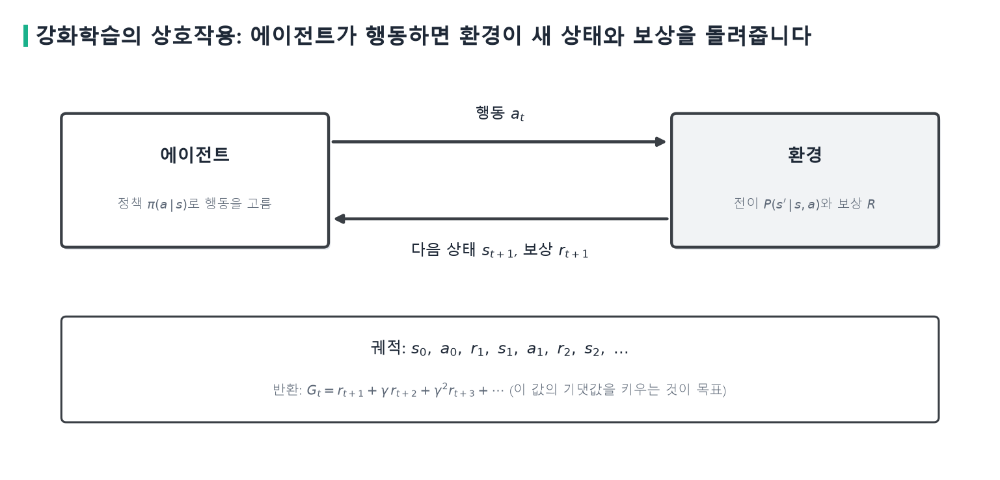
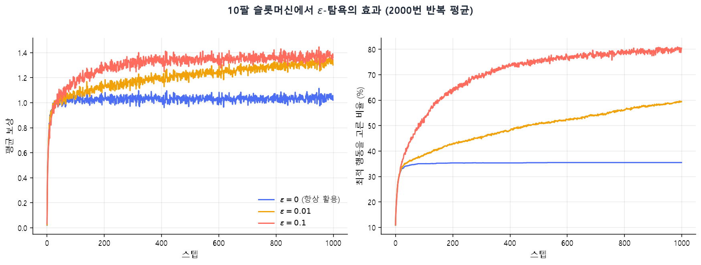
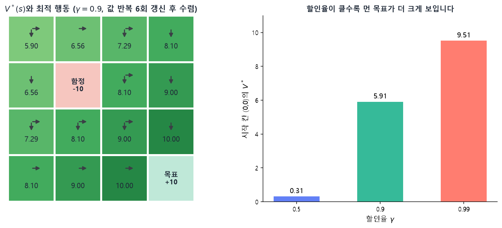
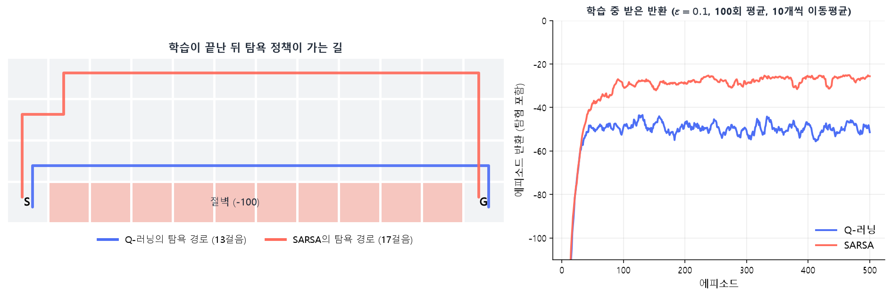
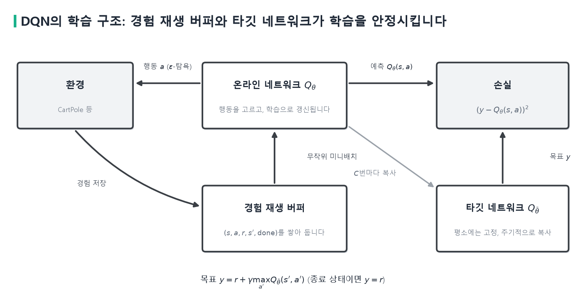
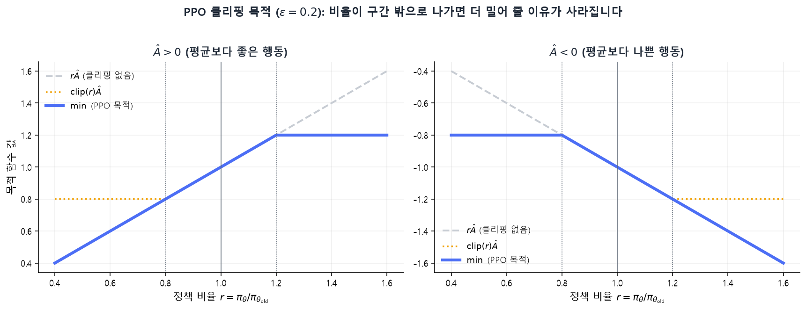
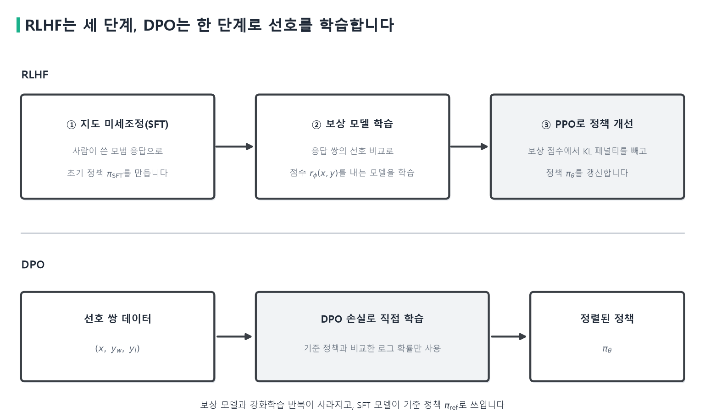
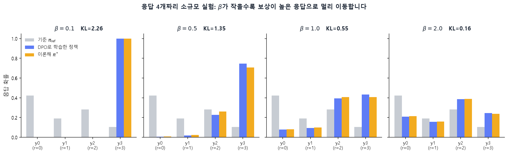

# 1. 이론 {#sec-ch13}

바둑에서 첫 수가 좋았는지 나빴는지는 그 자리에서 알 수 없습니다. 수백 수가 지나고 승패가 갈린 뒤에야 "그 수가 괜찮았다"고 말할 수 있습니다. 지금까지 다룬 지도학습은 이런 상황과 다릅니다. 이미지 분류에서는 사진마다 정답 라벨이 붙어 있어서 한 번 틀릴 때마다 얼마나 틀렸는지 바로 계산할 수 있었습니다. 하지만 로봇이 걷는 법, 게임을 이기는 법, 대화에서 도움이 되는 답을 고르는 법에는 한 걸음마다 붙은 정답이 없습니다. 있는 것은 여러 행동을 이어서 한 뒤에 돌아오는 결과뿐입니다.

**강화학습(reinforcement learning)**은 이런 문제를 위한 학습 방식입니다. 에이전트가 환경과 상호작용하면서 받는 보상을 모으고, 이 보상의 합이 커지는 행동 규칙을 스스로 찾습니다. 이 장은 강화학습의 기본 틀(MDP)과 대표 알고리즘(Q-러닝, 정책 경사)을 먼저 다룹니다. 그다음 같은 틀이 대규모 언어 모델을 사람의 선호에 맞추는 데 어떻게 쓰이는지, 곧 RLHF와 DPO를 살펴봅니다. 앞 장에서 ChatGPT 같은 모델이 사전학습, 지도 미세조정, 선호 정렬의 세 단계로 만들어진다고 했는데, 마지막 단계가 바로 이 장의 내용입니다.

## 강화학습이란 {#sec-rl}

### 지도학습과 무엇이 다른가

지도학습은 입력 $x$와 정답 $y$의 쌍을 많이 모아 두고 $f(x)\approx y$가 되도록 모델을 고칩니다. 데이터는 학습 전에 정해져 있고, 모델이 무엇을 출력하든 데이터는 변하지 않습니다. 강화학습은 세 가지 점에서 다릅니다.

첫째, 정답이 아니라 **보상(reward)**이 주어집니다. 보상은 "이 행동이 옳다"가 아니라 "결과가 이만큼 좋았다"를 숫자 하나로 알려 줄 뿐입니다. 어떤 행동이 더 나았을지는 에이전트가 직접 해 보면서 알아내야 합니다.

둘째, 보상이 **늦게** 옵니다. 체스에서 비숍을 내주는 수는 당장은 손해지만 열 수 뒤에 이기는 길을 열 수도 있습니다. 한 시점의 선택이 이후 모든 보상에 영향을 주므로, 어느 행동이 최종 결과에 얼마나 기여했는지를 가려내는 일(신용 할당, credit assignment)이 어려워집니다.

셋째, **데이터가 에이전트의 행동에 따라 달라집니다.** 에이전트가 서툴면 서투른 상황만 경험하고, 능숙해지면 더 깊은 상황까지 가 봅니다. 정책이 바뀌면 학습 데이터의 분포가 바뀌므로 지도학습에서 가정하던 고정된 분포를 쓸 수 없습니다. 이 성질을 비정상성(non-stationarity)이라고 부릅니다.

표 13-1은 두 학습 방식을 비교한 것입니다.

**표 13-1** 지도학습과 강화학습의 비교

| 구분 | 지도학습 | 강화학습 |
|:--|:--|:--|
| 학습 신호 | 입력마다 붙은 정답 | 행동 뒤에 오는 보상(숫자 하나) |
| 신호가 오는 시점 | 예측 즉시 | 여러 행동 뒤에 늦게 |
| 데이터 | 미리 모아 둔 고정 데이터 | 에이전트가 행동하며 직접 생성 |
| 목표 | 예측 오차 최소화 | 누적 보상 최대화 |
| 대표 문제 | 분류, 회귀 | 게임, 로봇 제어, 언어 모델 정렬 |

Kaelbling 등(1996)의 서베이는 강화학습을 "시행착오로 최적 행동을 배우는 문제"로 정리했고, 그 뒤의 발전은 Sutton과 Barto(2018)의 교재에 체계적으로 모여 있습니다. 이 장의 기호도 이 교재를 따릅니다.

### 에이전트와 환경의 상호작용

강화학습의 무대에는 두 주체가 있습니다. 행동을 고르는 **에이전트(agent)**와, 행동을 받아 상황을 바꾸고 결과를 돌려주는 **환경(environment)**입니다. 시점 $t$마다 다음 일이 일어납니다.

1. 에이전트가 현재 **상태(state)** $s_t$를 관찰합니다.
2. 에이전트가 **정책(policy)** $\pi$에 따라 **행동(action)** $a_t$를 고릅니다.
3. 환경이 보상 $r_{t+1}$과 다음 상태 $s_{t+1}$을 돌려줍니다.

이 반복이 한 판(에피소드)이 끝날 때까지 이어지면 $s_0, a_0, r_1, s_1, a_1, r_2, \ldots$ 같은 **궤적(trajectory)**이 남습니다(그림 13-1).

::: {.figbody}
{width=100% fig-alt="에이전트가 행동을 보내고 환경이 다음 상태와 보상을 돌려주는 상호작용 그림"}
:::
::: {.figcap}
**그림 13-1** 에이전트와 환경의 상호작용. 에이전트는 정책에 따라 행동을 보내고, 환경은 다음 상태와 보상을 돌려줍니다. 이 주고받음이 쌓인 기록이 궤적이며, 학습은 궤적에서 얻은 반환을 키우는 방향으로 이루어집니다.
:::

정책은 상태를 보고 행동을 고르는 규칙입니다. 같은 상태에서 항상 같은 행동을 고르면 **결정적 정책** $a=\pi(s)$이고, 행동마다 확률을 두고 뽑으면 **확률적 정책** $\pi(a\,|\,s)$입니다. 신경망으로 정책을 만들 때는 보통 소프트맥스 출력으로 행동의 확률분포를 냅니다. 언어 모델이 다음 토큰의 확률분포를 내는 것과 같은 모양이라는 점을 기억해 두십시오. 뒤에서 이 대응이 중요해집니다.

에이전트의 목표는 보상 하나가 아니라 앞으로 받을 보상의 합입니다. 시점 $t$ 이후의 보상을 할인해서 더한 값을 **반환(return)**이라고 하고 다음과 같이 씁니다.

$$
G_t = r_{t+1} + \gamma\, r_{t+2} + \gamma^2 r_{t+3} + \cdots = \sum_{k=0}^{\infty} \gamma^{k}\, r_{t+k+1}, \qquad 0 \le \gamma \le 1
$$

$\gamma$는 **할인율(discount factor)**입니다. $\gamma=0$이면 바로 다음 보상만 보는 근시안이 되고, $\gamma$가 1에 가까울수록 먼 미래의 보상까지 비슷한 무게로 셉니다. 할인을 두는 이유는 두 가지입니다. 하나는 미래는 불확실하니 가까운 보상이 더 믿을 만하다는 점이고, 다른 하나는 끝나지 않는 과제에서도 합이 무한대로 커지지 않게 막아 준다는 수학적 편의입니다. 한 반환의 점화식 $G_t = r_{t+1} + \gamma G_{t+1}$은 뒤에서 벨만 방정식의 출발점이 됩니다.

### 탐험과 활용

에이전트에게는 늘 갈등이 있습니다. 지금까지 가장 좋았던 행동을 또 고를 것인가(**활용**, exploitation), 아직 모르는 행동을 시험해 볼 것인가(**탐험**, exploration)입니다. 단골 식당만 가면 안전하지만 더 맛있는 집을 영영 모르게 되고, 새 식당만 찾아다니면 맛없는 식사가 늘어납니다.

이 갈등의 가장 단순한 형태가 **다중 슬롯머신 문제(multi-armed bandit)**입니다. 손잡이가 10개인 슬롯머신이 있고, 손잡이마다 평균 보상이 다르지만 에이전트는 그 값을 모릅니다. 당길 때마다 평균 주변에서 흔들리는 보상을 받습니다. 가장 흔한 해법은 **$\varepsilon$-탐욕($\varepsilon$-greedy)**입니다. 확률 $1-\varepsilon$로는 지금까지 평균이 가장 높았던 손잡이를 당기고, 확률 $\varepsilon$로는 아무 손잡이나 무작위로 당깁니다.

```python
import numpy as np
rng = np.random.default_rng(0)

q_true = rng.normal(0, 1, 10)      # 손잡이별 진짜 평균 보상 (에이전트는 모름)
Q = np.zeros(10)                   # 지금까지 추정한 평균 보상
N = np.zeros(10)                   # 손잡이를 당긴 횟수

def select(eps):
    if rng.random() < eps:
        return int(rng.integers(10))   # 탐험: 무작위 손잡이
    return int(Q.argmax())             # 활용: 추정이 가장 높은 손잡이

for t in range(1000):
    a = select(0.1)
    r = rng.normal(q_true[a], 1)       # 당긴 결과로 받는 보상
    N[a] += 1
    Q[a] += (r - Q[a]) / N[a]          # 표본 평균을 한 번에 하나씩 갱신
```

마지막 줄은 표본 평균 $Q_n = Q_{n-1} + \frac{1}{n}(r_n - Q_{n-1})$이고, 뒤에서 모든 가치 갱신 규칙의 원형으로 다시 나옵니다. "새 추정 = 옛 추정 + 스텝 크기 × (새 관측 − 옛 추정)"의 꼴입니다.

위 코드를 2000번 되풀이해서 평균을 낸 결과가 그림 13-2입니다. $\varepsilon=0$인 에이전트는 초반에 우연히 높게 나온 손잡이에 고착되어 평균 보상이 1.0 근처에서 더 오르지 못했고, 1000번째 스텝 부근 100번의 평균은 약 1.04였습니다. 이 구간에서 최적 손잡이를 고른 비율도 약 36%에 그쳤습니다. $\varepsilon=0.1$은 같은 구간에서 평균 보상 약 1.37, 최적 손잡이 비율 약 80%였습니다. $\varepsilon=0.01$은 탐험이 적어 느리지만 꾸준히 올라 약 1.32, 59%에 이르렀습니다. 탐험을 조금 섞는 편이 오래 하면 더 좋습니다. Auer 등(2002)은 탐험의 양을 불확실성에 따라 조절하는 UCB 방식을 제안했고, 이 문제의 이론은 오래전부터 연구되어 왔습니다.

::: {.figbody}
{width=100% fig-alt="탐험 비율에 따른 평균 보상과 최적 행동 비율 그래프"}
:::
::: {.figcap}
**그림 13-2** 10팔 슬롯머신에서 $\varepsilon$-탐욕의 효과(직접 계산한 2000번 반복 평균). $\varepsilon=0$은 일찍 고착되어 평균 보상과 최적 손잡이 선택 비율이 일찍 정체합니다. 탐험을 약간 섞은 $\varepsilon=0.1$이 가장 빨리, 가장 높이 올라갑니다.
:::

## 마르코프 결정 과정 {#sec-mdp}

### 문제를 수학으로 쓰기

강화학습 문제를 엄밀하게 적는 표준 틀이 **마르코프 결정 과정(Markov decision process, MDP)**입니다(Puterman, 1994). Bellman(1957)이 동적계획법과 함께 정리한 이 틀은 다섯 가지 요소로 이루어집니다.

$$
\mathcal{M} = (\mathcal{S},\ \mathcal{A},\ P,\ R,\ \gamma)
$$

- $\mathcal{S}$는 상태의 집합, $\mathcal{A}$는 행동의 집합입니다.
- $P(s'\,|\,s,a)$는 상태 $s$에서 행동 $a$를 했을 때 다음 상태가 $s'$일 **전이 확률**입니다.
- $R(s,a,s')$는 그 전이에서 받는 **보상 함수**입니다.
- $\gamma$는 앞에서 본 할인율입니다.

이 틀의 핵심 가정이 **마르코프 성질**입니다. 다음 상태의 분포가 현재 상태와 현재 행동에만 달려 있고, 그 이전 이력과는 무관하다는 가정입니다.

$$
P(s_{t+1}\,|\,s_t, a_t, s_{t-1}, a_{t-1}, \ldots, s_0) = P(s_{t+1}\,|\,s_t, a_t)
$$

현재 상태가 과거의 필요한 정보를 모두 요약하고 있다는 뜻입니다. 현실에서 이 가정이 그대로 성립하는 경우는 드뭅니다. 화면 한 장만 보고는 공이 어느 방향으로 움직이는지 알 수 없는 게임이 그런 예입니다. 그럴 때는 상태를 설계해서 필요한 과거를 상태 안에 넣습니다. Mnih 등(2015)이 아타리 게임에서 프레임 하나가 아니라 연속된 네 프레임을 상태로 쌓아 쓴 것이 이 방법입니다. 언어 모델도 같은 방식입니다. 지금까지 쓴 토큰 전체를 상태로 삼으면 다음 토큰의 분포는 그 상태만으로 정해지므로 마르코프 성질이 성립합니다.

### 격자 세계 예제

개념을 숫자로 확인하기 위해 작은 MDP를 하나 만들겠습니다. 4×4 격자에서 에이전트는 상하좌우로 한 칸씩 움직입니다. 격자 밖으로 나가려 하면 제자리에 있습니다. 오른쪽 아래 칸은 도착하면 보상 $+10$을 받고 끝나는 목표이고, 안쪽 한 칸 $(1,1)$은 들어가면 $-10$을 받고 끝나는 함정입니다. 나머지 이동의 보상은 0이고 전이는 결정적이며 $\gamma=0.9$입니다.

이 문제에서 "좋은 정책"이 무엇인지는 직관으로 보입니다. 함정을 피해서 목표로 가는 가장 짧은 길을 가는 것입니다. 이 직관을 수식으로 만드는 도구가 다음에 나올 가치 함수입니다.

### 정책과 가치 함수

정책 $\pi$를 따를 때 상태 $s$에서 시작해서 기대할 수 있는 반환을 **상태 가치 함수(state-value function)**라고 합니다.

$$
V^{\pi}(s) = \mathbb{E}_{\pi}\!\left[\, G_t \,\middle|\, s_t = s \,\right]
$$

상태 $s$에서 먼저 행동 $a$를 하고 그다음부터 $\pi$를 따를 때의 기대 반환은 **행동 가치 함수(action-value function)** $Q^{\pi}(s,a)$입니다.

$$
Q^{\pi}(s,a) = \mathbb{E}_{\pi}\!\left[\, G_t \,\middle|\, s_t = s,\ a_t = a \,\right], \qquad V^{\pi}(s) = \sum_{a} \pi(a\,|\,s)\, Q^{\pi}(s,a)
$$

가치 함수는 "이 자리가 얼마나 좋은 자리인가"를 반환의 기댓값으로 숫자로 바꾼 것입니다. 보상은 한 걸음의 즉각적인 결과이고 가치는 그 자리에서 시작해서 끝까지 갔을 때의 평균 결과여서, 보상이 0이어도 가치는 높을 수 있습니다. 목표 바로 옆 칸은 이동 보상이 0이지만 다음 걸음에 $+10$을 받으니 가치가 큽니다.

### 벨만 방정식

반환의 점화식 $G_t = r_{t+1} + \gamma G_{t+1}$을 기댓값 안에 넣으면 가치 함수도 점화식을 따릅니다. 이것이 **벨만 기대 방정식(Bellman expectation equation)**입니다.

$$
V^{\pi}(s) = \sum_{a} \pi(a\,|\,s) \sum_{s'} P(s'\,|\,s,a)\,\Big[\, R(s,a,s') + \gamma\, V^{\pi}(s') \,\Big]
$$

한 걸음 앞의 보상과 그다음 상태의 가치만 알면 현재 가치를 계산할 수 있다는 뜻입니다. 끝까지 가 보지 않아도 되는 이 성질이 이후 모든 알고리즘의 바탕입니다.

우리가 찾으려는 것은 어떤 정책이든 그보다 못하지 않은 **최적 정책** $\pi^*$이고, 그 가치 함수를 $V^*$, $Q^*$라고 씁니다. 최적 가치 함수는 기댓값의 평균 대신 가장 좋은 행동을 고르는 **벨만 최적 방정식(Bellman optimality equation)**을 만족합니다.

$$
V^*(s) = \max_{a} \sum_{s'} P(s'\,|\,s,a)\,\big[\, R(s,a,s') + \gamma\, V^*(s') \,\big], \qquad
Q^*(s,a) = \sum_{s'} P(s'\,|\,s,a)\,\Big[\, R(s,a,s') + \gamma \max_{a'} Q^*(s',a') \,\Big]
$$

$Q^*$를 알면 최적 정책은 $\pi^*(s) = \arg\max_a Q^*(s,a)$로 곧바로 얻습니다. 각 상태에서 $Q^*$가 가장 큰 행동을 고르면 됩니다. 그래서 가치 기반 강화학습은 $Q^*$를 추정하는 일에 집중합니다.

환경의 $P$와 $R$을 알고 있다면 벨만 최적 방정식을 반복해서 풀 수 있습니다. 모든 상태의 $V$를 0으로 두고, 오른쪽 식으로 모든 상태를 한 번씩 갱신하는 일(스윕)을 값이 변하지 않을 때까지 되풀이하는 **값 반복(value iteration)**입니다. 앞의 격자 세계에 적용한 코드는 다음과 같습니다.

```python
import numpy as np
N, gamma = 4, 0.9
goal, trap = (3, 3), (1, 1)
moves = [(-1, 0), (1, 0), (0, -1), (0, 1)]     # 위, 아래, 왼쪽, 오른쪽

def step(s, a):
    r, c = s
    nr = min(max(r + moves[a][0], 0), N - 1)
    nc = min(max(c + moves[a][1], 0), N - 1)
    ns = (nr, nc)
    if ns == goal: return ns, 10.0, True
    if ns == trap: return ns, -10.0, True
    return ns, 0.0, False

V = np.zeros((N, N))
for sweep in range(1, 100):
    V_new = V.copy()
    for r in range(N):
        for c in range(N):
            if (r, c) in (goal, trap):
                continue
            outcomes = [step((r, c), a) for a in range(4)]
            V_new[r, c] = max(rew + (0 if done else gamma * V[ns])
                              for ns, rew, done in outcomes)   # 벨만 최적 방정식
    delta = np.abs(V_new - V).max()
    V = V_new
    if delta < 1e-9:
        break
print(sweep)
print(np.round(V, 2))
# 7
# [[ 5.9   6.56  7.29  8.1 ]
#  [ 6.56  0.    8.1   9.  ]
#  [ 7.29  8.1   9.   10.  ]
#  [ 8.1   9.   10.    0.  ]]
```

여섯 번째 스윕에서 마지막으로 값이 바뀌었고 일곱 번째에서 변화가 0이 되어 멈췄습니다. 첫 스윕에서는 목표 바로 옆 두 칸만 10이 되고, 스윕이 한 번 지날 때마다 목표에서 한 칸씩 더 먼 칸으로 값이 퍼져 나갑니다. 값이 퍼질 때마다 $\gamma=0.9$가 곱해집니다. 그림 13-3의 값은 이 결과입니다.

::: {.figbody}
{width=100% fig-alt="격자 세계의 최적 가치와 최적 행동, 할인율에 따른 시작 칸의 가치"}
:::
::: {.figcap}
**그림 13-3** 격자 세계의 최적 가치 함수와 최적 행동(왼쪽, 값 반복으로 직접 계산)과, 할인율에 따른 시작 칸 $(0,0)$의 가치(오른쪽). 목표에서 멀어질수록 칸의 가치가 $0.9$씩 곱해져 줄어들고, 화살표는 가치가 가장 큰 이웃으로 향합니다. 화살표가 두 개인 칸은 두 방향이 같은 값입니다.
:::

손으로 한 칸을 확인해 보겠습니다. 칸 $(2,2)$에서 오른쪽으로 가면 $(2,3)$이고 $V^*(2,3)=10$이므로 $0 + 0.9\times 10 = 9$입니다. 아래로 가도 $(3,2)$가 10이어서 같은 9입니다. 위로 가면 $(1,2)$로 8.1이니 $0.9\times 8.1=7.29$로 더 작습니다. 최댓값은 9이므로 $V^*(2,2)=9.00$이고 그림의 값과 같습니다. 함정 $(1,1)$ 주변도 확인할 수 있습니다. 칸 $(1,2)$에서 왼쪽으로 가면 $-10$을 받고 끝나서 선택지에서 밀려나고, 오른쪽이나 아래로 가는 편이 $0.9\times 9=8.1$이 되어 최댓값이 됩니다. 시작 칸 $(0,0)$은 아래로 내려갔다가 목표로 가는 길(또는 위쪽 길)이 모두 같은 거리이고 가치는 $5.90$입니다.

할인율이 결과에 미치는 영향도 그림 13-3의 오른쪽에서 볼 수 있습니다. 같은 격자에서 $\gamma=0.5$이면 시작 칸의 가치가 $0.31$로 거의 0이고, $0.9$이면 $5.90$, $0.99$이면 $9.51$입니다. 목표까지 여섯 걸음이라는 사실은 같은데도, $\gamma$가 작으면 에이전트에게 먼 목표는 거의 가치가 없어 보입니다. 할인율은 에이전트가 얼마나 멀리 내다보는지를 정하는 값입니다.

값 반복은 $P$와 $R$을 알아야 쓸 수 있습니다. 바둑이나 로봇, 대화에서는 전이 확률을 표로 적어 둘 수 없습니다. 그래서 환경과 실제로 부딪혀 보면서 값을 추정하는 **모델 없는(model-free)** 방법이 필요해지고, 다음 절의 Q-러닝이 그 대표입니다.

## 가치 기반 학습: Q-러닝과 DQN {#sec-value}

### 시간차 학습

모델 없이 가치를 추정하는 가장 직접적인 방법은 한 판을 끝까지 해 보고 실제로 받은 반환 $G_t$의 평균을 내는 **몬테카를로(Monte Carlo)** 방법입니다. 편향이 없지만, 판이 끝나야 갱신할 수 있고 반환에 여러 걸음의 우연이 섞여서 분산이 큽니다.

Sutton(1988)의 **시간차 학습(temporal-difference learning, TD)**은 반대로 한 걸음만 가 보고 그다음 상태의 현재 추정치로 나머지를 대신합니다.

$$
V(s_t) \leftarrow V(s_t) + \alpha\,\Big[\, \underbrace{r_{t+1} + \gamma\, V(s_{t+1})}_{\text{TD 목표}} - V(s_t) \,\Big]
$$

대괄호 안이 **TD 오차** $\delta_t$입니다. 지금 추정이 "한 걸음 가 보고 다시 계산한 값"과 얼마나 어긋나는지를 재는 양입니다. 자기 추정치로 자기 추정치를 고치는 방식(**부트스트랩**, bootstrapping)이라서 약간의 편향이 생기지만, 한 걸음의 우연만 섞이므로 분산이 작고 판이 끝나기를 기다리지 않아도 됩니다. 앞의 표본 평균 갱신 규칙과 모양이 같습니다. "새 추정 = 옛 추정 + 스텝 크기 × 오차"입니다. Tesauro(1995)의 TD-Gammon은 이 방법으로 신경망을 학습해 백개먼에서 사람 최상급 선수에 근접한 수준에 이르렀고, 강화학습과 신경망이 만난 초기 성공 사례로 꼽힙니다.

### Q-러닝

행동을 고르려면 상태 가치 $V$만으로는 부족하고 행동 가치 $Q$가 필요합니다. Watkins(1989)와 Watkins, Dayan(1992)의 **Q-러닝(Q-learning)**은 TD 아이디어를 벨만 최적 방정식에 적용한 것입니다.

$$
Q(s_t,a_t) \leftarrow Q(s_t,a_t) + \alpha\,\Big[\, r_{t+1} + \gamma \max_{a'} Q(s_{t+1},a') - Q(s_t,a_t) \,\Big]
$$

숫자로 한 번 계산해 보겠습니다. $Q(s,a)=2.0$, 받은 보상 $r=1.0$, 다음 상태에서 가장 큰 $Q$ 값이 $5.0$, $\alpha=0.5$, $\gamma=0.9$라고 합니다.

```python
alpha, gamma = 0.5, 0.9
q_sa, r, q_next_max = 2.0, 1.0, 5.0

target   = r + gamma * q_next_max     # 1.0 + 0.9 * 5.0 = 5.5
td_error = target - q_sa              # 5.5 - 2.0 = 3.5
q_sa     = q_sa + alpha * td_error    # 2.0 + 0.5 * 3.5 = 3.75
```

추정 2.0이 TD 목표 5.5 쪽으로 오차의 절반만큼(0.5) 옮겨 가서 3.75가 됩니다. 이 갱신을 환경과 만나는 모든 전이마다 되풀이하면 $Q$가 서서히 $Q^*$로 다가갑니다. 표로 $Q$를 저장하는 경우, 모든 상태–행동 쌍을 무한히 자주 방문하고 학습률이 $\sum\alpha=\infty$, $\sum\alpha^2<\infty$를 만족하면 확률 1로 $Q^*$에 수렴한다는 것이 Watkins와 Dayan(1992)의 증명입니다.

Q-러닝의 중요한 성질은 **오프폴리시(off-policy)**라는 점입니다. 갱신식의 목표에는 실제로 다음에 한 행동이 아니라 $\max_{a'}$, 곧 "다음에 최선을 고른다면"이라는 가정이 들어 있습니다. 그래서 에이전트가 탐험하느라 엉뚱한 행동을 해도, 학습은 최적 정책의 가치를 향해 갑니다. 행동을 만드는 정책(행동 정책)과 가치를 평가하는 정책(목표 정책)이 다릅니다. 반대로 Rummery와 Niranjan(1994)이 제안한 **SARSA**는 목표에 실제로 다음에 한 행동 $a_{t+1}$의 값 $Q(s_{t+1},a_{t+1})$을 쓰는 **온폴리시(on-policy)** 방법입니다. 탐험까지 포함한 지금의 정책 자체를 평가합니다.

두 방법의 차이가 눈에 보이는 고전적 예제가 Sutton과 Barto(2018)의 **절벽 걷기(cliff walking)**입니다. 4×12 격자에서 왼쪽 아래에서 출발해 오른쪽 아래의 목표로 가는데, 맨 아래 줄 가운데가 절벽입니다. 한 걸음마다 $-1$, 절벽에 떨어지면 $-100$을 받고 출발점으로 돌아갑니다. 두 알고리즘을 $\varepsilon=0.1$, $\alpha=0.5$, $\gamma=1$로 500 에피소드 학습하고 100번 반복해서 비교했습니다(그림 13-4).

::: {.figbody}
{width=100% fig-alt="절벽 걷기에서 Q-러닝과 SARSA의 탐욕 경로와 학습 중 반환"}
:::
::: {.figcap}
**그림 13-4** 절벽 걷기에서 Q-러닝과 SARSA(직접 계산). 왼쪽은 학습이 끝난 뒤 탐욕 정책이 가는 길이고, 오른쪽은 학습 중 받은 에피소드 반환입니다. Q-러닝은 절벽 바로 위의 최단 경로를 찾지만, 탐험 중에 자주 떨어져서 학습 중 반환은 더 낮습니다.
:::

100번 모두에서 Q-러닝의 탐욕 경로는 절벽 바로 윗줄을 따라 가는 13걸음 최단 경로였습니다. SARSA는 탐욕 경로가 목표에 도착한 84번 가운데 81번이 맨 윗줄을 도는 17걸음 경로였습니다. 학습 중에 받은 반환은 마지막 100 에피소드 평균으로 Q-러닝이 약 $-50$, SARSA가 약 $-27$이었습니다. 이유는 갱신 목표의 차이입니다. Q-러닝은 "다음에 최선을 고른다"고 가정해서 절벽 옆 길이 최선이라고 배우지만, 실제로는 10%의 확률로 무작위 행동을 하니 가끔 절벽에 떨어집니다. SARSA는 그 무작위 행동까지 가치에 반영하므로 절벽에서 먼 안전한 길을 고릅니다. 학습이 끝난 최종 정책의 질은 Q-러닝이 더 좋고, 학습하는 동안의 성적은 SARSA가 더 좋다는 구분이 이 예제의 요점입니다.

### 신경망으로 Q를 근사하기: DQN

표는 상태가 적을 때만 쓸 수 있습니다. 아타리 화면은 픽셀 조합이 천문학적으로 많아서 모든 상태를 표에 담을 수 없습니다. 그러면 $Q(s,a)$를 파라미터 $\theta$를 가진 신경망 $Q_\theta(s,a)$로 근사하는 방법이 떠오릅니다. 하지만 단순히 Q-러닝에 신경망을 붙이면 학습이 불안정하거나 발산하는 일이 흔합니다. Sutton과 Barto(2018)는 **함수 근사, 부트스트랩, 오프폴리시**가 한꺼번에 있을 때 발산 위험이 커진다고 지적하며 이를 "죽음의 삼각형(deadly triad)"이라고 불렀고, Tsitsiklis와 Van Roy(1997)는 함수 근사를 쓴 TD 학습의 이론적 성질을 분석했습니다.

Mnih 등(2013, 2015)의 **DQN(deep Q-network)**은 이 불안정의 원인 두 가지를 짚어 각각 해결했습니다.

첫째 원인은 **연속된 샘플의 상관**입니다. 게임을 하면서 얻는 경험은 바로 앞뒤 프레임이 거의 같아서 서로 강하게 연관되어 있습니다. 신경망을 이런 순서대로 학습하면 최근 장면에 과하게 맞춰지고 이전에 배운 내용을 잊습니다. DQN은 **경험 재생(experience replay, Lin, 1992)**으로 이를 해결합니다. 경험 $(s,a,r,s')$을 버퍼에 쌓아 두고, 학습할 때 버퍼에서 무작위로 미니배치를 뽑습니다. 시간 순서가 섞이므로 지도학습의 독립 표본 가정에 가까워지고, 한 경험을 여러 번 재사용하니 데이터 효율도 올라갑니다.

둘째 원인은 **움직이는 목표**입니다. 손실의 목표 $y = r + \gamma \max_{a'} Q_\theta(s',a')$가 학습 중인 같은 신경망의 출력에 의존하므로, 가중치를 한 번 고칠 때마다 목표도 따라 움직입니다. 움직이는 과녁을 쫓는 학습은 진동하기 쉽습니다. DQN은 **타깃 네트워크(target network)**로 이를 해결합니다. 온라인 네트워크의 복사본 $Q_{\bar\theta}$를 따로 두고, 목표 계산에는 이 복사본만 씁니다. 복사본은 $C$번의 갱신마다 한 번씩만 온라인 네트워크의 가중치로 덮어씁니다.

$$
y = r + \gamma \max_{a'} Q_{\bar\theta}(s',a') \quad (\text{종료 상태이면 } y=r), \qquad
\mathcal{L}(\theta) = \mathbb{E}_{(s,a,r,s')\sim \mathcal{D}}\Big[\big(y - Q_\theta(s,a)\big)^2\Big]
$$

::: {.figbody}
{width=100% fig-alt="DQN의 온라인 네트워크, 경험 재생 버퍼, 타깃 네트워크, 손실의 연결 그림"}
:::
::: {.figcap}
**그림 13-5** DQN의 학습 구조. 온라인 네트워크가 $\varepsilon$-탐욕으로 행동을 고르고 경험이 재생 버퍼에 쌓입니다. 학습은 버퍼에서 무작위로 뽑은 미니배치로 하며, 목표 $y$는 주기적으로만 갱신되는 타깃 네트워크로 계산합니다.
:::

한 번의 갱신을 PyTorch로 쓰면 다음과 같습니다. 이 구조가 이 장의 실습 코드에 그대로 들어 있습니다.

```python
import torch
import torch.nn.functional as F

def dqn_update(online, target, optimizer, batch, gamma=0.99):
    s, a, r, s2, done = batch                        # 버퍼에서 무작위로 뽑은 미니배치
    q = online(s).gather(1, a.unsqueeze(1)).squeeze(1)   # 실제로 한 행동의 Q 값
    with torch.no_grad():                            # 목표에는 기울기를 흘리지 않습니다
        y = r + gamma * target(s2).max(dim=1).values * (1 - done)
    loss = F.mse_loss(q, y)
    optimizer.zero_grad()
    loss.backward()
    optimizer.step()
    return loss.item()

# C번 갱신마다 타깃 네트워크를 온라인 네트워크로 덮어씁니다.
# target.load_state_dict(online.state_dict())
```

Mnih 등(2015)은 같은 구조와 하이퍼파라미터로 49개 아타리 게임을 화면 픽셀과 점수만으로 학습해서, 많은 게임에서 사람 테스터에 견줄 성능을 냈다고 보고했습니다. 이후 DQN의 약점을 고친 변형이 이어졌습니다. $\max$ 연산은 잡음 섞인 추정에서 최댓값을 고르기 때문에 값을 실제보다 높게 잡는 경향이 있는데, van Hasselt 등(2016)의 **Double DQN**은 행동을 고르는 일은 온라인 네트워크가, 그 행동의 값을 평가하는 일은 타깃 네트워크가 나누어 맡게 해서 과대추정을 줄였습니다. Wang 등(2016)의 **Dueling 구조**는 $Q$를 상태 자체의 가치 $V(s)$와 행동의 상대적 이점 $A(s,a)$로 나누어 출력합니다. Schaul 등(2016)의 **우선순위 경험 재생**은 TD 오차가 큰 경험을 더 자주 뽑습니다. Hessel 등(2018)의 Rainbow는 이런 개선을 한데 묶어 성능이 더해지는지 확인했습니다.

DQN 계열에는 구조적 한계도 있습니다. 목표 계산에 $\max_{a'}$가 들어가므로 행동이 몇 개로 나뉘어 있어야 합니다. 로봇 관절의 토크처럼 행동이 연속적인 값이면 최댓값을 구할 수 없습니다. 또 정책이 $Q$의 부산물이어서, 확률적인 행동을 직접 표현하기도 어렵습니다. 이 한계가 다음 절의 정책 기반 방법으로 이어집니다.

## 정책 기반 학습 {#sec-policy}

### 정책을 직접 최적화하기

정책 기반 방법은 가치를 거치지 않고 정책 자체를 신경망 $\pi_\theta(a\,|\,s)$로 만들어 직접 개선합니다. 목표는 정책을 따랐을 때의 기대 반환 $J(\theta)$를 키우는 것입니다.

$$
J(\theta) = \mathbb{E}_{\tau\sim\pi_\theta}\big[\, G_0 \,\big] = \mathbb{E}_{\tau\sim\pi_\theta}\!\Big[\sum_{t=0}^{T}\gamma^t r_{t+1}\Big]
$$

이 방식에는 장점이 있습니다. 정책이 곧 확률분포여서 탐험이 자연스럽게 들어 있습니다. 행동이 연속적이어도 평균과 표준편차를 출력하는 가우시안 분포로 쉽게 다룰 수 있습니다. 확률적인 행동도 그대로 표현합니다. 대신 $J(\theta)$의 기울기를 구하는 일이 쉽지 않습니다. 환경이 어떤 상태와 보상을 돌려줄지는 $\theta$로 미분할 수 없는 상자 안의 일이기 때문입니다.

### 정책 경사 정리

Williams(1992)와 Sutton 등(1999)은 이 문제를 푸는 길을 제시했습니다. 궤적 $\tau$가 나올 확률은 시작 분포, 정책, 전이 확률의 곱입니다.

$$
p_\theta(\tau) = \rho(s_0)\prod_{t=0}^{T}\pi_\theta(a_t\,|\,s_t)\,P(s_{t+1}\,|\,s_t,a_t)
$$

여기에 **로그 미분 기법**($\nabla p = p\,\nabla\log p$)을 쓰면 기울기를 기댓값의 꼴로 바꿀 수 있습니다.

$$
\nabla_\theta J(\theta) = \mathbb{E}_{\tau\sim\pi_\theta}\!\big[\, G(\tau)\,\nabla_\theta \log p_\theta(\tau)\,\big]
$$

$\log p_\theta(\tau)$를 풀어 쓰면 전이 확률과 시작 분포는 $\theta$와 무관하므로 미분하면 사라지고, 정책의 로그 확률만 남습니다. 이렇게 정리한 결과가 **정책 경사 정리(policy gradient theorem)**입니다.

$$
\nabla_\theta J(\theta) = \mathbb{E}_{\tau\sim\pi_\theta}\!\Big[\sum_{t=0}^{T} \nabla_\theta \log \pi_\theta(a_t\,|\,s_t)\; G_t \Big]
$$

환경의 내부를 몰라도 됩니다. 정책으로 궤적을 몇 번 뽑아서 각 행동의 로그 확률 기울기에 그 행동 이후의 반환을 곱해 평균 내면 기울기의 추정이 됩니다. 의미는 직관적입니다. 반환이 컸던 궤적의 행동은 확률을 높이고, 작았던 궤적의 행동은 확률을 낮춥니다. 시행착오에서 얻은 보상의 크기를 확률에 반영하는 방식입니다.

### REINFORCE

이 추정을 그대로 알고리즘으로 만든 것이 Williams(1992)의 **REINFORCE**입니다. 한 에피소드를 끝까지 실행하고, 시점마다 반환 $G_t$를 계산해서, 손실 $-\sum_t \log\pi_\theta(a_t|s_t)\,G_t$를 최소화하는 경사 하강을 한 번 합니다.

```python
# 에피소드 하나를 실행하고 얻은 rewards와 log_probs로 한 번 갱신
returns, G = [], 0.0
for r in reversed(rewards):             # 뒤에서부터 G_t = r + gamma * G_{t+1}
    G = r + gamma * G
    returns.insert(0, G)
returns = torch.tensor(returns)
returns = (returns - returns.mean()) / (returns.std() + 1e-8)   # 정규화: 베이스라인 역할

loss = -(torch.stack(log_probs) * returns).sum()
optimizer.zero_grad()
loss.backward()
optimizer.step()
```

REINFORCE는 편향이 없지만 한계가 분명합니다. 에피소드가 끝나야 갱신할 수 있고, 반환에 여러 걸음의 우연이 섞여서 기울기 추정의 **분산**이 큽니다. 같은 정책으로 뽑은 두 궤적의 반환이 크게 다르면 기울기의 방향이 들쑥날쑥해져 학습이 느리고 불안정합니다.

분산을 줄이는 기본 도구가 **베이스라인(baseline)**입니다. 반환에서 상태만의 함수 $b(s_t)$를 빼도 기울기의 기댓값은 바뀌지 않습니다.

$$
\nabla_\theta J(\theta) = \mathbb{E}\!\Big[\sum_t \nabla_\theta \log \pi_\theta(a_t\,|\,s_t)\,\big(G_t - b(s_t)\big)\Big]
$$

행동에 의존하지 않는 $b(s_t)$에 대해 $\mathbb{E}_{a\sim\pi}[\nabla_\theta\log\pi_\theta(a|s)]=0$이기 때문입니다. 위 코드에서 반환을 평균으로 빼고 표준편차로 나누는 줄이 가장 단순한 베이스라인입니다. 가장 좋은 베이스라인은 그 상태의 가치 $V(s_t)$입니다. "평균적으로 이 정도를 기대할 수 있는 자리에서, 이번 행동이 평균보다 얼마나 더 좋았는가"를 곱하게 되기 때문입니다.

### 액터-크리틱과 어드밴티지

베이스라인으로 쓰는 $V$도 신경망 $V_\phi$로 함께 학습하면 구조가 두 갈래가 됩니다. 행동을 고르는 **액터(actor)** $\pi_\theta$와, 상태의 가치를 평가하는 **크리틱(critic)** $V_\phi$입니다. 이 구조에서 곱해지는 양을 **어드밴티지(advantage)**라고 합니다.

$$
A^{\pi}(s,a) = Q^{\pi}(s,a) - V^{\pi}(s)
$$

어드밴티지는 "이 행동이 그 자리의 평균 행동보다 얼마나 나았는가"입니다. 양수이면 평균보다 좋은 행동이어서 확률을 올리고, 음수이면 낮춥니다. 크리틱을 쓰면 $Q$를 한 걸음의 TD 오차로 추정할 수 있습니다.

$$
\hat A_t \approx \delta_t = r_{t+1} + \gamma V_\phi(s_{t+1}) - V_\phi(s_t)
$$

한 걸음 TD 오차는 분산이 작은 대신 크리틱이 틀리면 편향이 생깁니다. 반대로 끝까지의 반환은 편향이 없는 대신 분산이 큽니다. Schulman 등(2016)의 **일반화 어드밴티지 추정(GAE)**은 이 절충을 $\lambda$ 하나로 조절합니다.

$$
\hat A_t^{\mathrm{GAE}(\gamma,\lambda)} = \sum_{l=0}^{\infty} (\gamma\lambda)^{l}\, \delta_{t+l}
$$

$\lambda=0$이면 한 걸음 TD 오차이고 $\lambda=1$이면 몬테카를로에 가까운 반환입니다. 가까운 미래의 오차에 큰 비중을, 먼 미래에 작은 비중을 주는 가중 평균이어서 편향과 분산의 균형을 잡습니다. Mnih 등(2016)의 A3C는 여러 환경에서 액터-크리틱을 병렬로 학습해 안정성을 높였고, Lillicrap 등(2016)의 DDPG와 Haarnoja 등(2018)의 SAC는 이 틀을 연속 행동 제어로 넓혔습니다.

### 근접 정책 최적화(PPO)

정책 경사에는 또 하나의 위험이 있습니다. 한 번의 갱신이 너무 크면 정책이 갑자기 망가지고, 망가진 정책이 모으는 데이터는 더 나쁘니 회복하기 어렵습니다. 지도학습의 학습률 문제보다 훨씬 위험합니다. 정책이 바뀌면 데이터 분포 자체가 바뀌기 때문입니다.

Schulman 등(2015)의 **TRPO**는 새 정책과 옛 정책 사이의 KL 발산에 상한을 두고 그 안에서만 개선하는 신뢰 영역 방법이었습니다. 효과는 컸지만 이차 미분 정보가 필요해서 구현이 복잡했습니다. Schulman 등(2017)의 **PPO(proximal policy optimization)**는 같은 목적을 간단한 클리핑으로 이룹니다. 새 정책과 옛 정책의 확률 **비율**을 정의합니다.

$$
r_t(\theta) = \frac{\pi_\theta(a_t\,|\,s_t)}{\pi_{\theta_\mathrm{old}}(a_t\,|\,s_t)}
$$

비율이 1이면 정책이 그대로이고, 1보다 크면 그 행동의 확률이 커진 것입니다. PPO의 목적 함수는 이 비율을 구간 $[1-\varepsilon,\ 1+\varepsilon]$로 잘라서 씁니다.

$$
L^{\mathrm{CLIP}}(\theta) = \mathbb{E}_t\Big[\min\big(\, r_t(\theta)\,\hat A_t,\ \ \mathrm{clip}\big(r_t(\theta),\,1-\varepsilon,\,1+\varepsilon\big)\,\hat A_t \,\big)\Big]
$$

$\varepsilon=0.2$를 기준으로 네 경우를 계산해 보면 동작이 보입니다.

| 어드밴티지 $\hat A$ | 비율 $r$ | 클리핑 없음 $r\hat A$ | 클리핑한 값 | $\min$ (최종 목적) | 의미 |
|:--|:--|:--|:--|:--|:--|
| $+2$ | $1.5$ | $3.0$ | $2.4$ | $2.4$ | 이미 충분히 올렸으니 더 밀어 주지 않음(기울기 0) |
| $+2$ | $0.5$ | $1.0$ | $1.6$ | $1.0$ | 잘못 낮춘 상태는 클리핑되지 않고 계속 교정됨 |
| $-1$ | $0.7$ | $-0.7$ | $-0.8$ | $-0.8$ | 이미 충분히 낮췄으니 더 밀어 주지 않음(기울기 0) |
| $-1$ | $1.3$ | $-1.3$ | $-1.2$ | $-1.3$ | 잘못 높인 상태는 클리핑되지 않고 계속 교정됨 |

좋은 행동($\hat A>0$)의 확률은 $1+\varepsilon$까지만 올리고, 나쁜 행동($\hat A<0$)의 확률은 $1-\varepsilon$까지만 내리면 그 이상은 목적 함수가 평평해져서 기울기가 0이 됩니다(그림 13-6). 반대로 방향이 잘못 간 경우에는 $\min$이 클리핑하지 않은 쪽을 골라 계속 바로잡습니다. 정책이 옛 정책에서 멀어지지 못하게 하는 장치를 가장 간단한 함수로 만든 것입니다.

::: {.figbody}
{width=100% fig-alt="어드밴티지의 부호에 따른 PPO 클리핑 목적 함수 그래프"}
:::
::: {.figcap}
**그림 13-6** PPO 클리핑 목적($\varepsilon=0.2$). 왼쪽은 어드밴티지가 양수일 때로, 비율이 1.2를 넘으면 목적이 평평해집니다. 오른쪽은 음수일 때로, 비율이 0.8 아래로 내려가면 평평해집니다. 평평한 구간에서는 기울기가 0이라서 갱신이 멈춥니다.
:::

PPO는 한 번 모은 데이터로 여러 번 갱신해도 정책이 크게 변하지 않으므로 샘플 효율이 좋고 구현이 간단해서 가장 널리 쓰이는 정책 경사 알고리즘이 되었습니다. 실제 손실은 여기에 크리틱의 오차 항과 탐험을 유지하는 엔트로피 보너스를 더해서 만듭니다. 핵심인 클리핑 부분은 몇 줄이면 됩니다.

```python
ratio   = torch.exp(new_logp - old_logp)               # r_t = pi_new / pi_old
clipped = torch.clamp(ratio, 1 - eps, 1 + eps)
policy_loss = -torch.min(ratio * adv, clipped * adv).mean()
value_loss  = F.mse_loss(values, returns)
loss = policy_loss + 0.5 * value_loss - 0.01 * entropy
```

표 13-2는 지금까지 본 두 갈래를 비교한 것입니다.

**표 13-2** 가치 기반 방법과 정책 기반 방법의 비교

| 구분 | 가치 기반 (Q-러닝, DQN) | 정책 기반 (REINFORCE, PPO) |
|:--|:--|:--|
| 학습 대상 | $Q(s,a)$를 추정하고 $\arg\max$로 행동 선택 | 정책 $\pi_\theta(a\mid s)$를 직접 학습 |
| 행동 공간 | 이산 행동에 적합 | 이산·연속 모두 가능 |
| 정책의 형태 | 결정적(탐험은 $\varepsilon$-탐욕으로 덧붙임) | 확률적(탐험이 내장) |
| 데이터 재사용 | 재생 버퍼로 오프폴리시 재사용 | 온폴리시가 기본, PPO는 짧게 재사용 |
| 주요 어려움 | 과대추정, 불안정한 근사 | 기울기의 큰 분산, 정책 붕괴 |
| 안정화 장치 | 타깃 네트워크, 경험 재생 | 베이스라인, GAE, 클리핑 |

Henderson 등(2018)은 같은 알고리즘이라도 시드와 구현 세부에 따라 결과가 크게 달라진다는 점을 실험으로 보였습니다. 강화학습 결과를 읽을 때는 한 번의 학습 곡선이 아니라 여러 시드의 평균과 분산을 함께 보아야 합니다. 이 장의 그림 13-2와 13-4가 100번, 2000번의 반복 평균인 이유도 같습니다.

## 언어 모델 정렬과 RLHF {#sec-rlhf}

### 왜 정렬이 필요한가

사전학습한 언어 모델은 인터넷의 글에서 다음 토큰을 잘 맞히도록 학습되었습니다. 이 목표는 "사람이 원하는 답을 하라"와 같지 않습니다. 질문을 넣으면 질문이 이어지는 글, 곧 시험 문제 목록이나 포럼의 다른 질문을 이어 쓸 수도 있습니다. 사전학습 데이터에 섞인 편향과 유해한 표현도 그대로 따라 할 수 있습니다. 모델의 출력을 사람의 의도와 가치에 맞추는 일을 **정렬(alignment)**이라고 합니다. Askell 등(2021)은 정렬의 목표를 도움이 되고(helpful), 정직하고(honest), 해롭지 않은(harmless) 응답으로 정리했습니다.

정렬의 효과는 크기보다 방식에서 나옵니다. Ouyang 등(2022)의 InstructGPT에서, 사람의 선호로 정렬한 13억 개 파라미터 모델의 출력이 정렬하지 않은 1750억 개 파라미터 GPT-3의 출력보다 사람 평가에서 더 선호되었습니다. 파라미터가 100배 이상 큰 모델보다, 방향을 맞춘 작은 모델이 낫다는 결과입니다.

### 왜 강화학습인가

정렬에서 어려운 점은 "좋은 응답"의 정답을 적을 수 없다는 것입니다. 요약문 하나를 쓰는 방법은 수없이 많고, 어떤 것이 더 나은지는 비교해야 압니다. 하지만 두 요약 중 어느 쪽이 나은지 고르는 일은 사람에게 훨씬 쉽습니다. Christiano 등(2017)은 정답 보상 대신 **사람이 두 행동 기록을 비교해 고른 선호**만으로 보상을 학습해 아타리와 로봇 제어를 풀 수 있고, 환경과 상호작용한 횟수의 1%도 안 되는 분량의 사람 피드백이면 충분했다고 보고했습니다. 이 아이디어를 언어 모델에 가져온 것이 Ziegler 등(2019)이고, Stiennon 등(2020)은 레딧 게시글 요약에서 사람 선호로 학습한 모델이 지도 미세조정만 한 훨씬 큰 모델보다 선호된다는 것을 보였습니다. Ouyang 등(2022)이 이를 지시 따르기 전반으로 넓혀 지금의 표준 절차로 만들었고, Bai 등(2022a)도 같은 방식으로 도움과 무해함을 함께 다뤘습니다. 이 절차를 **인간 피드백을 통한 강화학습(RLHF, reinforcement learning from human feedback)**이라고 부릅니다.

### 언어 모델을 MDP로 보기

언어 모델이 응답을 만드는 과정은 앞의 MDP에 그대로 대응합니다. 표 13-3이 그 대응입니다.

**표 13-3** 응답 생성과 MDP의 대응

| MDP 요소 | 언어 모델에서의 의미 |
|:--|:--|
| 상태 $s_t$ | 프롬프트 $x$와 지금까지 생성한 토큰 $y_{<t}$ |
| 행동 $a_t$ | 다음 토큰 $y_t$ (어휘 집합이 행동 집합) |
| 전이 | 선택한 토큰을 이어 붙임(결정적) |
| 정책 $\pi_\theta$ | 언어 모델이 내는 다음 토큰의 확률분포 |
| 보상 | 응답이 끝났을 때 보상 모델이 매기는 점수 하나 |
| 에피소드 | 응답 하나(종료 토큰이 나오면 끝) |

토큰 하나를 고르는 일이 행동이고, 응답 전체에 대한 점수가 늦게 한 번 돌아오는 구조입니다. 앞에서 본 지연 보상과 신용 할당의 문제가 그대로 나타납니다.

### RLHF의 세 단계

RLHF는 세 단계로 이루어집니다(그림 13-7 위쪽).

::: {.figbody}
{width=100% fig-alt="RLHF의 세 단계와 DPO의 한 단계를 비교한 그림"}
:::
::: {.figcap}
**그림 13-7** RLHF와 DPO의 흐름. RLHF는 지도 미세조정, 보상 모델 학습, PPO 정책 개선의 세 단계를 거칩니다. DPO는 보상 모델과 강화학습 반복 없이 선호 쌍 데이터로 정책을 직접 학습합니다.
:::

**1단계, 지도 미세조정(SFT).** 사람이 쓴 모범 응답으로 사전학습 모델을 미세조정해서 지시를 따르는 초기 정책 $\pi_{\mathrm{SFT}}$를 만듭니다.

**2단계, 보상 모델 학습.** 같은 프롬프트 $x$에 대한 응답 여러 개를 사람이 비교해 순위를 매긴 데이터를 모읍니다. 선호된 응답 $y_w$(winner)와 덜 선호된 응답 $y_l$(loser)의 쌍으로 만들고, 응답의 점수를 내는 **보상 모델** $r_\phi(x,y)$를 학습합니다. 비교 결과를 확률로 모형화하는 방법으로 Bradley와 Terry(1952)의 모형을 씁니다. 두 응답의 점수 차이를 시그모이드에 넣은 값이 $y_w$가 이길 확률이라고 봅니다.

$$
P(y_w \succ y_l\,|\,x) = \sigma\big(r_\phi(x,y_w) - r_\phi(x,y_l)\big), \qquad
\mathcal{L}_{\mathrm{RM}}(\phi) = -\,\mathbb{E}\Big[\log \sigma\big(r_\phi(x,y_w) - r_\phi(x,y_l)\big)\Big]
$$

예를 들어 $y_w$의 점수가 $1.8$, $y_l$의 점수가 $0.6$이면 점수 차이가 $1.2$여서 $y_w$가 이길 확률은 $\sigma(1.2)\approx 0.769$이고, 이때의 손실은 $-\log 0.769 \approx 0.263$입니다. 점수 차이가 커질수록 손실이 0에 가까워지고, 순서가 뒤집혀 있으면 손실이 커집니다.

**3단계, 강화학습으로 정책 개선.** 보상 모델을 환경의 보상으로 삼아 PPO로 정책 $\pi_\theta$를 개선합니다. 다만 보상을 높이는 것만 목표로 삼으면 정책이 보상 모델의 허점을 파고들어 이상한 글을 쓰게 되므로, 기준 정책 $\pi_{\mathrm{ref}}$(보통 SFT 모델)에서 너무 멀어지지 못하게 KL 발산을 페널티로 뺍니다.

$$
\max_{\pi_\theta}\ \ \mathbb{E}_{x\sim\mathcal{D},\ y\sim\pi_\theta(\cdot|x)}\big[\, r_\phi(x,y) \,\big] \;-\; \beta\, \mathrm{KL}\big(\pi_\theta(\cdot\,|\,x)\ \|\ \pi_{\mathrm{ref}}(\cdot\,|\,x)\big)
$$

$\beta$는 두 항의 균형을 정하는 계수입니다. 보상 모델은 학습 데이터와 비슷한 응답에서만 믿을 만하기 때문에, KL 항은 "보상 모델이 아는 범위 안에서만 개선하라"는 안전 장치입니다. 실제 구현에서는 토큰마다 $-\beta\log\frac{\pi_\theta(y_t|s_t)}{\pi_{\mathrm{ref}}(y_t|s_t)}$를 보상에 더하고, 응답 끝에 보상 모델의 점수를 더합니다.

이 단계를 돌리려면 정책, 기준 정책, 보상 모델, 크리틱(가치 모델)의 모델 네 개가 동시에 필요합니다. 수십억 파라미터 모델 네 개를 메모리에 올리고, 그중 정책이 직접 응답을 생성해 가며 학습하는 절차는 구현과 조정이 모두 까다롭습니다.

### 보상 과최적화와 한계

보상 모델은 사람의 선호를 근사한 대리물일 뿐이어서, 이 점수를 세게 최적화하면 점수는 오르지만 사람이 실제로 원하는 것과는 멀어지는 일이 생깁니다. 이를 굿하트의 법칙(Goodhart's law)이라고 부릅니다. Gao 등(2023)은 진짜 보상을 대신하는 고정된 "정답 보상 모델"을 두고 더 작은 대리 보상 모델로 정책을 최적화하는 실험을 했습니다. 정책이 기준에서 멀어질수록 대리 보상은 계속 오르지만, 정답 보상은 어느 시점부터 오히려 떨어졌습니다. 곡선의 모양은 최적화 방식(강화학습, best-of-n 샘플링)에 따라 달랐고, 곡선의 계수는 대리 보상 모델의 크기에 따라 매끄럽게 변했습니다.

구체적인 편향도 확인되었습니다. Singhal 등(2023)은 세 가지 공개 도움 데이터에서 보상 모델의 점수가 응답 길이와 강하게 상관되어 있고, 길이만으로 매긴 보상으로도 RLHF 향상의 상당 부분을 재현할 수 있다고 보고했습니다. 보상 모델이 "길면 좋다"를 배웠다는 뜻입니다. Sharma 등(2023)은 사용자의 견해에 맞장구치는 응답이 사람 선호 데이터에서 더 자주 선호되고, 선호 모델을 세게 최적화하면 진실성을 일부 포기하고 아첨을 택하는 경우가 있다고 보였습니다. 이런 문제를 포함해 RLHF의 근본적인 한계를 정리한 글로 Casper 등(2023)이 있고, 보상 해킹의 일반적 정의는 Amodei 등(2016)과 Skalse 등(2022)이 다뤘습니다.

사람이 일일이 비교하는 데 드는 비용을 줄이려는 시도도 있습니다. Bai 등(2022b)의 Constitutional AI는 사람 대신 원칙 목록(헌법)에 따라 모델이 스스로 응답을 비판하고 선호를 매기게 했고, Lee 등(2023)은 AI가 매긴 선호로 학습하는 RLAIF가 일부 과제에서 RLHF와 비슷한 수준임을 보였습니다.

## 직접 선호 최적화(DPO) {#sec-dpo}

### 출발점

RLHF가 복잡하다는 점에서 질문이 나옵니다. 선호 데이터가 있으니 보상 모델 없이, 강화학습 없이 정책을 바로 학습할 수는 없을까요? Rafailov 등(2023)의 **직접 선호 최적화(DPO, direct preference optimization)**가 이 질문에 대한 답입니다. 아이디어는 RLHF의 목적 함수를 수학적으로 풀어서, 보상 모델을 정책의 로그 확률 비로 바꿔 쓰는 것입니다. 네 단계로 따라가 보겠습니다.

**1단계, KL 제약 보상 최대화의 닫힌 해.** RLHF의 목적을 프롬프트 $x$ 하나에 대해 쓰면 $\max_\pi\ \mathbb{E}_{y\sim\pi}[r(x,y)] - \beta\,\mathrm{KL}(\pi\,\|\,\pi_{\mathrm{ref}})$입니다. $\tilde\pi(y|x) = \frac{1}{Z(x)}\pi_{\mathrm{ref}}(y|x)\,e^{r(x,y)/\beta}$, $Z(x)=\sum_y \pi_{\mathrm{ref}}(y|x)\,e^{r(x,y)/\beta}$라고 두면, 이 목적은 다음과 같이 변형됩니다.

$$
\mathbb{E}_{y\sim\pi}[r] - \beta\,\mathrm{KL}(\pi\,\|\,\pi_{\mathrm{ref}})
= -\beta\sum_y \pi(y)\log\frac{\pi(y)}{\pi_{\mathrm{ref}}(y)\,e^{r/\beta}}
= -\beta\,\mathrm{KL}\big(\pi\,\|\,\tilde\pi\big) + \beta\log Z(x)
$$

오른쪽의 $\beta\log Z(x)$는 $\pi$와 무관한 상수입니다. KL은 0 이상이고 두 분포가 같을 때만 0이므로 이 목적을 최대로 만드는 정책은 $\tilde\pi$입니다. 곧 최적 정책은 다음과 같습니다.

$$
\pi^*(y\,|\,x) = \frac{1}{Z(x)}\ \pi_{\mathrm{ref}}(y\,|\,x)\ \exp\!\Big(\frac{r(x,y)}{\beta}\Big)
$$

기준 정책에 $e^{r/\beta}$를 곱해 보상이 높은 응답의 확률을 키운 것입니다. $\beta$가 작으면 보상 차이가 크게 증폭되어 기준에서 멀리 가고, $\beta$가 크면 기준 가까이에 머뭅니다.

**2단계, 보상을 정책으로 표현하기.** 위 식을 보상에 대해 풀면 다음과 같습니다.

$$
r(x,y) = \beta \log\frac{\pi^*(y\,|\,x)}{\pi_{\mathrm{ref}}(y\,|\,x)} + \beta\log Z(x)
$$

**3단계, 선호 확률에 대입.** Bradley–Terry 모형은 두 응답의 보상 **차이**만 쓰므로, 응답에 따라 변하지 않는 $\beta\log Z(x)$가 서로 상쇄됩니다. 그러면 계산하기 어려운 분배 함수 $Z(x)$가 사라집니다.

$$
P(y_w \succ y_l\,|\,x) = \sigma\!\Big(\beta\log\frac{\pi^*(y_w|x)}{\pi_{\mathrm{ref}}(y_w|x)} - \beta\log\frac{\pi^*(y_l|x)}{\pi_{\mathrm{ref}}(y_l|x)}\Big)
$$

**4단계, 정책을 학습 대상으로.** 최적 정책 $\pi^*$를 학습하는 정책 $\pi_\theta$로 바꿔 쓰고 선호 데이터에 대한 로그 가능도를 최대화하면 DPO 손실이 됩니다.

$$
\mathcal{L}_{\mathrm{DPO}}(\theta) = -\,\mathbb{E}_{(x,y_w,y_l)}\Big[\log\sigma\Big(\beta\Big[\log\frac{\pi_\theta(y_w|x)}{\pi_{\mathrm{ref}}(y_w|x)} - \log\frac{\pi_\theta(y_l|x)}{\pi_{\mathrm{ref}}(y_l|x)}\Big]\Big)\Big]
$$

보상 모델을 따로 학습하는 대신 정책 자체가 보상 모델 역할을 합니다. $\hat r_\theta(x,y)=\beta\log\frac{\pi_\theta(y|x)}{\pi_{\mathrm{ref}}(y|x)}$를 **암묵적 보상(implicit reward)**이라고 부릅니다. DPO의 손실은 암묵적 보상이 선호된 응답에서 더 높게 되도록 하는 이진 분류 손실입니다.

### 손실의 동작

손실의 기울기는 다음과 같습니다.

$$
\nabla_\theta\mathcal{L}_{\mathrm{DPO}} = -\,\beta\,\mathbb{E}\Big[\underbrace{\sigma\big(\hat r_\theta(y_l) - \hat r_\theta(y_w)\big)}_{\text{순서가 틀릴수록 큰 가중치}}\Big(\nabla_\theta\log\pi_\theta(y_w|x) - \nabla_\theta\log\pi_\theta(y_l|x)\Big)\Big]
$$

선호된 응답의 로그 확률은 올리고 덜 선호된 응답의 로그 확률은 내리는 방향이며, 암묵적 보상이 순서를 틀리게 매기고 있는 쌍에 더 큰 가중치를 줍니다. 이미 순서를 잘 맞히는 쌍은 거의 갱신하지 않으니 자연스러운 설계입니다. 코드는 다음과 같이 아주 짧습니다. 인자는 응답 전체의 로그 확률(토큰별 로그 확률의 합)입니다.

```python
import torch
import torch.nn.functional as F

def dpo_loss(pi_w, pi_l, ref_w, ref_l, beta=0.1):
    # pi_*: 학습 중인 정책의 로그 확률, ref_*: 기준 정책의 로그 확률 (w: 선호, l: 비선호)
    z = beta * ((pi_w - ref_w) - (pi_l - ref_l))
    return -F.logsigmoid(z).mean()

# 정책이 순서를 맞게 매기는 쌍
z1 = dpo_loss(torch.tensor(-12.0), torch.tensor(-15.0), torch.tensor(-13.0), torch.tensor(-14.0))
# 정책이 순서를 틀리게 매기는 쌍
z2 = dpo_loss(torch.tensor(-14.0), torch.tensor(-12.5), torch.tensor(-13.0), torch.tensor(-14.0))
print(z1.item(), z2.item())
# 0.5981388688087463 0.825939416885376
```

첫 쌍에서는 $(\log\pi_w - \log\pi_{\mathrm{ref},w}) - (\log\pi_l - \log\pi_{\mathrm{ref},l}) = 1-(-1)=2$이고 $z=0.1\times 2=0.2$이므로 손실이 $-\log\sigma(0.2)=0.598$입니다. 기울기의 가중치 $\sigma(-z)$는 $0.450$입니다. 둘째 쌍에서는 같은 계산이 $-1.0 - 1.5 = -2.5$여서 $z=-0.25$, 손실이 $0.826$이고 가중치 $\sigma(0.25)$가 $0.562$로 더 큽니다. 순서가 틀린 쌍이 더 큰 손실과 더 큰 기울기를 받는다는 점이 숫자로 확인됩니다.

### 소규모 실험으로 확인하기

앞의 유도가 맞는지 작은 문제로 확인해 보겠습니다. 응답이 4개($y_0,\ldots,y_3$)뿐인 단순한 정책을 만들고, 응답의 진짜 보상은 $r=0,1,2,3$으로 둡니다. 기준 정책은 $\pi_{\mathrm{ref}}=(0.42,\,0.19,\,0.28,\,0.10)$이고, 이 정책에서 응답 두 개를 뽑아 Bradley–Terry 확률로 선호 라벨을 붙여 선호 쌍 20,000개를 만듭니다. 그 데이터로 DPO 손실을 Adam으로 학습하고, 앞에서 유도한 이론해 $\pi^*\propto\pi_{\mathrm{ref}}\,e^{r/\beta}$와 비교합니다(그림 13-8).

::: {.figbody}
{width=100% fig-alt="베타 값에 따라 DPO로 학습한 정책과 이론해, 기준 정책을 비교한 막대그래프"}
:::
::: {.figcap}
**그림 13-8** 응답 4개짜리 DPO 소규모 실험(직접 계산). 선호 쌍은 진짜 보상 $r=0,1,2,3$을 Bradley–Terry 확률에 넣어 만들었습니다. 회색은 기준 정책, 파랑은 DPO로 학습한 정책, 노랑은 이론해입니다. 제목의 KL은 학습한 정책의 기준 정책 대비 KL입니다.
:::

결과는 세 가지로 읽힙니다. 첫째, 학습한 정책이 이론해와 가깝습니다. $\beta=0.5$, $1.0$, $2.0$에서 각 응답의 확률 차이가 최대 0.04 안쪽이었고, 남은 차이는 선호 쌍의 수가 유한해서 생기는 표본 오차입니다. 보상 모델 없이 선호 쌍만 보고도 정책이 이론이 예측한 방향과 크기로 움직였습니다. 둘째, $\beta$가 작을수록 정책이 기준에서 멀리 갑니다. 기준 정책 대비 KL이 $\beta=2.0$에서 $0.16$, $1.0$에서 $0.55$, $0.5$에서 $1.35$, $0.1$에서 $2.26$이었고, $\beta=0.1$에서는 보상이 가장 큰 $y_3$에 확률의 99.9%가 몰렸습니다. 셋째, 기준 정책에서 확률이 낮았던 $y_3$(0.10)이 오히려 가장 많이 올랐습니다. 선호 신호가 있는 방향으로 분포가 이동한다는 점은 RLHF와 같고, $\beta$가 그 이동 거리를 조절하는 장치라는 점도 같습니다.

이 실험은 응답이 4개뿐인 표 형태의 정책이라서 실제 언어 모델에서 같은 일이 일어난다는 증명은 아닙니다. 응답이 수없이 많고 파라미터를 공유하는 신경망에서는 한 응답의 확률을 바꾸면 다른 응답도 함께 바뀝니다. 그래서 다음에 보는 한계가 나타납니다.

### 장점과 한계

DPO의 장점은 단순함입니다. 보상 모델과 크리틱이 필요 없고, 학습 중에 응답을 생성하는 강화학습 반복도 없습니다. 정책과 고정한 기준 정책만 메모리에 올리면 되고, 기준 정책의 로그 확률은 데이터마다 한 번만 계산해 두어도 됩니다. 교재 실습에서는 TRL 라이브러리의 `DPOTrainer`가 $\beta$(기본 0.1)와 기준 정책을 받아 이 손실로 학습합니다. 지도 미세조정을 해 본 사람에게 익숙한 틀에서 정렬을 할 수 있다는 점이 널리 퍼진 이유입니다.

한계도 연구되었습니다. 첫째, DPO는 미리 모은 고정된 선호 데이터로 학습하는 오프라인 방법이어서 데이터의 질과 분포에 민감합니다. 둘째, 선호된 응답의 로그 확률이 오히려 낮아지는 경우가 보고되었습니다. 손실은 선호 응답과 비선호 응답의 확률 **차이**만 키우기 때문에 두 확률이 함께 내려가도 손실이 줄 수 있습니다(Pal 등, 2024). 셋째, 선호가 거의 결정적인 데이터에서는 정책이 기준에서 지나치게 멀어지며 과적합할 수 있다는 이론적 분석이 있습니다. Azar 등(2024)은 이를 보완하는 IPO를 제안했습니다. 넷째, 선호 쌍이 아닌 데이터에도 쓰려는 변형이 이어졌습니다. Ethayarajh 등(2024)의 KTO는 쌍이 아니라 응답 하나에 "좋음/나쁨" 표시만 있어도 학습하고, Meng 등(2024)의 SimPO는 기준 정책 없이 길이로 정규화한 로그 확률을 보상으로 씁니다. Rafailov 등(2024)은 토큰 단위 MDP로 보면 DPO로 학습한 언어 모델 자체가 $Q$ 함수로 해석된다는 관점을 제시했습니다.

DPO가 PPO를 대체했다고 결론 내릴 수는 없습니다. Xu 등(2024)은 같은 조건에서 신중하게 조정한 PPO가 대화와 코드 과제에서 DPO보다 높은 성능을 보였다고 보고했습니다. Ahmadian 등(2024)은 크리틱 없이 REINFORCE 계열만으로도 PPO보다 낫거나 비슷할 수 있다고 보였습니다. 어느 쪽이 나은지는 데이터, 모델 크기, 조정 노력에 따라 달라집니다. 표 13-4는 두 방법을 비교한 것입니다.

**표 13-4** RLHF(PPO)와 DPO의 비교

| 구분 | RLHF (PPO) | DPO |
|:--|:--|:--|
| 필요한 모델 | 정책, 기준 정책, 보상 모델, 크리틱 | 정책, 기준 정책 |
| 보상 모델 | 별도로 학습 | 정책의 로그 확률 비가 대신함(암묵적 보상) |
| 학습 방식 | 정책이 응답을 생성하며 강화학습(온라인) | 고정한 선호 쌍으로 지도학습처럼 학습(오프라인) |
| 구현 난이도 | 높음(조정할 하이퍼파라미터 많음) | 낮음(손실 함수 하나) |
| KL 제약 | 목적 함수의 페널티 항 | 손실 안에 $\beta$로 내장 |
| 알려진 약점 | 보상 과최적화, 불안정, 비용 | 선호 로그 확률 감소, 데이터 의존 |

### 정답을 확인할 수 있는 보상으로

선호가 아니라 **정답 여부**를 자동으로 확인할 수 있는 과제(수학 문제의 최종 답, 코드의 테스트 통과)에서는 보상 모델이 필요 없습니다. 규칙으로 맞고 틀림을 검사하면 되기 때문입니다. Shao 등(2024)은 크리틱 없이, 같은 프롬프트에서 여러 응답을 뽑아 그 보상을 서로 비교해서 어드밴티지를 만드는 **GRPO**를 제안했습니다. 응답 $i$의 어드밴티지를 그룹 안의 보상 평균과 표준편차로 정규화한 값 $\hat A_i = (r_i-\bar r)/\sigma_r$로 두므로 크리틱을 학습하지 않아도 됩니다. Guo 등(2025)은 이런 방식으로 규칙 기반 보상만 써서 추론 능력을 강화학습으로 끌어올렸다고 보고했습니다. 앞 장에서 본 사고의 사슬(CoT)처럼 긴 풀이를 쓰는 모델이 이렇게 학습됩니다. 같은 강화학습의 틀이 보상의 종류만 바꿔 정렬에서 추론 학습으로 이어지는 흐름입니다.

## 정리 {#sec-rl-summary}

이 장의 내용은 하나의 질문에서 출발해 이어집니다. 정답이 없고 결과만 늦게 주어지는 문제에서 어떻게 좋은 행동을 학습하는가입니다. MDP는 이 문제를 상태, 행동, 보상, 전이, 할인율로 정의하는 틀이고, 가치 함수와 벨만 방정식은 "먼 미래의 결과를 지금의 선택에 연결하는" 계산 도구입니다. Q-러닝과 DQN은 가치를 추정해서 행동을 고르고, 정책 경사와 PPO는 정책을 직접 개선합니다. RLHF는 이 틀을 언어 모델에 적용해서 사람의 선호를 보상으로 바꾸었고, DPO는 같은 목적을 보상 모델과 강화학습 반복 없이 풀어서 단순화했습니다.

::: {.keybox}
- [강화학습]{.key}은 에이전트가 환경과 상호작용하며 받는 보상의 [누적 합(반환)]{.key}을 키우도록 [정책]{.key}을 학습합니다. 정답 대신 보상이 주어지고, 보상이 늦게 오며, 데이터가 정책에 따라 달라집니다.
- [MDP]{.key}는 $(\mathcal{S},\mathcal{A},P,R,\gamma)$로 문제를 정의하며, 다음 상태가 현재 상태와 행동에만 달려 있다는 [마르코프 성질]{.key}을 가정합니다. [할인율 $\gamma$]{.key}가 클수록 먼 보상을 중요하게 봅니다.
- [가치 함수]{.key}는 반환의 기댓값이고, [벨만 방정식]{.key}은 현재 가치를 한 걸음 뒤의 보상과 다음 가치로 쓰는 점화식입니다. $Q^*$를 알면 $\arg\max_a Q^*(s,a)$가 최적 정책입니다.
- [Q-러닝]{.key}은 $Q \leftarrow Q + \alpha\,[\,r+\gamma\max_{a'}Q(s',a')-Q\,]$로 갱신하는 [오프폴리시]{.key} 방법이고, SARSA는 온폴리시입니다. 절벽 걷기에서 Q-러닝은 최단 경로를 찾지만 탐험 중 반환은 더 낮았습니다.
- [DQN]{.key}은 $Q$를 신경망으로 근사하며, [경험 재생]{.key}으로 샘플 상관을, [타깃 네트워크]{.key}로 움직이는 목표를 해결합니다. 행동이 이산적일 때 쓰기 좋습니다.
- [정책 경사 정리]{.key}는 $\nabla J=\mathbb{E}[\sum_t\nabla\log\pi_\theta(a_t|s_t)\,G_t]$입니다. REINFORCE는 분산이 크므로 [베이스라인]{.key}과 [어드밴티지(GAE)]{.key}로 줄이고, [PPO]{.key}는 확률 비율을 $[1-\varepsilon,1+\varepsilon]$로 [클리핑]{.key}해서 한 번에 너무 멀리 가지 못하게 합니다.
- [RLHF]{.key}는 [SFT, 보상 모델(Bradley–Terry), PPO]{.key}의 세 단계로, 보상에서 [KL 페널티]{.key}를 빼 기준 정책에서 멀어지지 못하게 합니다. 보상 모델을 세게 최적화하면 [과최적화]{.key}가 일어나 길이와 아첨 같은 편향이 나타날 수 있습니다.
- [DPO]{.key}는 KL 제약 목적의 닫힌 해 $\pi^*\propto\pi_{\mathrm{ref}}\,e^{r/\beta}$에서 [분배 함수가 상쇄]{.key}되는 점을 이용해, 보상 모델과 강화학습 없이 선호 쌍으로 정책을 직접 학습합니다. $\beta$가 작을수록 기준 정책에서 멀리 이동합니다.
- DPO가 PPO를 항상 대체하지는 않으며, 정답을 자동으로 확인할 수 있는 과제에서는 [GRPO]{.key} 같은 크리틱 없는 강화학습이 쓰입니다.
:::
